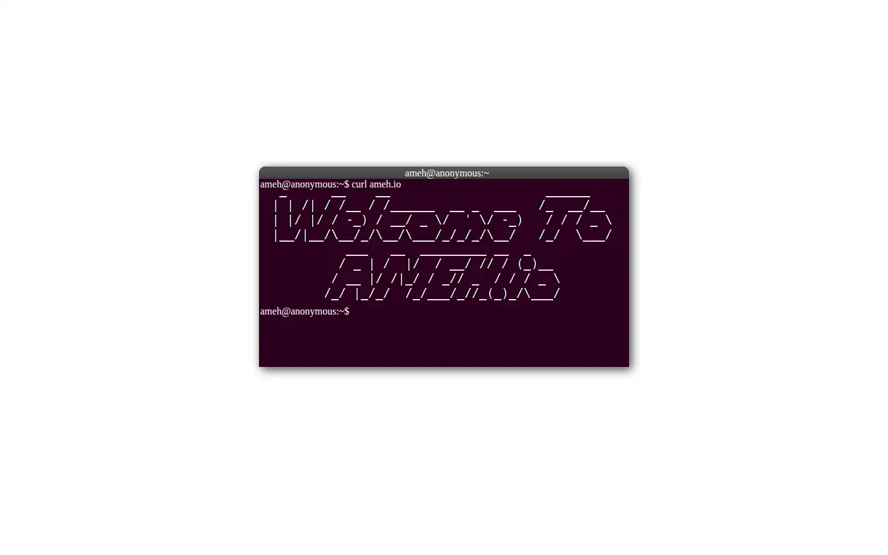
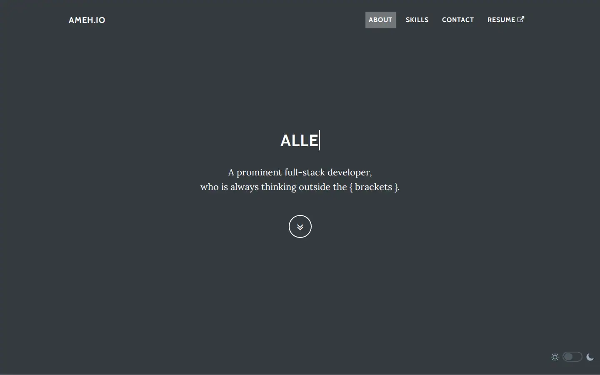
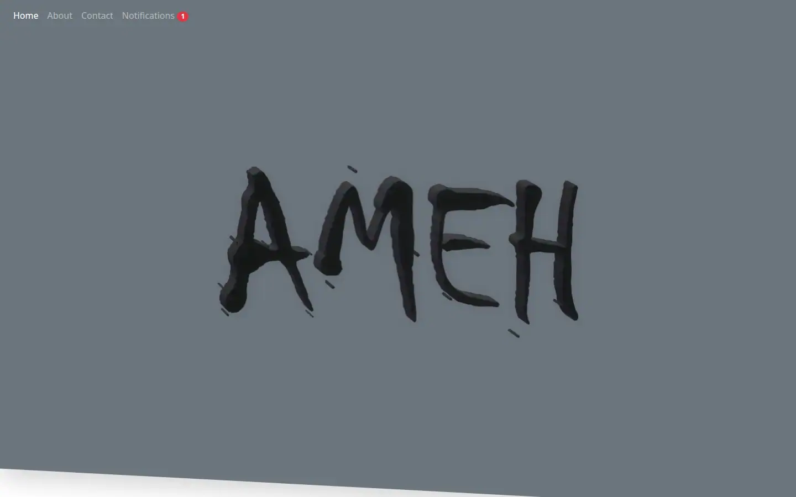
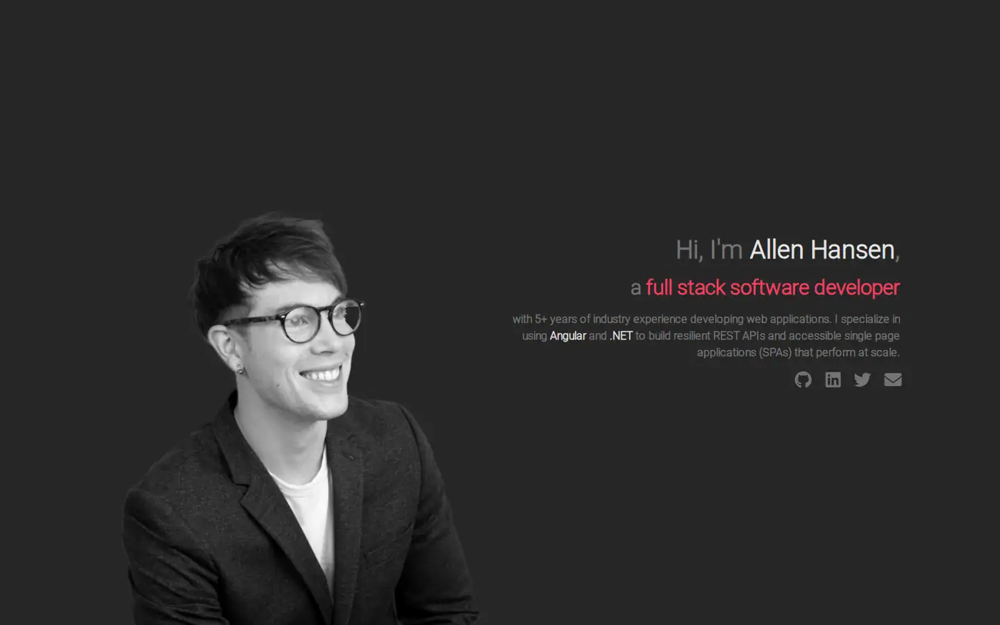
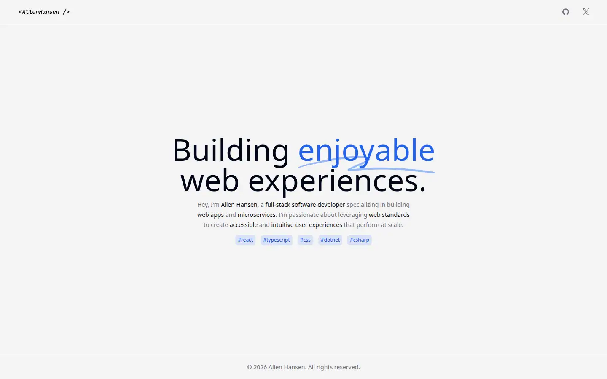
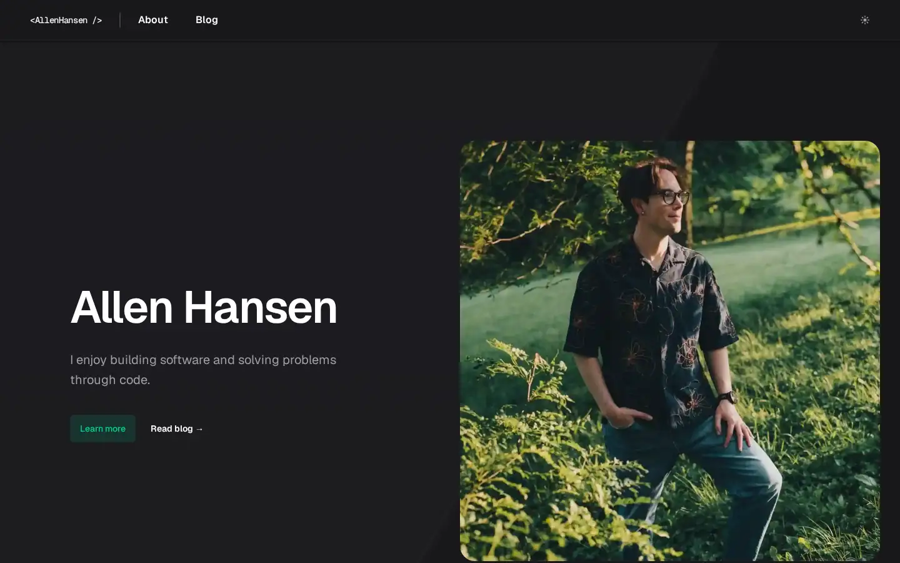
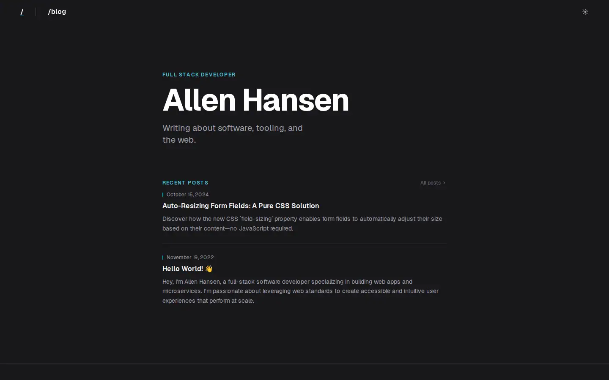
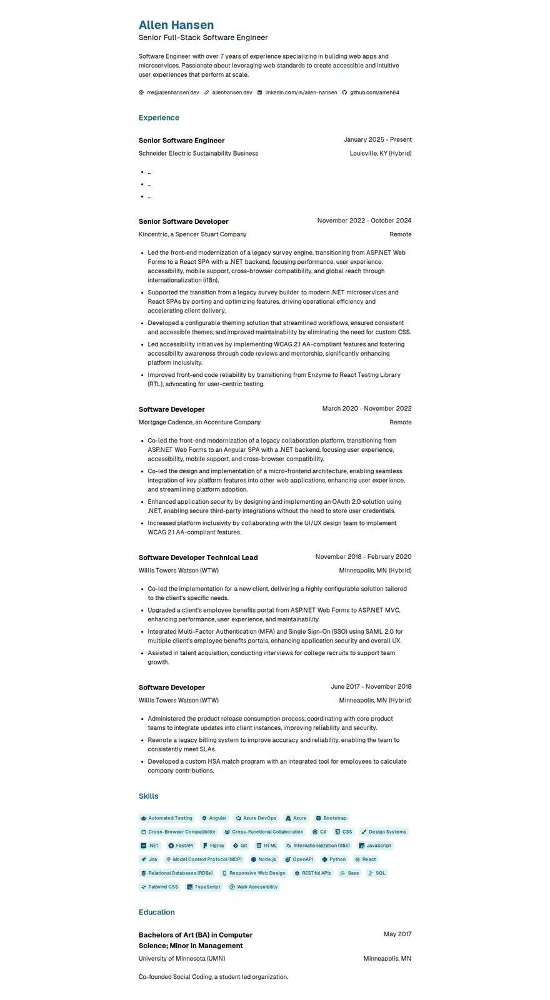

# The starting point

[Design history](README.md) · Next: [Round 1, the brief](02-round-1-brief.md)

Allen has rebuilt the site roughly every one to two years since 2018. Each
rebuild changed the stack and the accent color, and some changed the name, from
AMEH on ameh.io to Allen Hansen on allenhansen.dev. The round 1 brief summed it
up as eight years, seven visual eras, and no identity that lasted long enough to
build up.

Every tagged version now has a
[GitHub Release](https://github.com/AMEH64/allenhansen.dev/releases) with
screenshots. Those were taken during this project by rebuilding each version
from its commit with the tools of its time. The same screenshots are in
[images/10-releases](images/10-releases/index.md), and older captures made for
the brief are in [images/01-site-history](images/01-site-history/index.md).

## Earlier versions

The terminal-themed page on ameh.io predates the repo and survives only on the
Wayback Machine. The 2019 Jekyll one-pager
([v1.0.0](images/10-releases/v1.0.0/index.md)) had a day/night switch and a
hand-drawn AMEH signature. The 2020 refresh
([v2.0.0](images/10-releases/v2.0.0/index.md)) added a brush-script AMEH logo
and Bitmoji avatars. The brief found these early versions had the most
personality.

In 2022 the site moved to allenhansen.dev on Angular and Tailwind, with a
headshot hero ([v3.0.0 to v3.1.3](images/10-releases/v3.0.0/index.md)). The 2024
Remix version ([v4.0.0](images/10-releases/v4.0.0/index.md)) and the Astro
rebuild that added the blog ([v5.0.0](images/10-releases/v5.0.0/index.md)) were
cleaner and more generic. The August 2025 emerald page
([v5.2.0](images/10-releases/v5.2.0/index.md)) brought back a large photo of
Allen, which turned out to matter in round 2.

## The site before the redesign

In May 2026 the site was a text-first Astro page with a teal-slate accent and
Geist type ([v5.3.0](images/10-releases/v5.3.0/index.md)). It was fast and
accessible but said very little about Allen. The home page had his name, one
line about writing on software, and two posts, the newer one from October 2024.

The audit for round 1 also found real bugs. The current role on the résumé had
three "…" placeholder bullets. The home page's share image returned a 404. About
and Now pages were built and served but hidden from the nav, and the About copy
contradicted the résumé. The "All posts" link failed contrast, a React island
was used for the theme toggle alone, and canonical URLs pointed at the apex
domain while the site was served from `www`. The 404 page was the host's
default.

The full set of audit screenshots is in
[images/02-pre-redesign-site](images/02-pre-redesign-site/index.md).
