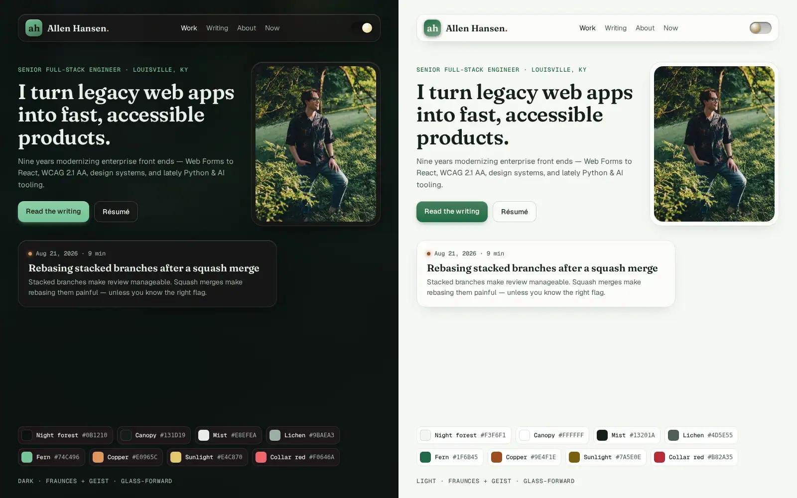
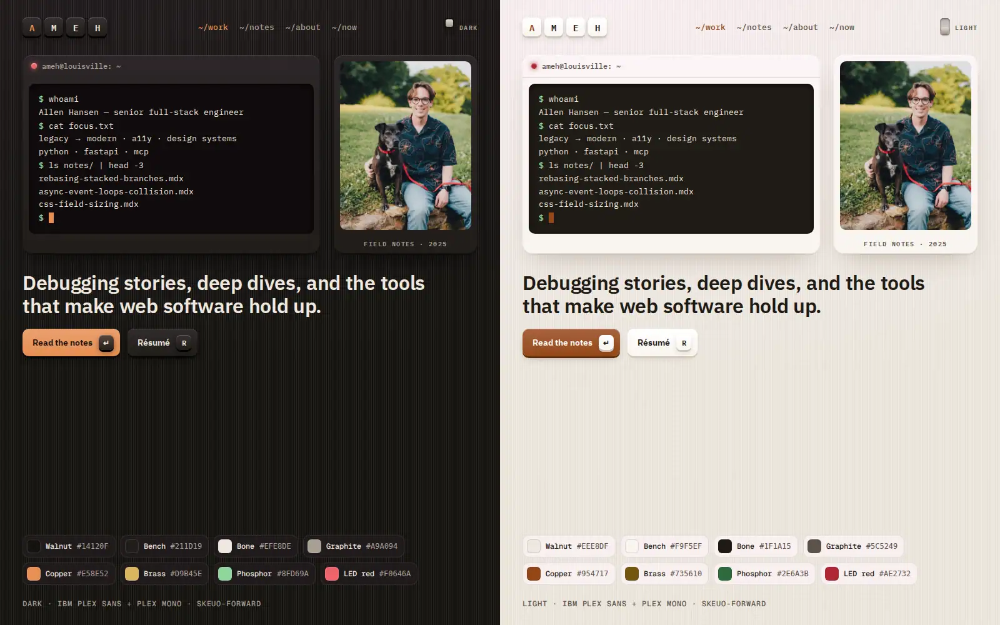
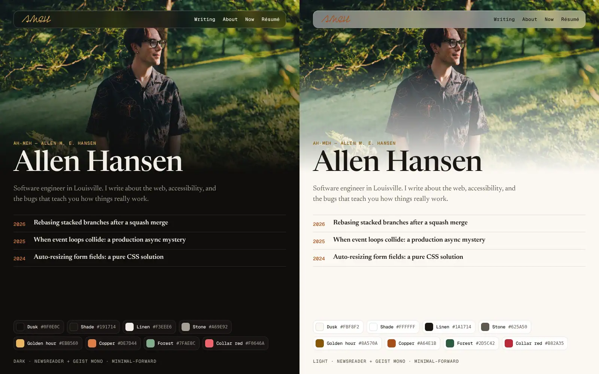

# Round 1: the brief

[Design history](README.md) · Previous:
[The starting point](01-starting-point.md) · Next:
[Round 2](03-round-2-magazine.md)

October 11, 2026. Screenshots are in
[images/03-round-1-brief](images/03-round-1-brief/index.md).

The first brief was research only. It went through the site's history and the
audit described on the [previous page](01-starting-point.md), looked at Allen's
writing and work, and pulled a palette from photos he shared: forest greens,
golden-hour light, copper thread, and his dog Boba's red collar. Allen had said
he liked glass, skeuomorphism, and minimalism, so each direction mixed those
three in a different ratio.

At this point the brief still assumed a professional site. Its proposed
structure had case studies under `/work`, a `/writing` section with series, and
a home page with a portrait, three "pillars", and calls to action for the
résumé.

## The three directions

**A. Canopy** was the glass-forward option, with frosted panels over a blurred
forest, fern green with copper, and Fraunces with Geist. The brief recommended
it, borrowing details from the other two.

**B. Workbench** was the skeuomorphic option, an engineer's desk with keycaps
spelling AMEH, a recessed terminal panel, and IBM Plex.

**C. Golden Hour** was the minimal one, led by a full-bleed photo with
Newsreader type and the 2019 AMEH signature.

## What happened next

Allen liked A and C. He also said what he actually wanted from the site, which
changed the brief more than any of the visuals did. That became round 2.

The audit's fix list carried all the way to the build. It included a custom 404,
working share images for every page, one canonical host, no hidden pages, and
replacing the React theme toggle with a few lines of plain JavaScript. All of
those shipped in [#136](https://github.com/AMEH64/allenhansen.dev/pull/136).
Dark mode as the default, with a full light mode, also carried through every
later round.
