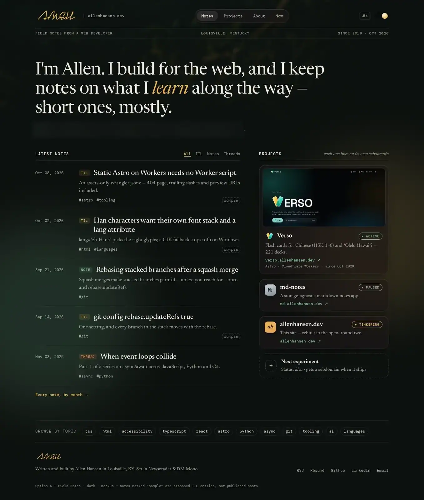
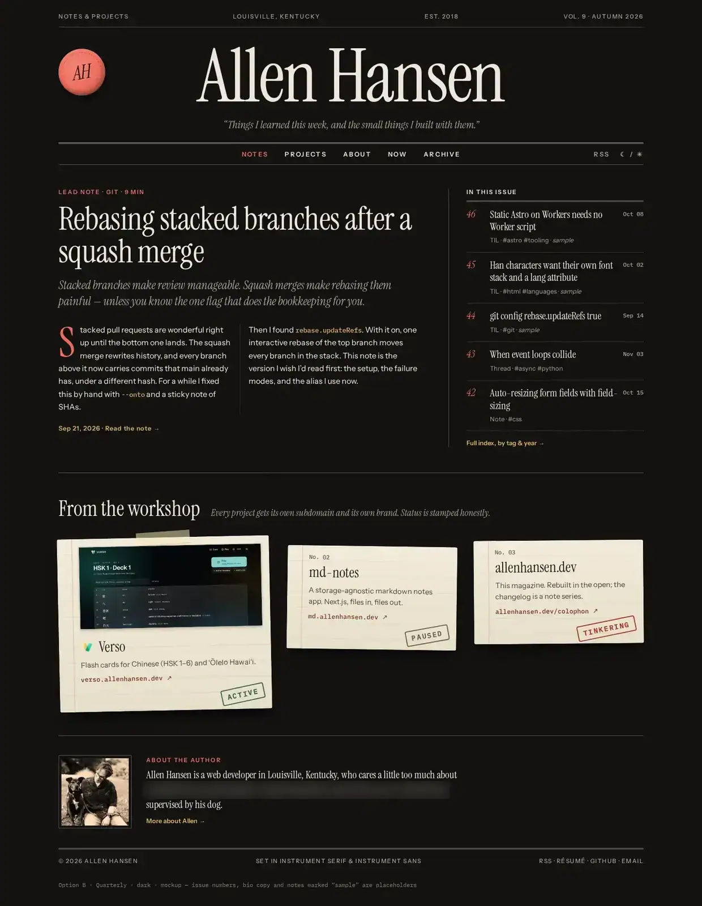
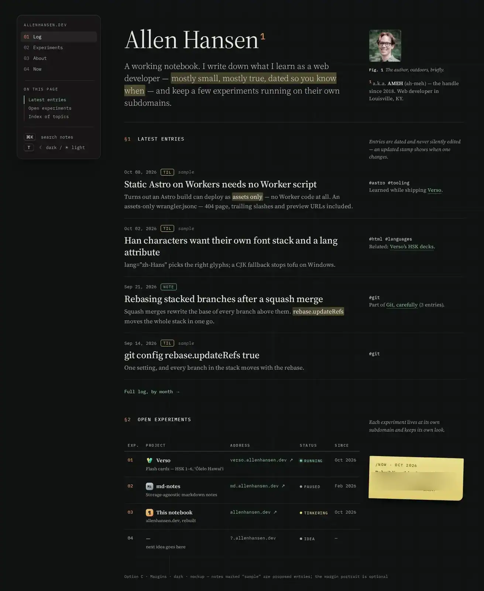
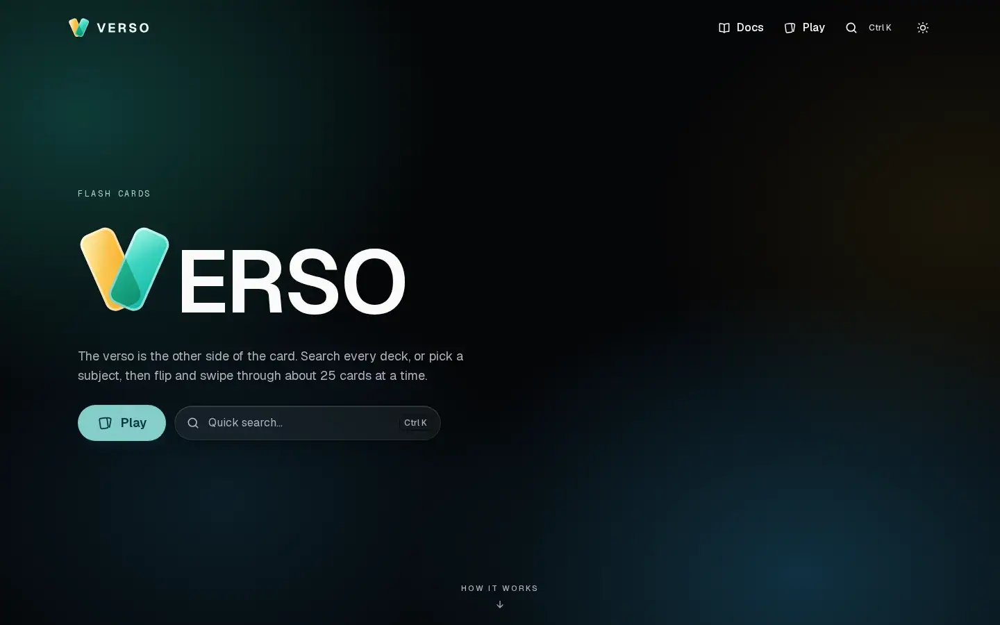

# Round 2: minimal and magazine-like

[Design history](README.md) · Previous: [Round 1](02-round-1-brief.md) · Next:
[Round 3](04-round-3-concepts.md)

October 11, 2026. Screenshots are in
[images/04-round-2-magazine](images/04-round-2-magazine/index.md).

After round 1, Allen said the site should be purely personal. He wanted a place
for notes on things he learns and for small projects that each live on their own
subdomain, starting with Verso, his flash-card app. About and Now would stay,
work history could come later, and the résumé could move to the footer. He
leaned toward minimal and magazine-like layouts. He also didn't want a photo
hero, because a coworker had once chuckled at the large photo on an earlier
version of the site.

Round 2 kept that structure and tried three layouts where type and the wordmark
carried the design instead of a photo. A coworker's site was looked at as a
reference. It used green, glass, and Geist, the same vocabulary as Canopy, which
was a reason to move away from those.

## The three options

**A. Field Notes** combined Canopy and Golden Hour, with gold on forest black,
Newsreader and DM Mono, and the AMEH signature as the wordmark. It was the
recommendation. A
[light version](images/04-round-2-magazine/option-a-field-notes-light.webp) was
also built.

**B. Quarterly** (left) was a personal print magazine with a big masthead, index
cards, and rubber-stamp statuses. **C. Margins** (right) was a lab notebook with
sidenotes and an experiments table.

Verso was screenshotted for this round too. From here on, each new design was
checked against it so the site and the app wouldn't look like the same product.

## What happened next

Allen turned down the whole round, along with round 1, and asked for something
much bolder. Looking back at both rounds, they had become variations on one
look, forest and gold with serif type in a journal or magazine frame, and none
of them gave the site anything to do.

The information architecture from this round stayed. The site still has a
writing section, projects on subdomains, About, Now, and the résumé in the
footer. So did the rule of no photo hero, which is why the photos on the
finished site are on About and Now only.
