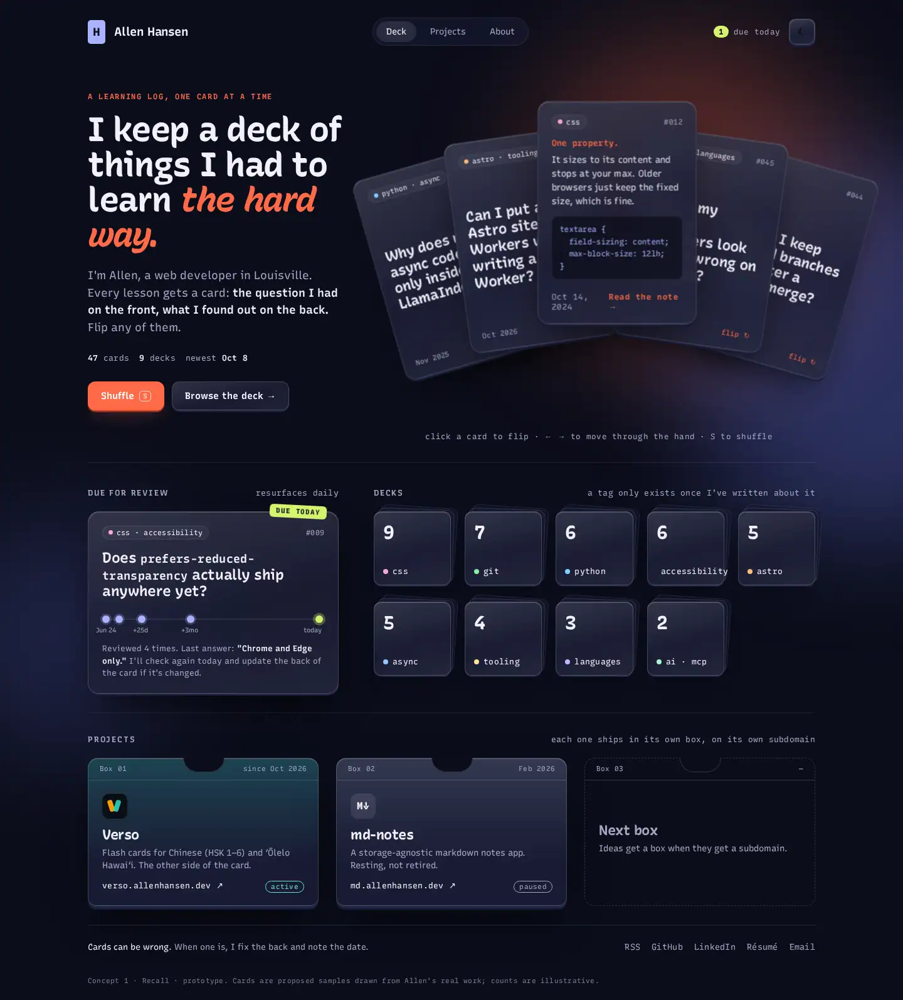
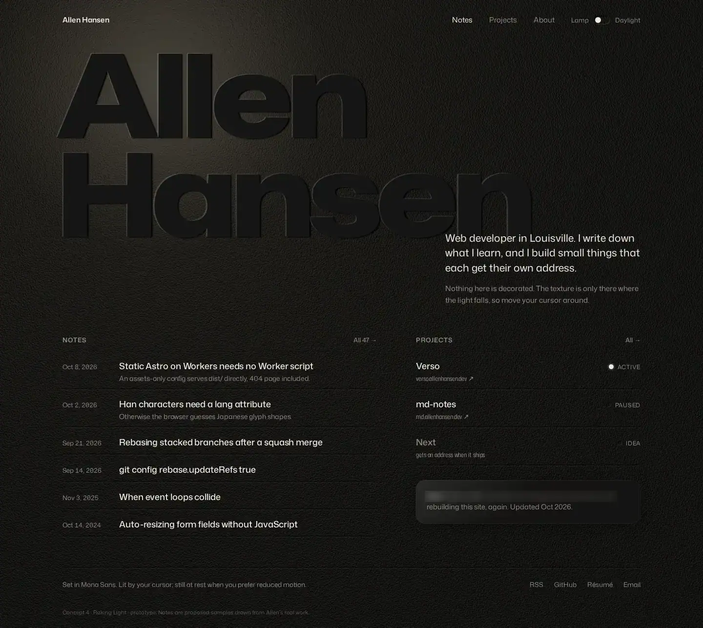
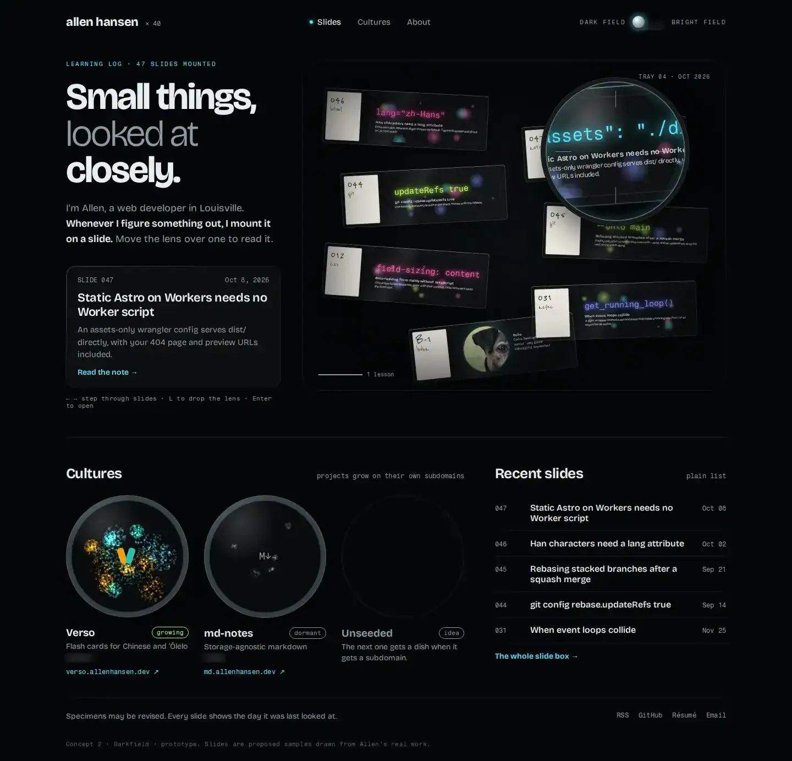
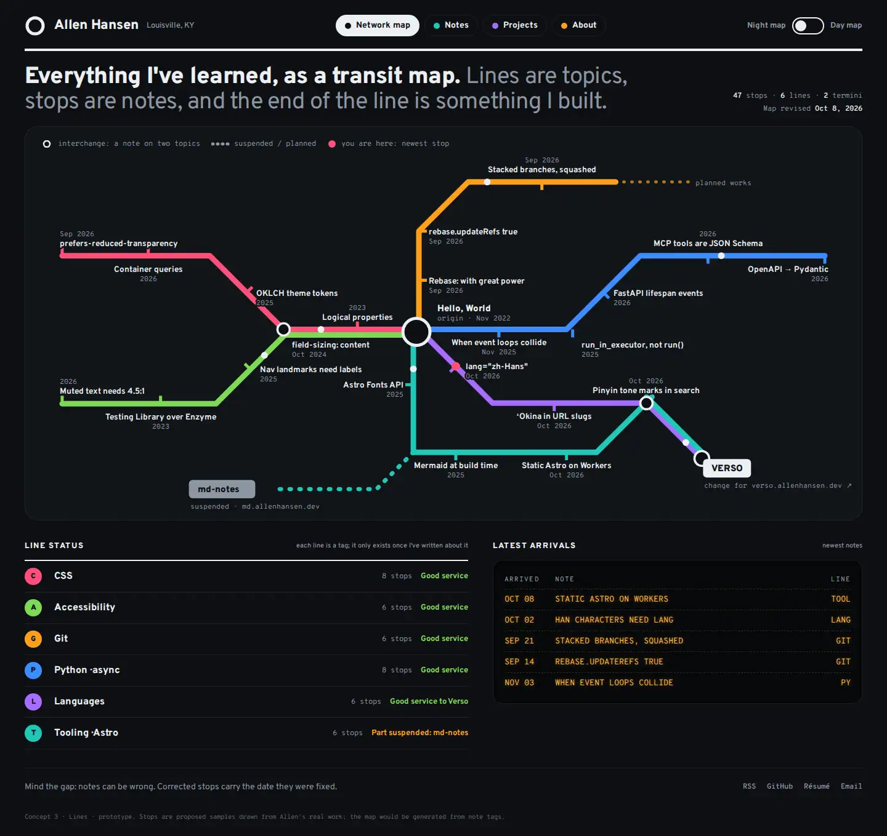
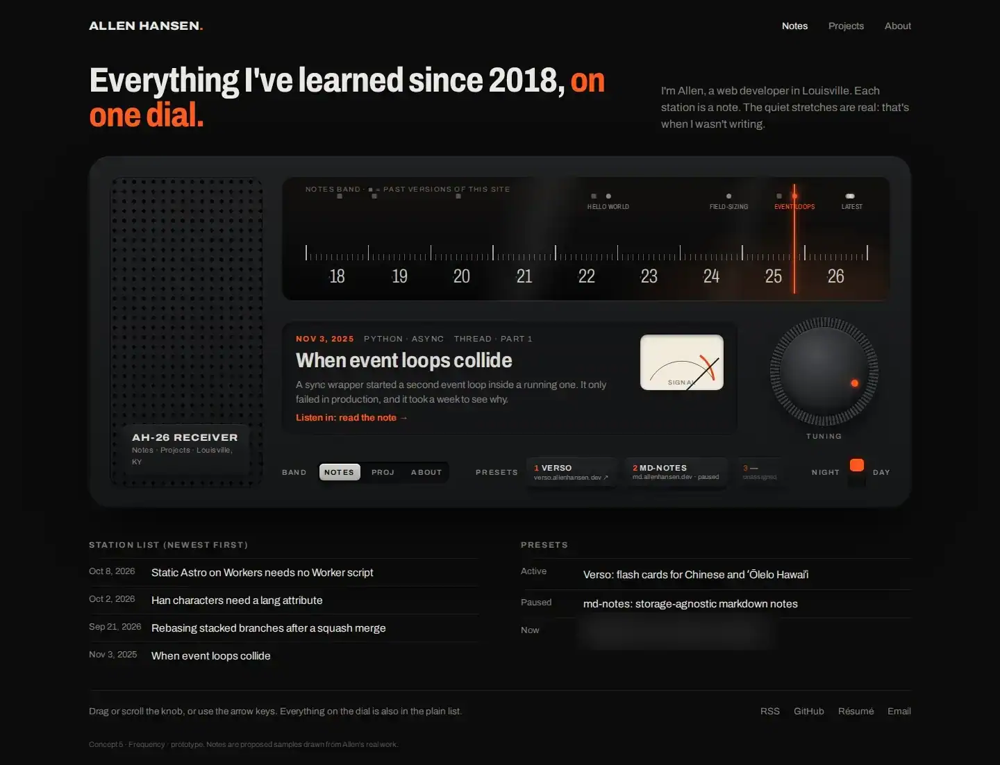
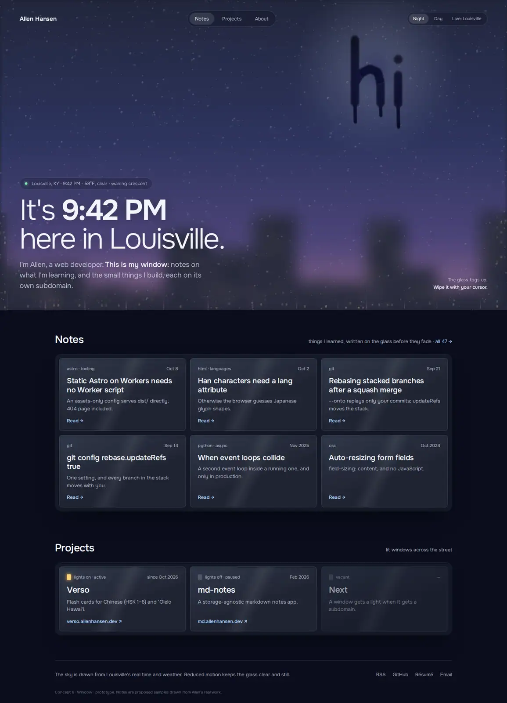

# Round 3: six concepts built around an interaction

[Design history](README.md) · Previous: [Round 2](03-round-2-magazine.md) ·
Next: [Round 4](05-round-4-raking-light.md)

October 11 to 12, 2026. Screenshots are in
[images/05-round-3-concepts](images/05-round-3-concepts/index.md).

This round started over. Each concept began from a mechanic, meaning an
interaction or a way of navigating, and the palette and type followed from it.
Forest and gold, serif editorial type, the magazine framing, keycaps, and the
AMEH signature were all ruled out so the round couldn't drift back to earlier
ideas. Every concept was a working HTML, CSS, and JavaScript page with sample
notes based on Allen's real work.

The round also tried to answer a problem the earlier rounds had left alone. The
site had two posts in two years, and notes on code go out of date.

## The six concepts

**Recall** (left) treated notes as flash cards, with a question on the front,
the answer on the back, and an old card resurfacing each day. It was the
recommendation. **Raking Light** (right) was a flat dark page whose embossed
name and grooves only showed where the cursor's light fell.

**Darkfield** read notes as microscope slides through a lens you drag. **Lines**
drew topics as transit lines with notes as stops. **Frequency** was a hi-fi
tuner whose dial was time.

**Window** was a fogged pane looking out on the city at the current time, which
visitors could wipe clear.

## What happened next

Allen said Recall was nice in theory but felt too much like a deck of cards and
too close to Verso. He was "kind of digging" Raking Light, so round 4 developed
it.

Two ideas from Recall carried into round 4 in smaller form. The daily card
became a resurfaced "From the archive" note on the home page, and the worry
about stale notes led to freshness labels and change logs. The resurfaced note
was cut when the build started, and the home page shows the three latest posts
instead. The change log is still on every post.
