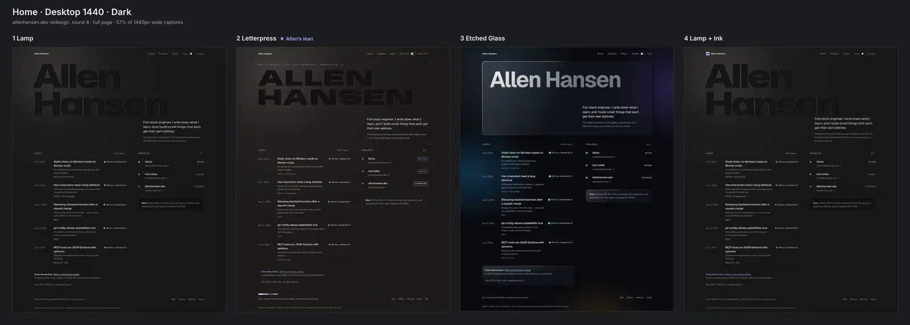
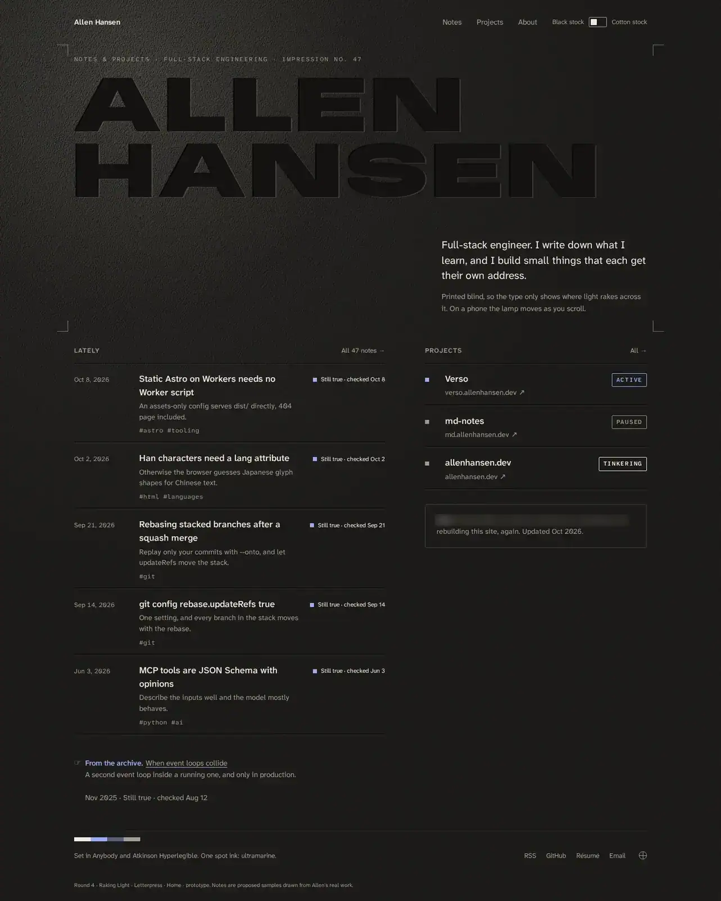
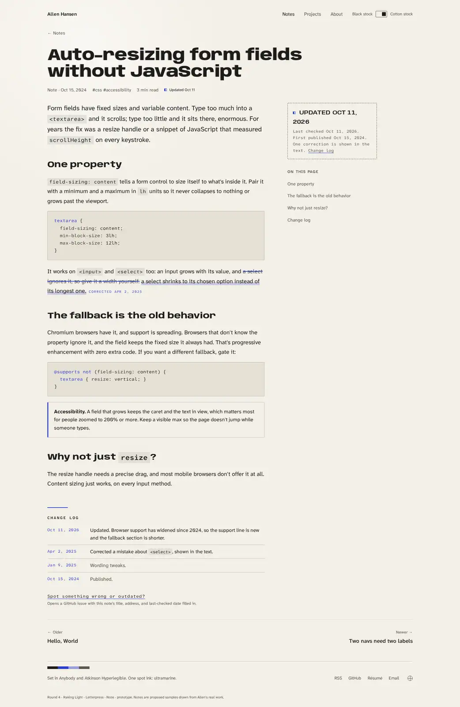
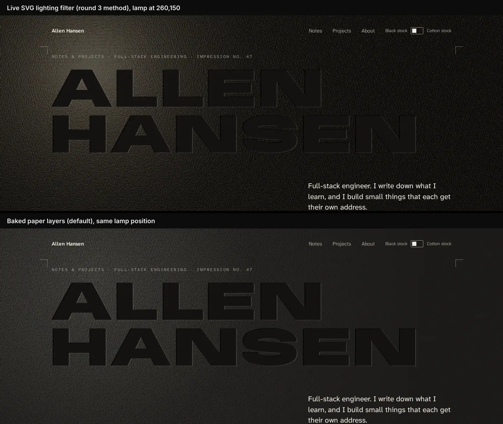
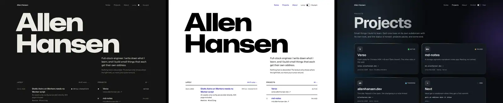

# Round 4: Raking Light, four ways

[Design history](README.md) · Previous: [Round 3](04-round-3-concepts.md) ·
Next: [Round 5](06-round-5-letterpress.md)

October 11 to 12, 2026. Screenshots are in
[images/06-round-4-raking-light](images/06-round-4-raking-light/index.md).

Round 4 turned Raking Light into four variations. Each one had six working pages
(Home, Notes, a Note, Projects, About, and Résumé) in dark and light modes, and
each handled phones differently, since a phone has no cursor to move the light.
The comparison sheets put every page of all four variations next to each other.

From left to right, Lamp, Letterpress, Etched Glass, and Lamp + Ink, home page
in dark mode.

## The variations

**Lamp** kept round 3's idea closest. It was monochrome ink on graphite paper
with blind embossing, lit by a warm lamp that followed the cursor. It was the
quietest and cheapest to build, but with no color it could read as severe.

**Letterpress** pressed the type into rough cotton stock and added one
ultramarine spot ink. On phones, scrolling moved the lamp down the page. Allen
leaned toward it because of the ink, and it was the recommendation.

**Etched Glass** used frosted panes lit from behind, with the name etched into
the glass. Allen liked its colors but felt it was too close to Verso, and its
backdrop blur made it the heaviest page.

**Lamp + Ink** combined Lamp's paper and type with Letterpress's ultramarine for
links and accents, as a fallback in case Letterpress felt too loud.

Letterpress in round 4. The home page is on the left, and on the right is a note
page with the freshness label, a sample inline correction, and the change log.

## Decisions made during the round

Allen made several content decisions while reviewing this round, and they were
applied to all four prototypes. He's a full-stack engineer, and no location
appears in any opening line. Notes would carry plain-word freshness labels such
as "Still true · checked Oct 8" instead of proofreader's marks, and read "Due
for a re-check" after twelve months. Each note would show its latest version
with a short dated change log, plus an inline correction only for real mistakes.
A small "Spot something wrong or outdated?" link would open a GitHub issue.
About would get a small rotator of photos of Boba captioned "Boba and me", and
every variation got a print-friendly résumé page.

The home page's resurfaced note was built the cheap way after Allen worried it
would hurt Lighthouse scores. It was an inline script under 1 KB that swapped
text into a fixed-size slot. It was dropped before the build anyway.

## Performance and accessibility

Round 3 lit the paper with a live SVG lighting filter, which ran at about 31 fps
with the CPU throttled 4×. Round 4 rendered the paper ahead of time, unlit and
lit from each side, and cross-faded those layers toward the light. That held
about 54 fps under the same throttle. The baked light was a little softer, and
it became the default.

Every embossed or etched heading was decoration, hidden from screen readers,
with a real heading carrying the text. With the lighting off for print, forced
colors, or more contrast, each page was still plain readable type. The
[QA captures](images/06-round-4-raking-light/index.md#qa-captures) show each
fallback.

## What happened next

Allen came to love Letterpress for its ink, but he was torn between it and
Etched Glass, whose colors he liked. Round 5 was built to settle that. The round
also produced a short screen recording of each variation's lighting. The videos
aren't committed, but a contact sheet of frames from each one is in the image
folder.
