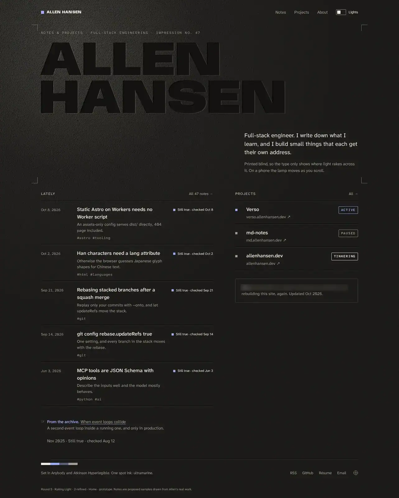
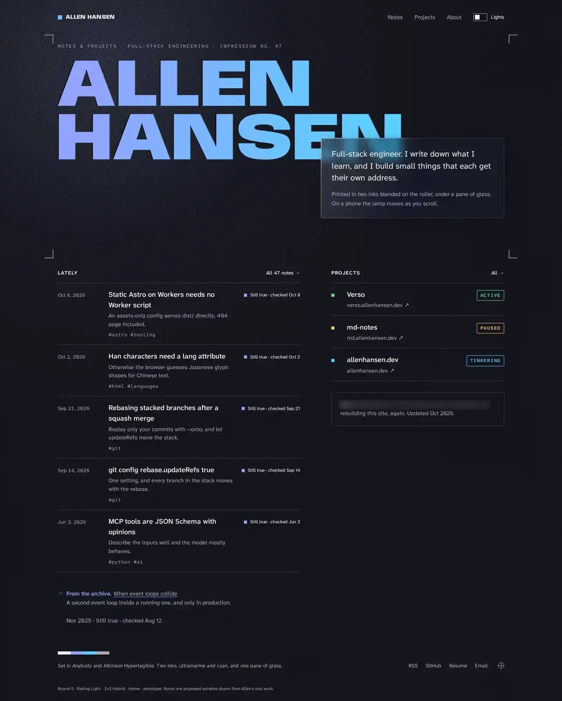
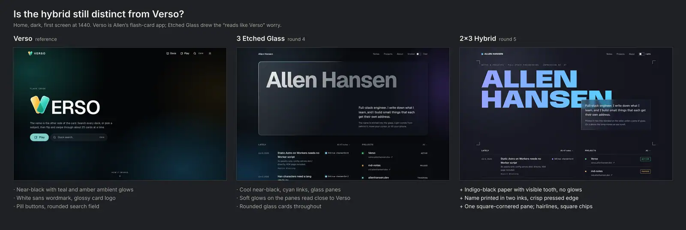
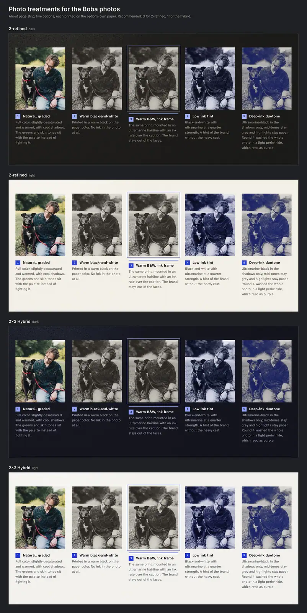
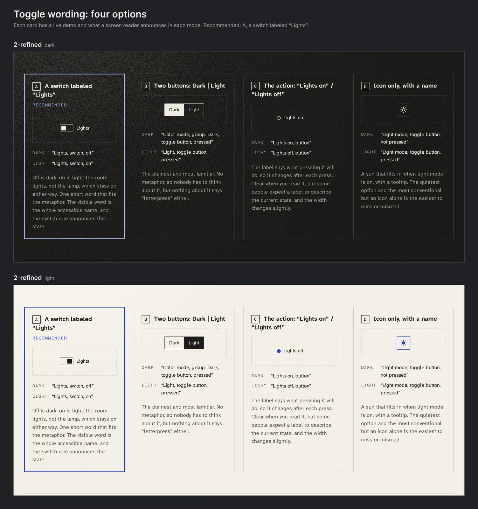
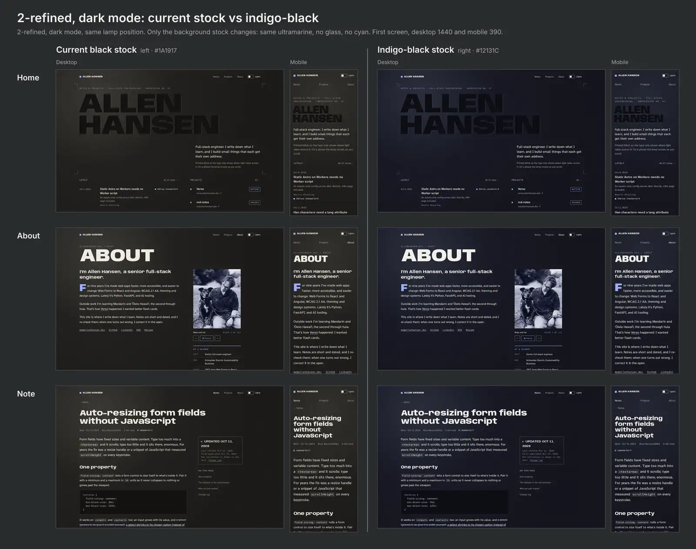

# Round 5: choosing Letterpress

[Design history](README.md) · Previous: [Round 4](05-round-4-raking-light.md) ·
Next: [The build](07-build-and-refinements.md)

October 11 to 12, 2026. Screenshots are in
[images/07-round-5-letterpress](images/07-round-5-letterpress/index.md).

Allen saw Letterpress as the brand and Etched Glass as having the better colors.
Round 5 built two options to choose between, and also worked out the photo
treatment, the wording of the theme switch, and the logo, which both options
shared.

## The two options

**2-refined** (left) was Letterpress with its round 4 problems fixed. The
wordmark was narrowed and tightened so "ALLEN HANSEN" read as one shape, and a
small ultramarine square, the press's spot of ink, sat next to it as the logo
and the favicon. Allen had been lukewarm on the "ah" monogram from Lamp + Ink,
so there was none.

**The 2×3 hybrid** (right) kept Letterpress's paper, layout, wordmark, and
ultramarine, and took from Etched Glass a deeper indigo-black stock, a second
cyan ink, colored status lights, and a single glass pane over the intro. It was
the recommendation.

Because Etched Glass had felt too close to Verso, the hybrid was checked against
it. Its paper, ink wordmark, and square corners kept it reading as print.

## Photos and the theme switch

Five treatments of the Boba photo were tried on both options. Allen picked the
low ink tint, which is black-and-white with ultramarine at a quarter of its
strength.

Round 4's switch said "Black stock / Cotton stock", which made sense only if you
knew the metaphor. Four wordings were compared with what a screen reader
announces for each. Option A, a switch labeled "Lights", was picked. Off means
dark, and the lamp keeps raking the page either way.

## The decision

Allen picked 2-refined over the hybrid, with the "Lights" switch and the low ink
tint. One question was left, which was whether dark mode should stay on the warm
black stock (`#1A1917`) or move to the hybrid's indigo-black (`#12131C`).

On indigo, ultramarine and the tinted photos sat in the same cool family, and
contrast improved slightly for every text color. Allen chose indigo, and that
was the last design decision before the build.
