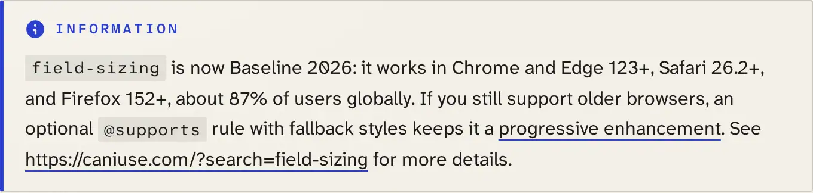
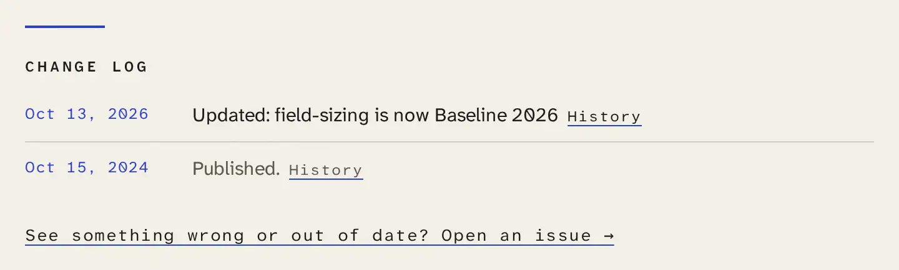
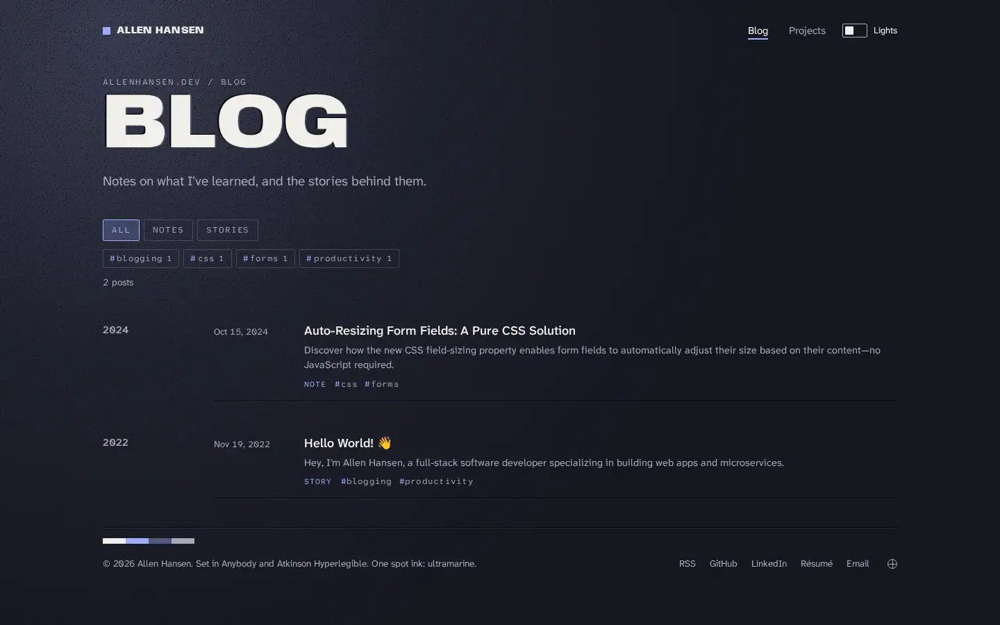
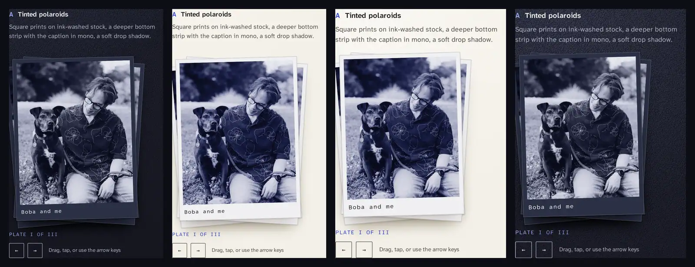
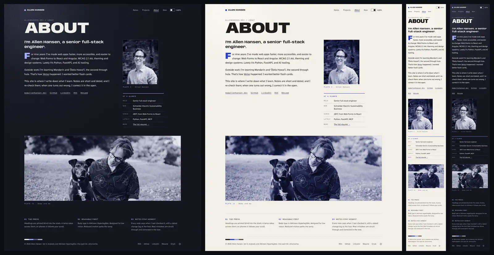
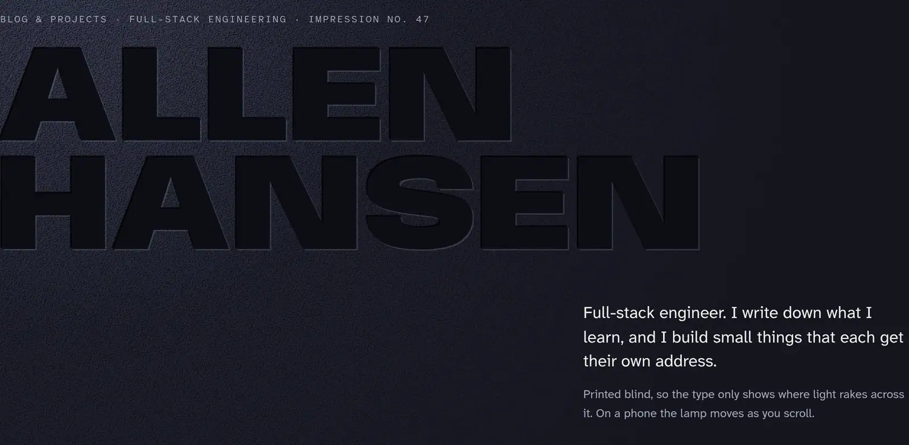
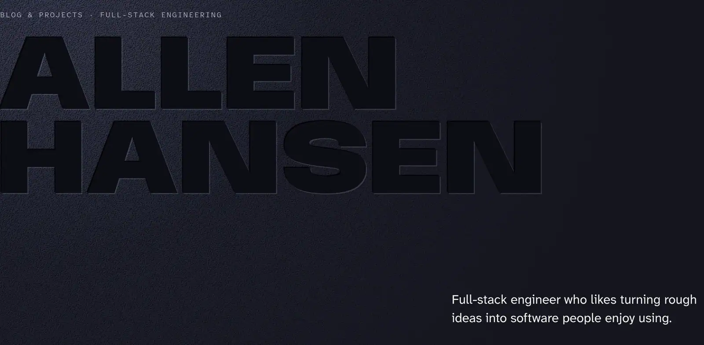
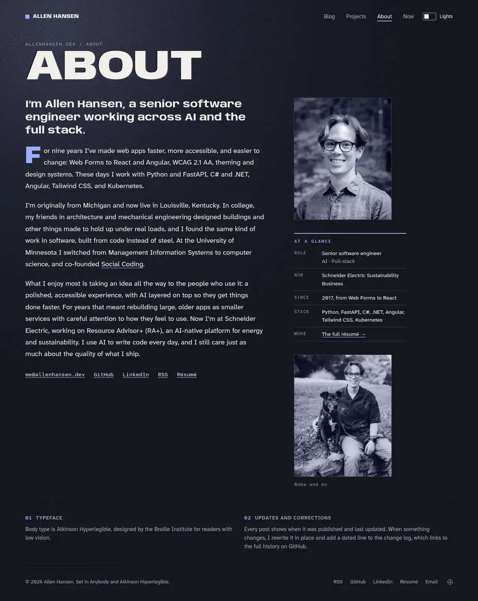
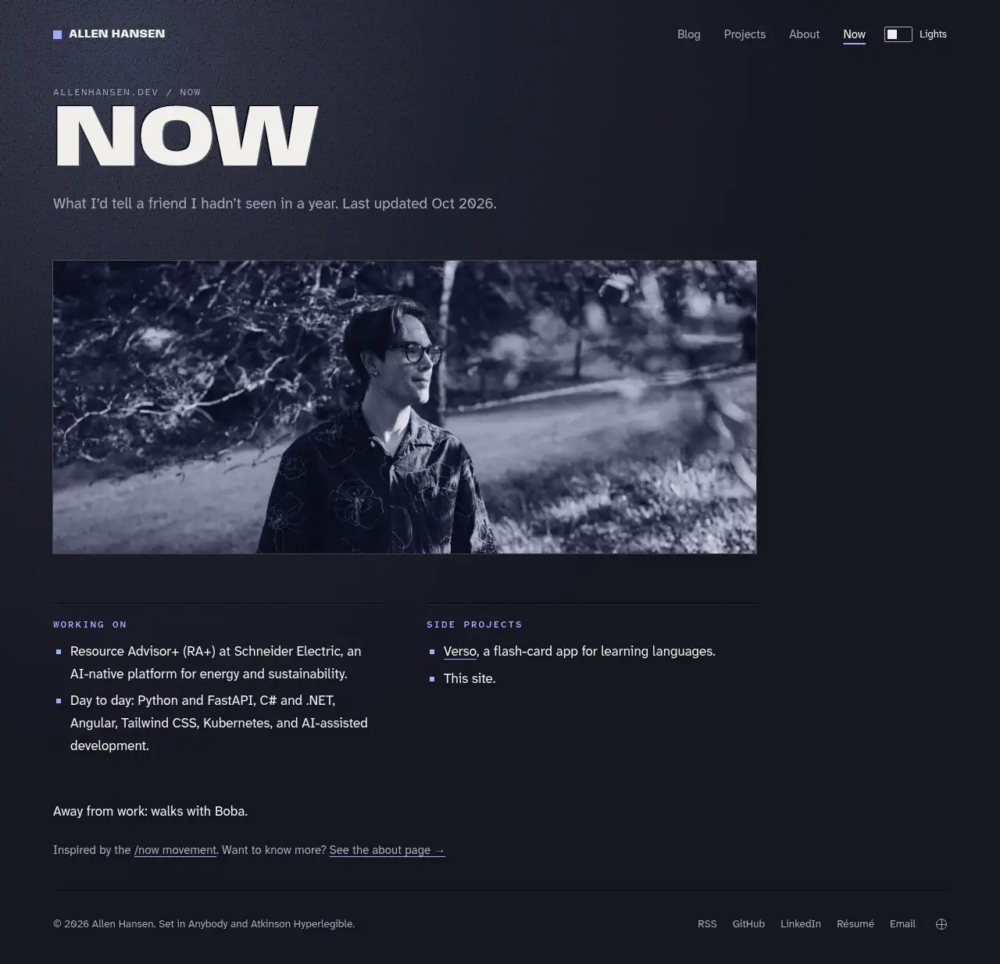

# The build and what came after

[Design history](README.md) · Previous: [Round 5](06-round-5-letterpress.md)

October 12 to 18, 2026. Screenshots are in
[images/08-build](images/08-build/index.md) and
[images/09-about-now](images/09-about-now/index.md), and the shipped site is in
[images/10-releases/v6.0.0](images/10-releases/v6.0.0/index.md).

## Building Letterpress (#136)

[PR #136](https://github.com/AMEH64/allenhansen.dev/pull/136) built 2-refined
into the real Astro site, with the indigo-black dark stock, ultramarine as the
only ink, the tighter wordmark and square logo, and the "Lights" switch. It
followed the build plan from round 4. The fonts were self-hosted and preloaded,
the React theme toggle was replaced with a small inline script, and the bugs
from the round 1 audit were fixed, including the broken share images, the
contrast failure, and canonical URLs on the wrong host. The resurfaced note was
left out, so the home page shows the latest posts straight from the build.

Allen reviewed the preview over several rounds while the PR was open, and a lot
changed before it merged.

### Notes and corrections

The first build showed a corrected sentence struck through, with the new text
beside it. Allen found that noisy, so notes are now rewritten in place and the
change log at the bottom records what changed, linked to the Git history. A
`supersededBy` field covers a note that a newer one replaces. The freshness
labels from round 4 were removed too. What's left on each post is the published
and updated dates, the change log, and a link to open an issue.

### Blog, not Notes

The build first replaced the blog with a Notes section. On October 13, research
into what other developer sites call their posts section found "Blog" was by far
the most common label and the one readers expect. The section went back to
`/blog/`, with every post labeled Note or Story, and filters for type and tag
that live in the URL so a filtered view can be shared. More than one tag can be
selected at once.

### About photos

The timed photo rotator from round 4 became a stack of photos, in three styles
(A to C). Allen then asked for a fourth, D, with two still photos placed like
plates in a printed book, a portrait beside the opening paragraph and "Boba and
me" full width further down. He picked D. It needs no JavaScript, and the plate
numbers in its captions were later dropped.

### Smaller fixes

Allen removed the placeholder card on Projects, and project links now open in a
new tab. Code blocks got a copy button. The current role on the résumé now has
no bullets at all instead of placeholder ones, and in the data the bullets are
now a list that defaults to empty. The favicon in production was still the
orange "AH" from the old site, which was fixed with the ultramarine square
([before and after](images/08-build/index.md#favicon)).

About and Now were finished, but their copy wasn't final, so both shipped behind
feature flags that redirect to the home page while they're off.

### Shipping

#136 merged on October 14 and was released as
[v6.0.0](https://github.com/AMEH64/allenhansen.dev/releases/tag/v6.0.0). A smoke
test on production followed. The same day, releases v5.0.0 to v5.3.0 were
published for the Astro-era versions that had never been tagged, with
screenshots added to every release.

## After the merge

**Hosting.** [#142](https://github.com/AMEH64/allenhansen.dev/pull/142) moved
the site from Vercel to Cloudflare Workers static assets, with no Worker script,
deployed by Workers Builds.
[#143](https://github.com/AMEH64/allenhansen.dev/pull/143) recorded the `www`
custom domain in `wrangler.jsonc`. The apex domain redirects to `www`.

**Copy.** [#144](https://github.com/AMEH64/allenhansen.dev/pull/144) cut copy
that described the site's own design. The "Impression No. 47" slug line and the
paragraph explaining the lamp went, and the home intro became "Full-stack
engineer who likes turning rough ideas into software people enjoy using." The
footer's "One spot ink: ultramarine" became a plain colophon line, and Projects
got a plain lead.

**Tailwind.** [#145](https://github.com/AMEH64/allenhansen.dev/pull/145) moved
most of the custom CSS into Tailwind utilities in the markup, from 1,823 lines
of custom CSS to 576, without `@apply`. A visual diff of 100 screenshots against
`main` showed only the intended fixes and sub-pixel noise
([summary](images/08-build/tailwind-visual-diff.webp)).

**Dependencies.** [#146](https://github.com/AMEH64/allenhansen.dev/pull/146)
updated dependencies within range and grouped Dependabot updates.
[#149](https://github.com/AMEH64/allenhansen.dev/pull/149) upgraded to Astro
7.4.

**Images.** [#150](https://github.com/AMEH64/allenhansen.dev/pull/150) made
every image on the site WebP with its metadata stripped. It added
`scripts/check-images.mjs` to `pnpm build`, which fails the build if any image
under `src/`, `public/`, or `dist/` still carries metadata.

## Publishing About and Now (#151)

[#151](https://github.com/AMEH64/allenhansen.dev/pull/151) removes the feature
flags and publishes About and Now with Allen's final copy and three new photos,
all in the low ink tint. The home page and the résumé now call him a senior
software engineer. The PR was still open when this history was written, so the
[screenshots](images/09-about-now/index.md) may show pages that aren't live yet.
