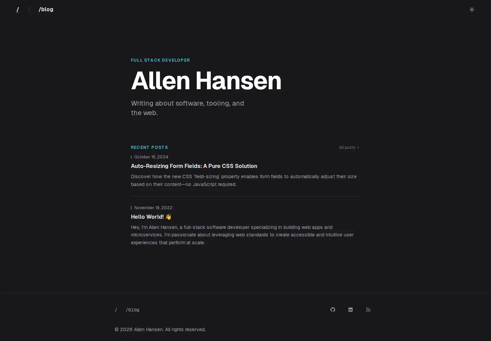
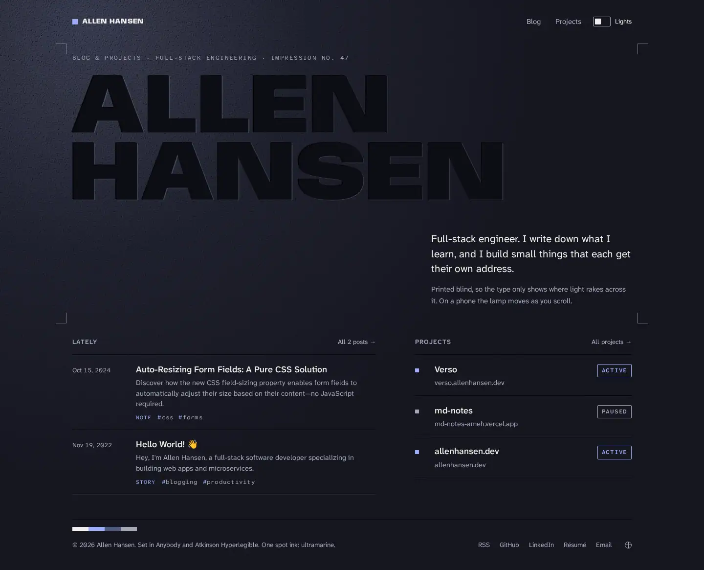

# Design history

This folder records how allenhansen.dev went from the text-first Astro site of
May 2026 to the Letterpress design that shipped in October 2026, and the work
that followed it. It's reference material for the repo and is not part of the
website. Astro builds only from `src/` and `public/`, and Cloudflare serves only
`dist/`, so nothing in `docs/` is deployed.

The home page before the redesign (v5.3.0, left) and after it (v6.0.0, right).

## How to read this

The narrative is split into one page per stage, in order. Each page links to the
screenshots for that stage, and every screenshot has a caption in its folder's
`index.md`.

1. [The starting point](01-starting-point.md) covers the site's history from
   2018 and the state it was in before the redesign.
2. [Round 1, the brief](02-round-1-brief.md) is the audit and the first three
   brand directions.
3. [Round 2, minimal and magazine-like](03-round-2-magazine.md) reframes the
   site as a personal one and tries three editorial layouts.
4. [Round 3, six concepts](04-round-3-concepts.md) starts over from interactions
   instead of palettes. This is where Raking Light appears.
5. [Round 4, Raking Light four ways](05-round-4-raking-light.md) builds four
   full prototypes of it, including Letterpress.
6. [Round 5, choosing Letterpress](06-round-5-letterpress.md) settles the last
   open choices.
7. [The build and what came after](07-build-and-refinements.md) follows PR #136
   and the follow-up PRs through #151.

All screenshots are under [images/](images/README.md), grouped by stage.

## Timeline

All dates are 2026 unless noted.

| Date             | What happened                                                                                                                                                                                                                                                                                                            |
| :--------------- | :----------------------------------------------------------------------------------------------------------------------------------------------------------------------------------------------------------------------------------------------------------------------------------------------------------------------- |
| 2018 to May 2026 | Seven earlier versions of the site, from ameh.io to the text-first Astro site ([v1.0.0 to v5.3.0](https://github.com/AMEH64/allenhansen.dev/releases)).                                                                                                                                                                  |
| Oct 11           | Round 1 brief: history, audit, and directions Canopy, Workbench, and Golden Hour. Round 2 follows the same day with Field Notes, Quarterly, and Margins.                                                                                                                                                                 |
| Oct 11 to 12     | Rounds 3, 4, and 5: six interaction-led concepts, then four Raking Light variations, then refined Letterpress against a hybrid with Etched Glass.                                                                                                                                                                        |
| Oct 12           | [PR #136](https://github.com/AMEH64/allenhansen.dev/pull/136) opens with the Letterpress build.                                                                                                                                                                                                                          |
| Oct 13           | The blog section is renamed back to "Blog", with Note and Story labels and filters.                                                                                                                                                                                                                                      |
| Oct 14           | #136 merges and ships as v6.0.0. Hosting moves from Vercel to Cloudflare Workers ([#142](https://github.com/AMEH64/allenhansen.dev/pull/142), [#143](https://github.com/AMEH64/allenhansen.dev/pull/143)). Releases v5.0.0 to v6.0.0 are published.                                                                      |
| Oct 15           | Copy cleanup ([#144](https://github.com/AMEH64/allenhansen.dev/pull/144)), Tailwind migration ([#145](https://github.com/AMEH64/allenhansen.dev/pull/145)), dependency updates ([#146](https://github.com/AMEH64/allenhansen.dev/pull/146)), and Astro 7.4 ([#149](https://github.com/AMEH64/allenhansen.dev/pull/149)). |
| Oct 18           | Every image served as WebP ([#150](https://github.com/AMEH64/allenhansen.dev/pull/150)). [#151](https://github.com/AMEH64/allenhansen.dev/pull/151) opens to publish About and Now.                                                                                                                                      |

## Decisions

| Decision                                                                        | When                                                       | Why                                                                                                                                                   |
| :------------------------------------------------------------------------------ | :--------------------------------------------------------- | :---------------------------------------------------------------------------------------------------------------------------------------------------- |
| Make it a personal site for writing and projects, with the résumé in the footer | Round 2                                                    | Allen didn't want a portfolio aimed at hiring managers. The résumé stayed as a page but left the main nav.                                            |
| No photo hero                                                                   | Round 2                                                    | A coworker had chuckled at the photo hero on an earlier version. Photos moved to About.                                                               |
| Projects get their own subdomains                                               | Round 2                                                    | Verso was already a separate app, and more small projects were planned.                                                                               |
| Stop picking palettes and give the site an interaction                          | Round 3                                                    | Rounds 1 and 2 had all become one forest-and-gold editorial look, and none of them gave the site anything to do.                                      |
| Raking Light over Recall                                                        | Round 3 to 4                                               | Recall felt too much like a deck of cards and too close to Verso. Allen liked the quiet lamp effect.                                                  |
| Letterpress over Lamp, Etched Glass, and Lamp + Ink                             | Round 4 to 5                                               | Allen loved its ultramarine ink. Etched Glass had colors he liked but read too much like Verso.                                                       |
| 2-refined over the Letterpress and Etched Glass hybrid                          | Round 5                                                    | Allen picked the single-ink version even though the hybrid was recommended.                                                                           |
| Indigo-black dark stock (`#12131C`)                                             | Round 5                                                    | Ultramarine and the tinted photos sat better on it, and contrast went up slightly.                                                                    |
| A switch labeled "Lights"                                                       | Round 5                                                    | One word, announced as "Lights, switch, on/off", and it works with voice control.                                                                     |
| Low ink tint on photos                                                          | Round 5                                                    | Black-and-white with ultramarine at quarter strength fit the one-ink palette.                                                                         |
| Pre-rendered paper layers instead of a live SVG filter                          | Round 4                                                    | About 54 fps against 31 under a 4× CPU throttle, and it looked close.                                                                                 |
| Rewrite notes in place with a change log, and drop freshness labels             | Build (#136)                                               | Allen found strikethrough and "checked on" labels noisy. Dates, a change log linked to Git history, and an issue link were enough.                    |
| Call the section "Blog", with Note and Story labels                             | Build (#136)                                               | Research on section names found "Blog" the clearest word, and labels let short notes and longer stories share it.                                     |
| Two still photos on About (variant D)                                           | Build (#136)                                               | Allen preferred them to the photo stacks and the timed rotator, and they need no JavaScript.                                                          |
| Ship About and Now behind feature flags                                         | Build (#136)                                               | The copy wasn't final. [#151](https://github.com/AMEH64/allenhansen.dev/pull/151) removes the flags.                                                  |
| Remove copy that describes the site's own design                                | [#144](https://github.com/AMEH64/allenhansen.dev/pull/144) | Lines like "Impression No. 47" and "One spot ink: ultramarine" talked about the design instead of Allen.                                              |
| Move custom CSS to Tailwind utilities                                           | [#145](https://github.com/AMEH64/allenhansen.dev/pull/145) | Custom CSS went from 1,823 lines to 576, with no visual changes beyond intended fixes.                                                                |
| Host on Cloudflare Workers static assets                                        | [#142](https://github.com/AMEH64/allenhansen.dev/pull/142) | The site is fully static, so it needs no server, and the setup follows Verso, which already ran there.                                                |
| Serve every image as WebP with metadata stripped                                | [#150](https://github.com/AMEH64/allenhansen.dev/pull/150) | Two images were being copied to `dist/` unconverted, and the photos for About and Now needed their metadata removed. A build check now enforces both. |

## What isn't here

The screenshots are the record of each prototype. The HTML prototypes
themselves, the interaction videos, and the PDF exports stayed in the project's
working files and aren't committed. Rounds 1 and 2 were only ever kept as
screenshots, so there is no source for them. Round 2's options B and C were only
captured in dark mode.

Some screenshots were left out or edited before committing. The original photo
shoot and a crop plan of it are left out because most of those photos aren't on
the site. A coworker's site that was used as a round 2 reference is left out
because it isn't Allen's. In prototype screenshots, lines of draft copy with
personal details that never made it onto the site are blurred, and one preview
hostname is removed. The [images index](images/README.md) lists every case.
