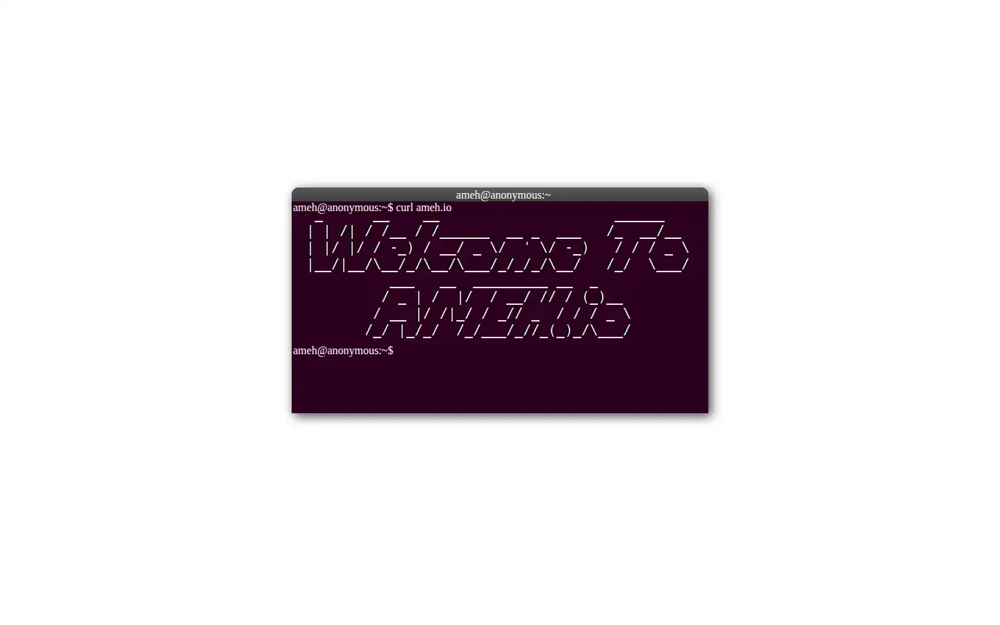
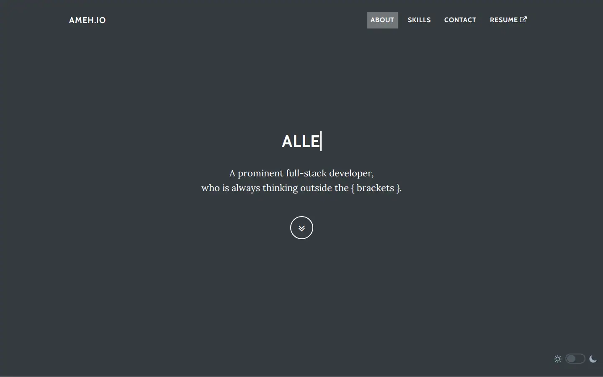
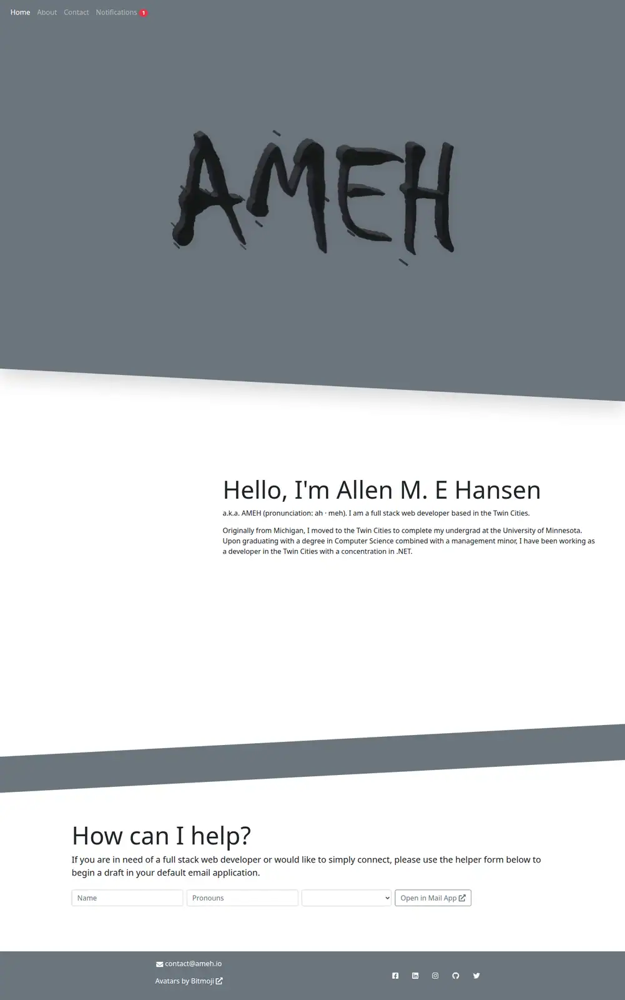
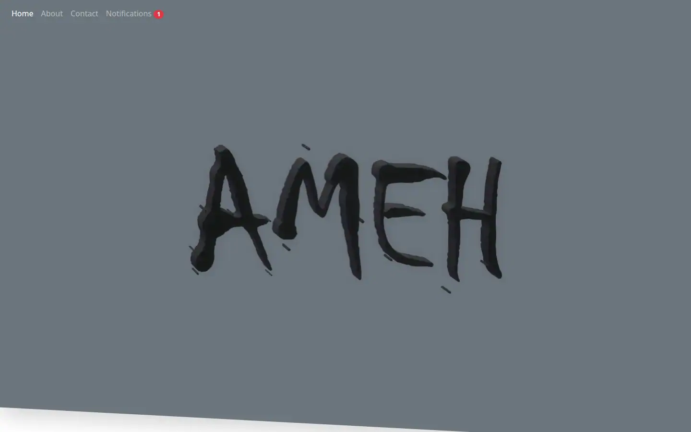
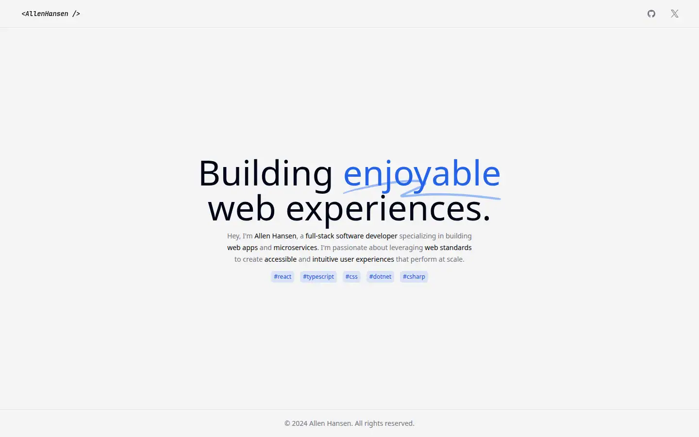
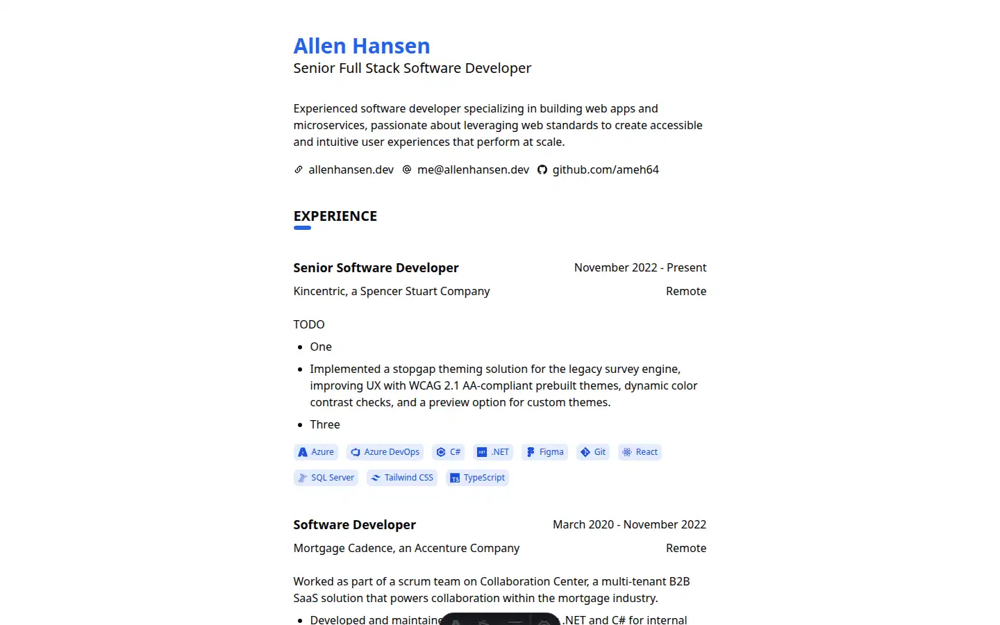
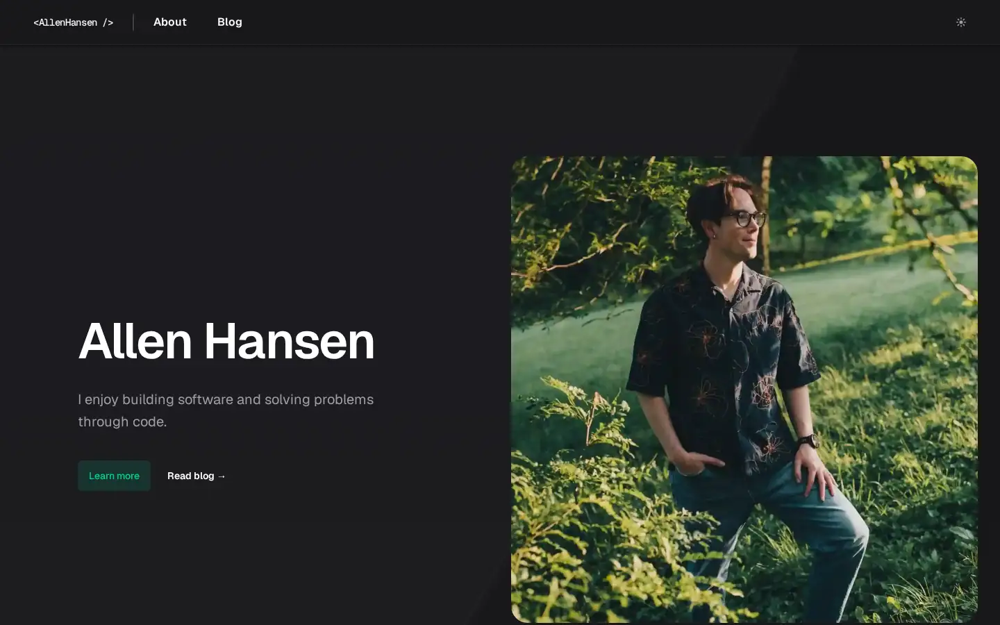
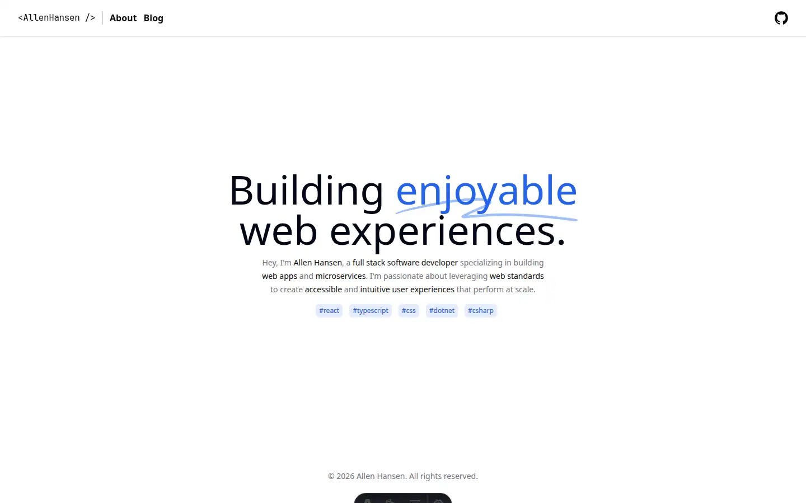
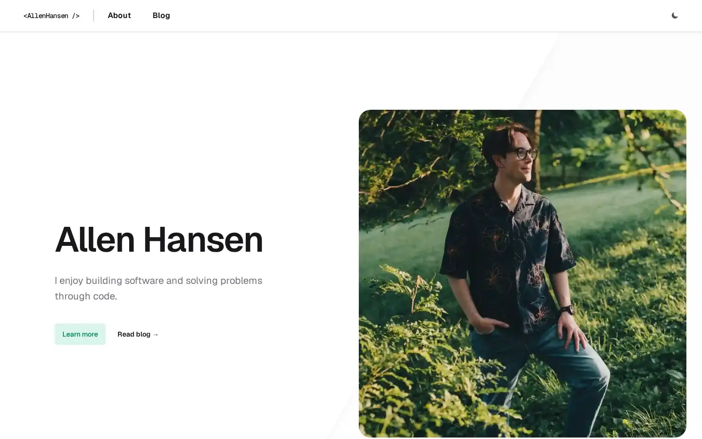

# Site history, 2018 to 2025

[All images](../README.md) · [Narrative](../../01-starting-point.md)

Earlier versions of the site, captured for the round 1 brief. The 2018 and May
2024 versions come from the Wayback Machine. The others were rebuilt locally
from their git tags or commits and screenshotted. They show the pattern the
brief called out: the versions with the most personality (2019, 2020,
August 2025) kept getting replaced by cleaner, more generic ones.

**[`2018-ameh-io-terminal-wayback.webp`](2018-ameh-io-terminal-wayback.webp)** ·
1440 × 900

ameh.io in 2018, from the Wayback Machine: a terminal-themed Bootstrap 3 page
with an ASCII welcome banner. It predates the repo and was the first site to use
the AMEH name.

**[`2019-v1-jekyll-ameh-io-full.webp`](2019-v1-jekyll-ameh-io-full.webp)** ·
1000 × 3167, full-page capture

The same 2019 site, full page: typed intro, About, experience timeline, skill
bars, and contact.

**[`2019-v1-jekyll-ameh-io-hero.webp`](2019-v1-jekyll-ameh-io-hero.webp)** ·
1440 × 900

The 2019 Jekyll one-pager (v1.0.0), first screen. It had the most personality of
any version: the AMEH name, a day/night switch, and a hand-drawn signature.
Round 1 and 2 both proposed bringing the signature back.

**[`2020-v2-bootstrap-ameh-io-full.webp`](2020-v2-bootstrap-ameh-io-full.webp)**
· 1001 × 1600

The 2020 site, full page: skewed grey sections, Bitmoji avatars, and the contact
helper.

**[`2020-v2-bootstrap-ameh-io-hero.webp`](2020-v2-bootstrap-ameh-io-hero.webp)**
· 1440 × 900

The 2020 Bootstrap refresh (v2.0.0), first screen, with the brush-script AMEH
logo. Its three stated values (intuitive design, performance, responsive design)
still described Allen's work in 2026.

**`2022-v3-angular-dark.webp`** · byte-identical to
[`10-releases/v3.1.3/home-dark-desktop.webp`](../10-releases/v3.1.3/home-dark-desktop.webp),
so it's stored once

The 2022 Angular and Tailwind site (v3.1.3) on allenhansen.dev, dark mode, with
the headshot hero and the rose accent.

**[`2024-05-v4-remix-wayback.webp`](2024-05-v4-remix-wayback.webp)** · 1440 ×
900

The Remix site in May 2024 (v4.0.0), from the Wayback Machine: "Building
enjoyable web experiences" with a blue accent and hashtag badges. The brief
found it confident but generic.

**[`2024-10-astro-launch-resume.webp`](2024-10-astro-launch-resume.webp)** ·
1440 × 900

The October 2024 data-driven résumé page, the ancestor of today's résumé.

**[`2025-08-emerald-landing-dark.webp`](2025-08-emerald-landing-dark.webp)** ·
1440 × 900

The August 2025 emerald landing page (v5.2.0), dark mode, with the golden-hour
photo hero. The brief noted that the photo made the page feel human. Allen later
explained a coworker had chuckled at it, which is why every later round kept
photos small.

**[`2025-08-emerald-landing-mobile.webp`](2025-08-emerald-landing-mobile.webp)**
· 600 × 1682, full-page capture

The emerald landing page on a phone.

**`2022-v3-angular-light.webp`** · byte-identical to
[`10-releases/v3.1.3/home-light-desktop.webp`](../10-releases/v3.1.3/home-light-desktop.webp),
so it's stored once

The 2022 Angular site in light mode.

**[`2024-10-astro-launch-light.webp`](2024-10-astro-launch-light.webp)** · 1440
× 900

The Astro rebuild at launch in October 2024 (v5.0.0), rebuilt locally from
commit `8a9f76c`. Same look as the Remix site, plus the blog.

**[`2025-08-emerald-landing-light.webp`](2025-08-emerald-landing-light.webp)** ·
1440 × 900

The emerald landing page in light mode.
