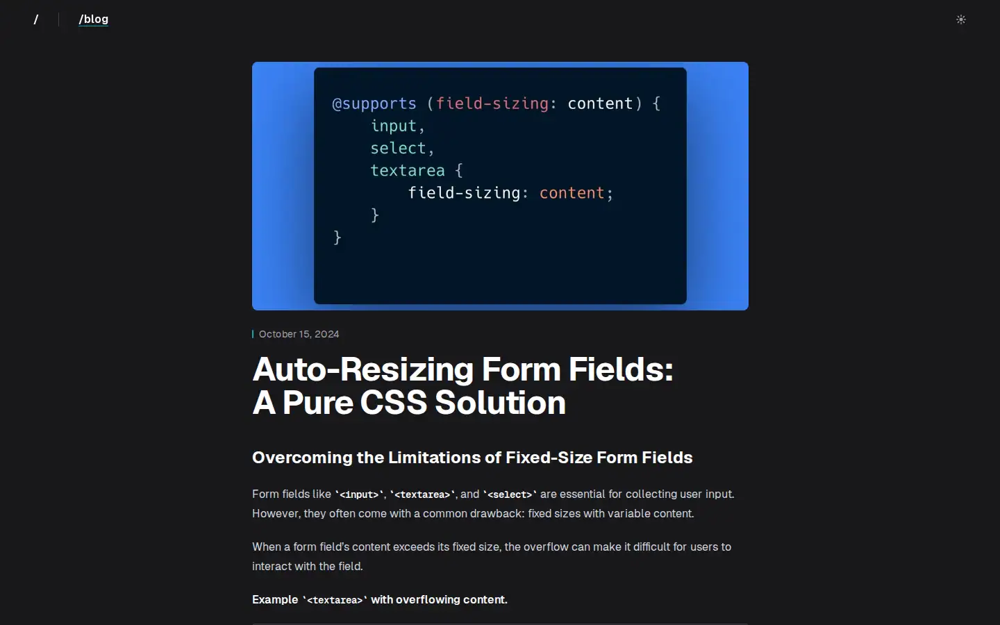
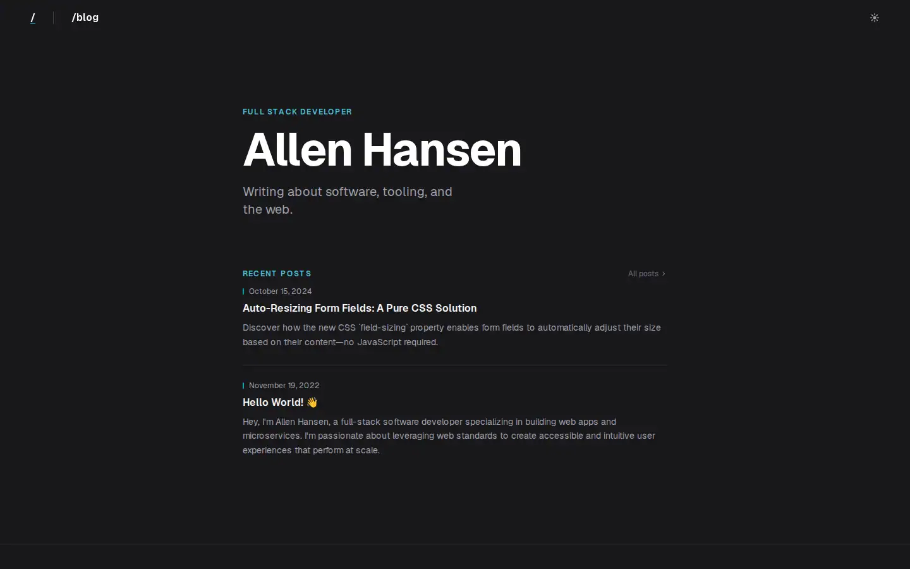
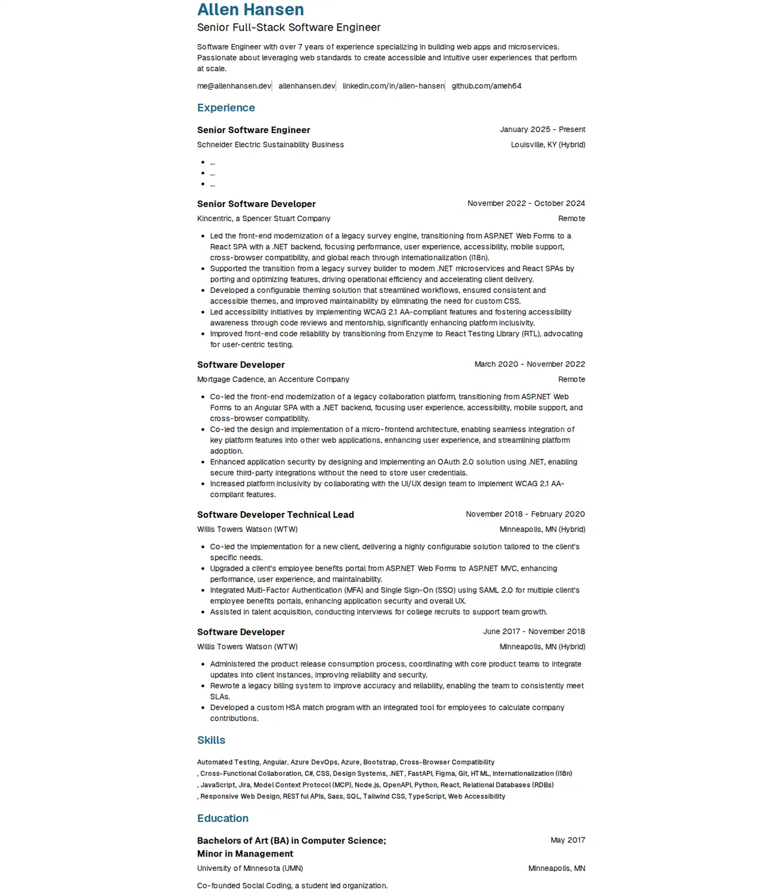
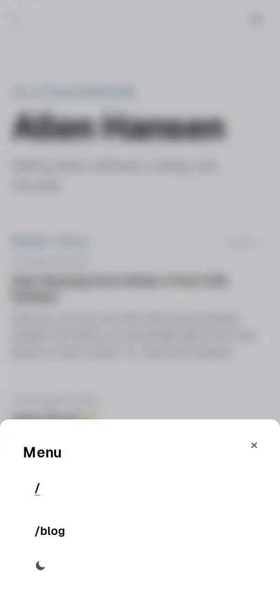
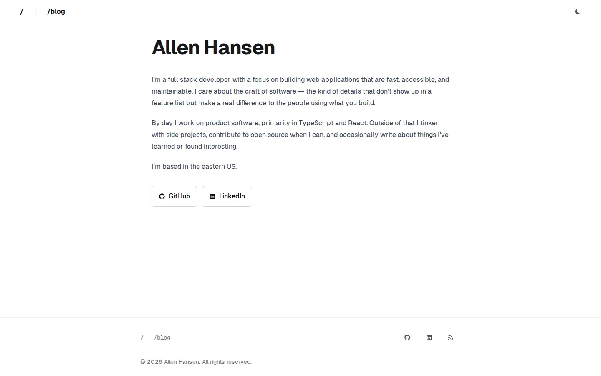
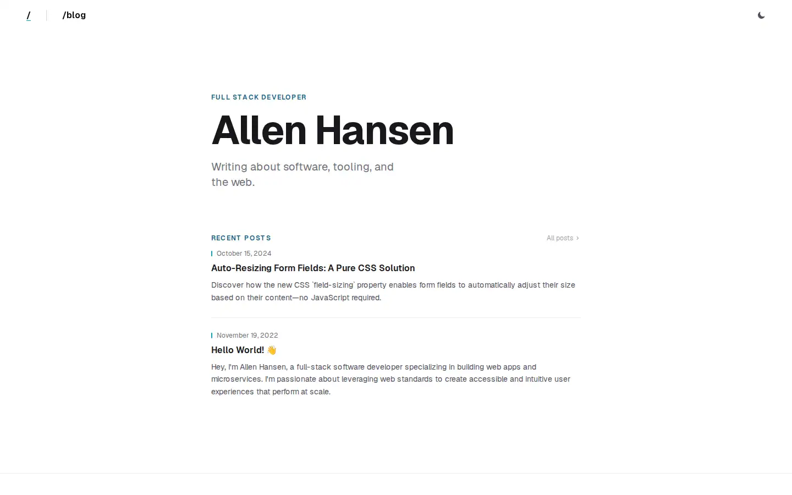
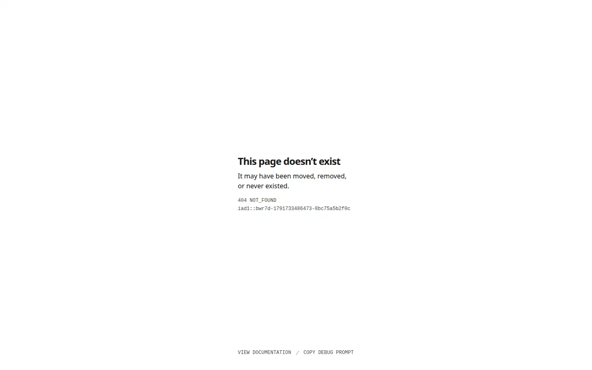
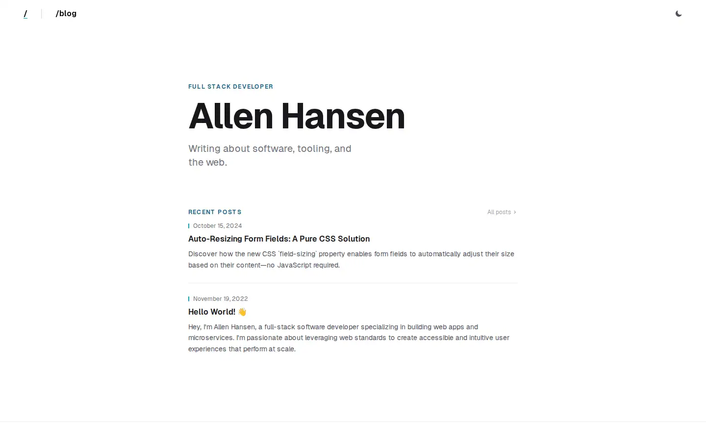
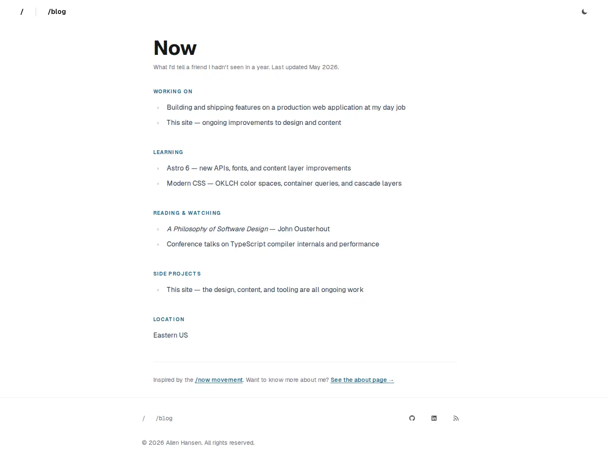

# The site before the redesign (v5.3.0)

[All images](../README.md) · [Narrative](../../01-starting-point.md)

The text-first Astro site as it stood in October 2026, before Letterpress. These
were the audit screenshots for the round 1 brief. They show what had to be
fixed: no positioning, two posts in two years, placeholder bullets on the
current résumé role, and About and Now pages that were built but hidden from the
nav.

**`blog-index-desktop-dark.webp`** · byte-identical to
[`10-releases/v5.3.0/blog-dark-desktop.webp`](../10-releases/v5.3.0/blog-dark-desktop.webp),
so it's stored once

The blog index, dark: two posts, the newest from October 2024.

**[`blog-post-desktop-dark.webp`](blog-post-desktop-dark.webp)** · 1440 × 900

The field-sizing post, dark. The blog typography was one thing the brief said to
keep.

**[`home-desktop-dark.webp`](home-desktop-dark.webp)** · 1440 × 900

Home, dark mode: eyebrow, name, one line ("Writing about software, tooling, and
the web"), and two recent posts. No photo and no positioning; the brief called
it fast and accessible but anonymous.

**`resume-desktop-dark.webp`** · byte-identical to
[`10-releases/v5.3.0/resume-dark-desktop.webp`](../10-releases/v5.3.0/resume-dark-desktop.webp),
so it's stored once

The résumé, dark mode.

**[`resume-print-preview.webp`](resume-print-preview.webp)** · 1405 × 1600

The résumé's print preview. Print styles were already solid and carried into the
redesign.

**`home-mobile-dark.webp`** · byte-identical to
[`10-releases/v5.3.0/home-dark-mobile.webp`](../10-releases/v5.3.0/home-dark-mobile.webp),
so it's stored once

Home on a phone, dark mode.

**[`mobile-menu-open.webp`](mobile-menu-open.webp)** · 600 × 1298

The bottom-sheet mobile menu, opened over a blurred page.

**[`about-desktop-light.webp`](about-desktop-light.webp)** · 1440 × 900

The About page, which was built and served but hidden from the nav, with generic
copy that contradicted the résumé.

**`blog-index-desktop-light.webp`** · byte-identical to
[`10-releases/v5.3.0/blog-light-desktop.webp`](../10-releases/v5.3.0/blog-light-desktop.webp),
so it's stored once

The blog index, light.

**`blog-post-desktop-light.webp`** · byte-identical to
[`10-releases/v5.3.0/post-light-desktop.webp`](../10-releases/v5.3.0/post-light-desktop.webp),
so it's stored once

The field-sizing post, light.

**[`home-desktop-light.webp`](home-desktop-light.webp)** · 1440 × 900

Home, light mode.

**[`live-404-desktop-light.webp`](live-404-desktop-light.webp)** · 1440 × 900

The 404 on the live site, which was the host's generic page. A custom 404 went
on the fix list.

**[`live-home-desktop-light.webp`](live-home-desktop-light.webp)** · 1440 × 900

The live home page on www.allenhansen.dev at the time of the audit.

**[`now-desktop-light.webp`](now-desktop-light.webp)** · 1440 × 1083

The Now page, also hidden, dated May 2026.

**`resume-desktop-light.webp`** · byte-identical to
[`10-releases/v5.3.0/resume-light-desktop.webp`](../10-releases/v5.3.0/resume-light-desktop.webp),
so it's stored once

The résumé, light mode. The current role shows three "…" placeholder bullets,
one of the content bugs the audit found.

**[`blog-post-mobile-light.webp`](blog-post-mobile-light.webp)** · 600 × 2768,
full-page capture

The Hello World post on a phone, light.

**`home-mobile-light.webp`** · byte-identical to
[`10-releases/v5.3.0/home-light-mobile.webp`](../10-releases/v5.3.0/home-light-mobile.webp),
so it's stored once

Home on a phone, light mode.
