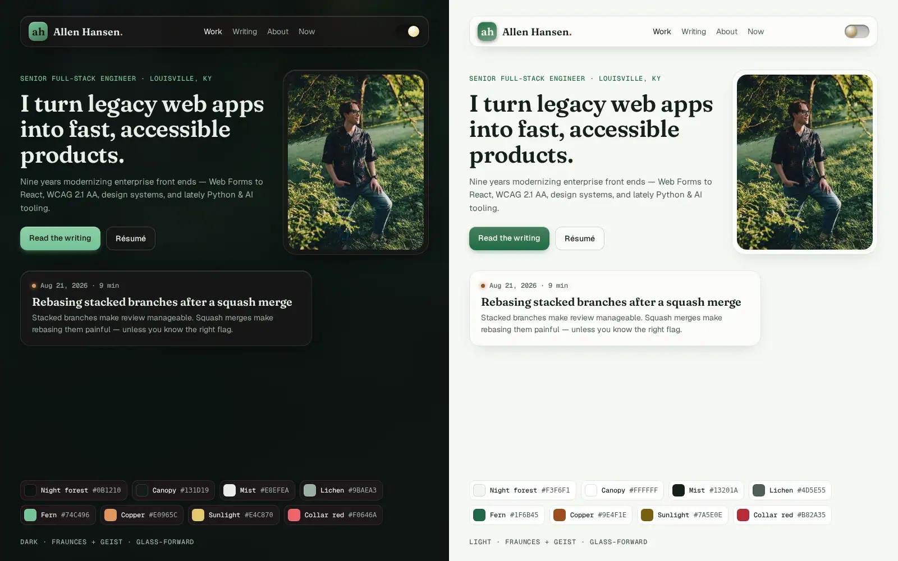
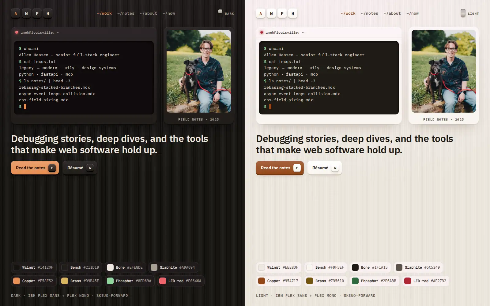
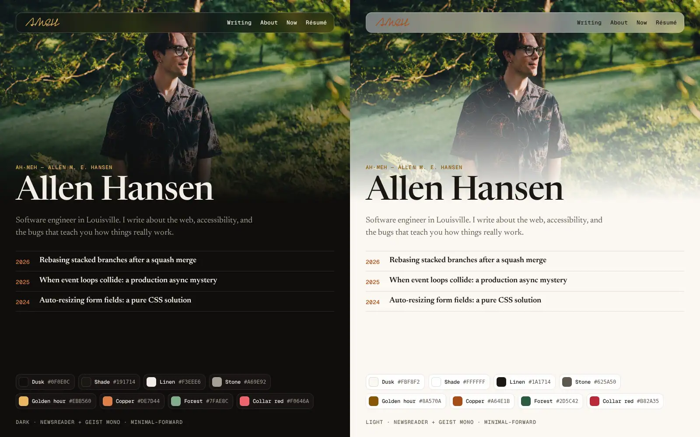

# Round 1: brand directions

[All images](../README.md) · [Narrative](../../02-round-1-brief.md)

The three direction boards from the first brief, rendered in HTML with real
fonts and photos, dark and light side by side. Allen liked A and C best. All
three were set aside after round 2, but the photo cues and the dark-first rule
carried forward.

**[`direction-a-canopy.webp`](direction-a-canopy.webp)** · 1600 × 1000

Direction A, Canopy (glass-forward): frosted panels over a blurred forest, fern
green and copper, Fraunces with Geist, and a portrait in a glass frame. The
brief recommended it. Round 2 dropped it after noticing that green, glass, and
Geist were also the look of a coworker's site.

**[`direction-b-workbench.webp`](direction-b-workbench.webp)** · 1600 × 1000

Direction B, Workbench (skeuo-forward): keycaps spelling AMEH, a recessed
terminal panel, copper on walnut, IBM Plex. Allen didn't pick it, and the
keycaps and terminal ideas were ruled out for round 3.

**[`direction-c-golden-hour.webp`](direction-c-golden-hour.webp)** · 1600 × 1000

Direction C, Golden Hour (minimal-forward): a full-bleed golden-hour photo,
Newsreader serif, and the 2019 AMEH signature. Allen liked it along with A; the
photo hero was what he later ruled out.

**`photo-crop-plan.webp`** (not included)

Left out. It's a contact sheet of the original photo shoot, and most of those
photos aren't on the live site.
