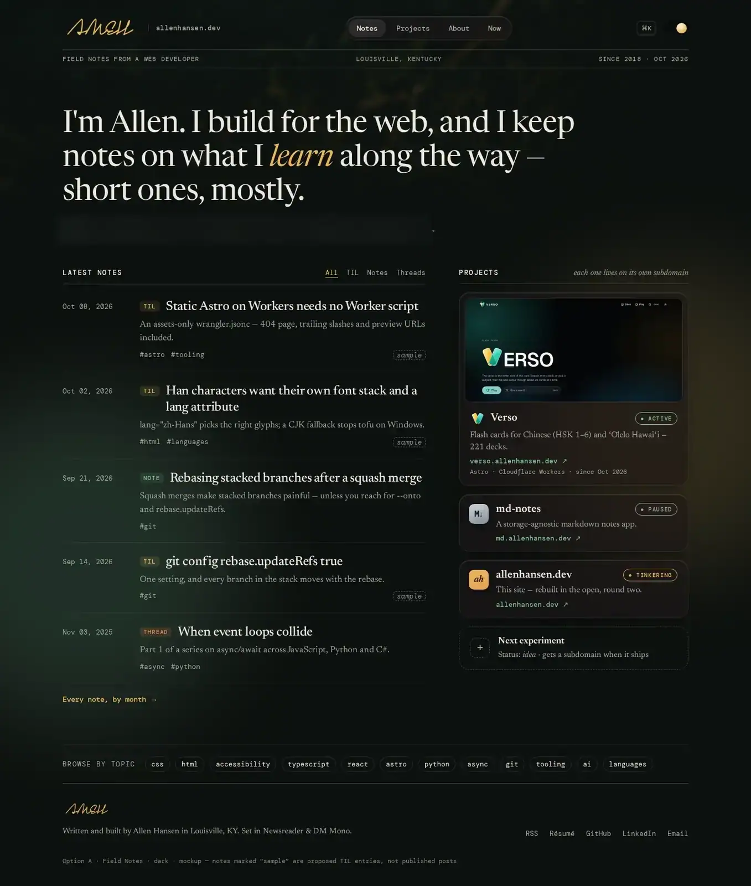
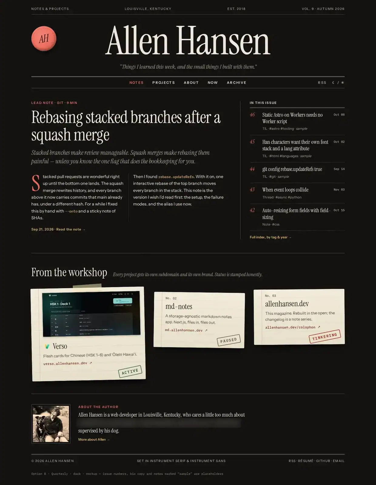
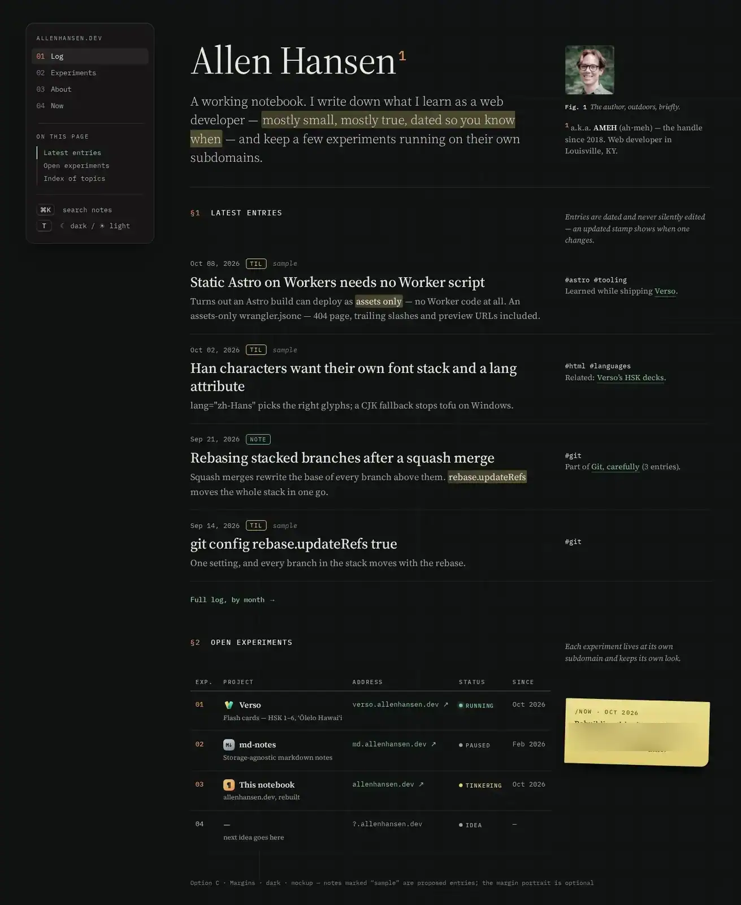
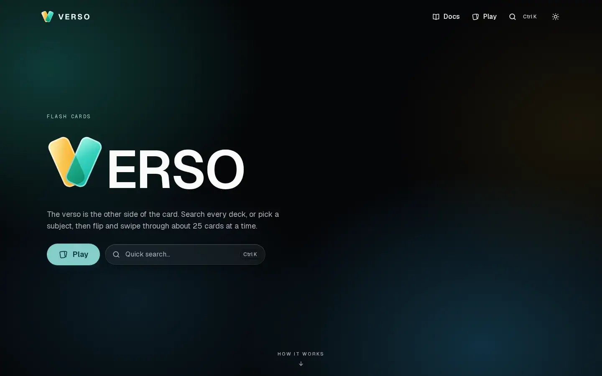
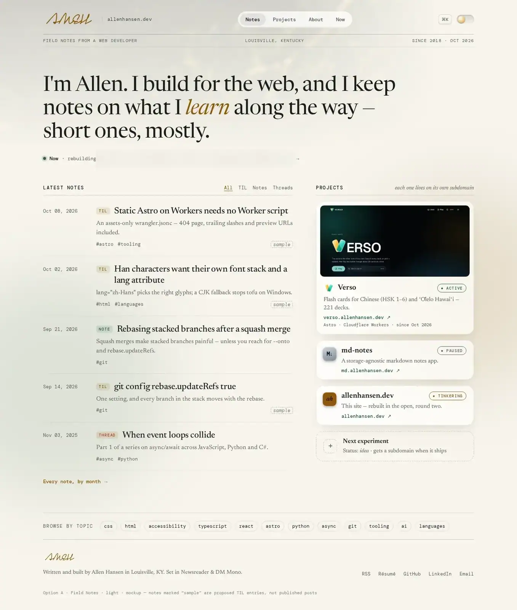

# Round 2: minimal and magazine-like

[All images](../README.md) · [Narrative](../../03-round-2-magazine.md)

Full home-page mockups for the three round 2 options, plus the Verso reference.
Allen turned down this whole round. Its information architecture (Notes,
Projects on subdomains, About, Now) survived, and its visual direction didn't.

**[`option-a-field-notes-dark.webp`](option-a-field-notes-dark.webp)** · 1357 ×
1600

Option A, Field Notes, dark: the Canopy and Golden Hour hybrid. Gold on forest
black, Newsreader and DM Mono, the AMEH signature as the wordmark, a
one-sentence intro instead of a name hero, notes on the left and project
"slides" on the right. It was the recommendation.

**[`option-b-quarterly-dark.webp`](option-b-quarterly-dark.webp)** · 1240 × 1600

Option B, Quarterly: a personal print magazine with a huge masthead, an AH wax
seal, index cards, washi tape, and rubber-stamp statuses. The most distinctive
option, and the most upkeep. Lines of draft copy with personal details that
never went on the site are blurred.

**[`option-c-margins-dark.webp`](option-c-margins-dark.webp)** · 1311 × 1600

Option C, Margins: a Tufte-style lab notebook with a glass rail, sidenotes, and
an experiments table. Its sidenotes and honest project status were ideas worth
borrowing. Lines of draft copy with personal details that never went on the site
are blurred.

**`reference-keaton-smith-home-desktop.webp`** (not included)

Left out. It's a coworker's personal site, used as a reference in round 2. It
belongs to someone else, so it isn't republished here.

**[`reference-verso-home-dark.webp`](reference-verso-home-dark.webp)** · 1440 ×
900

Verso, Allen's flash-card app, built locally from its repo. It became the
reference every later round had to stay distinct from: dark, teal and amber
glows, glass panels.

**[`option-a-field-notes-light.webp`](option-a-field-notes-light.webp)** · 1357
× 1600

Field Notes in light mode, on warm paper with burnished gold. Lines of draft
copy with personal details that never went on the site are blurred.
