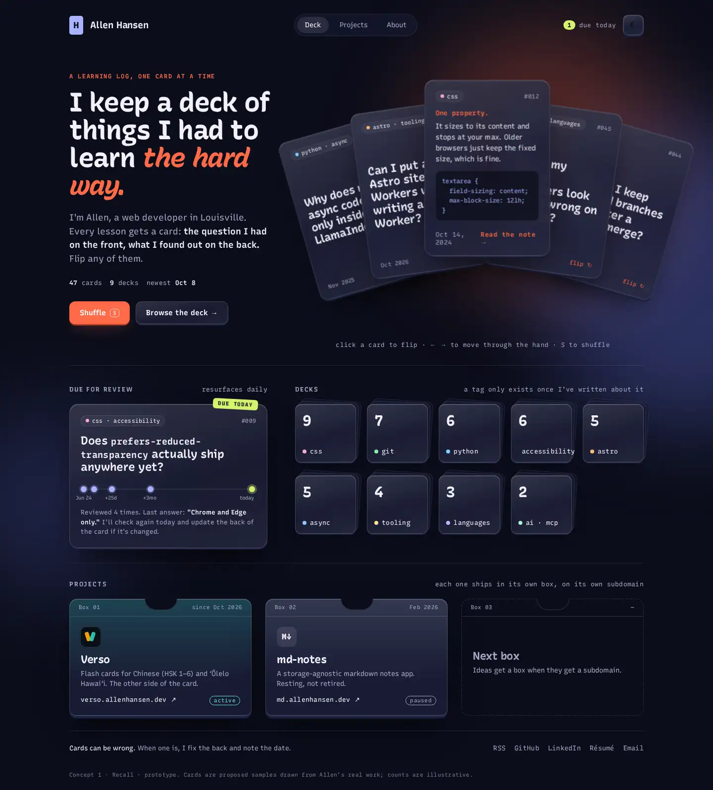
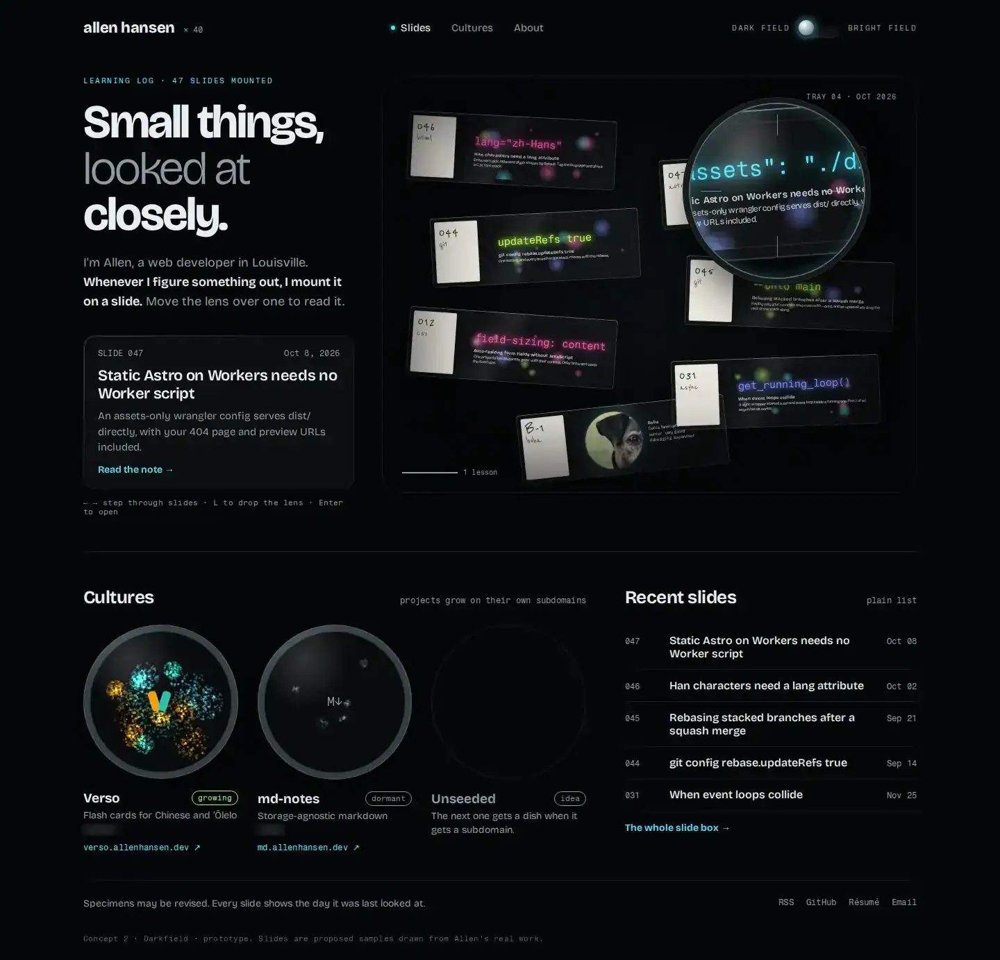
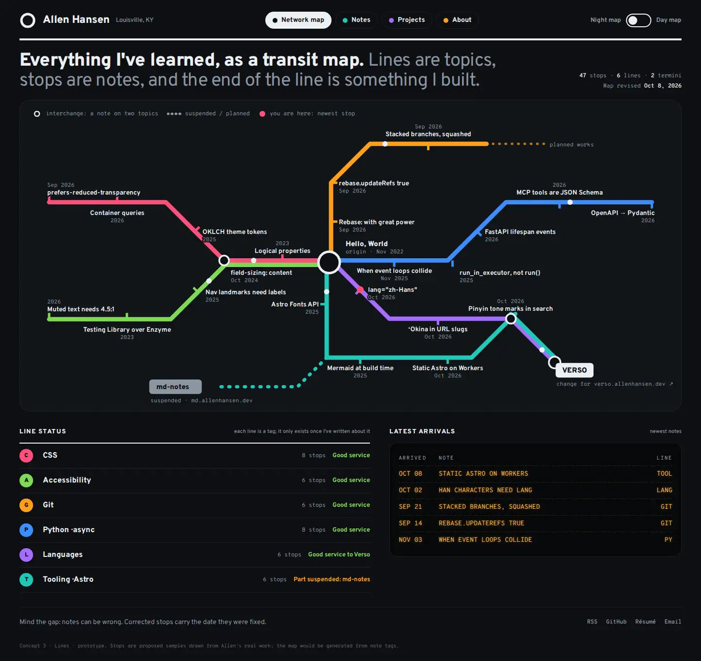
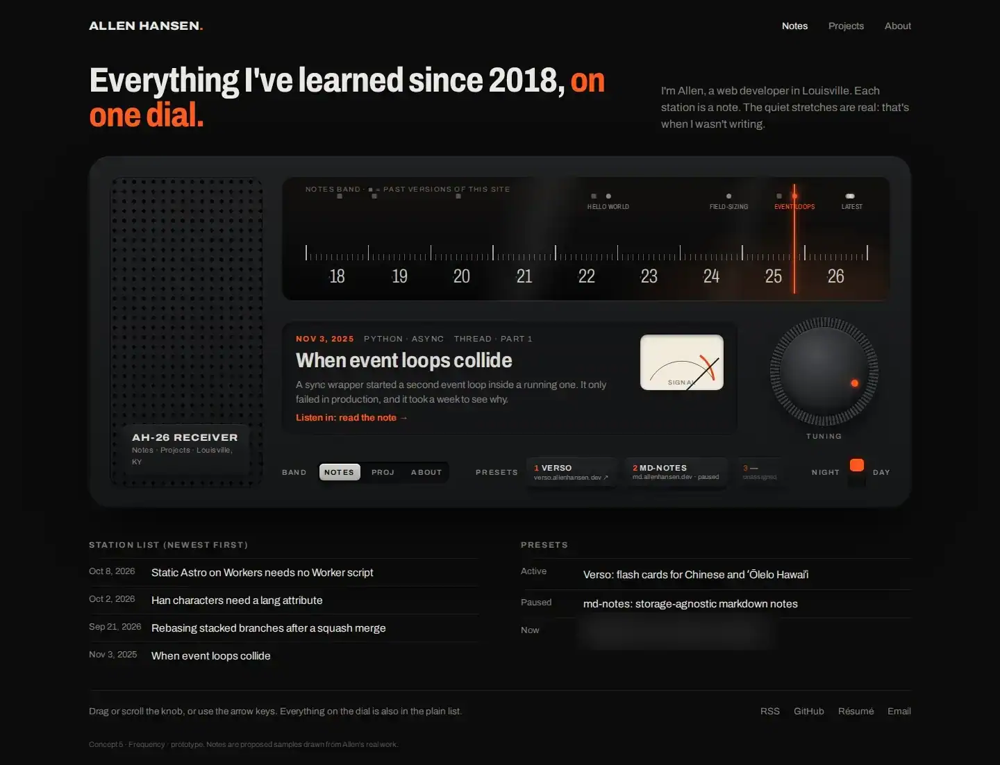
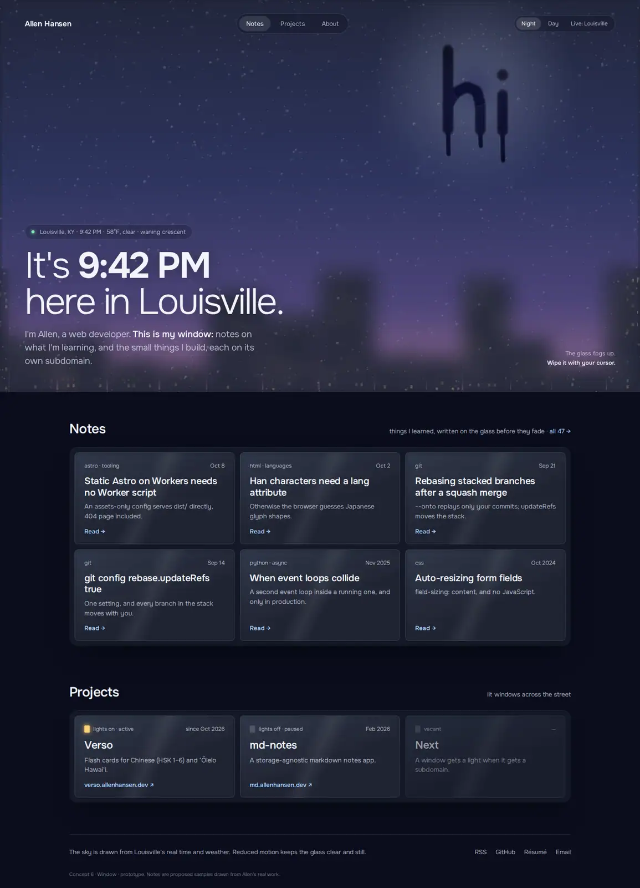
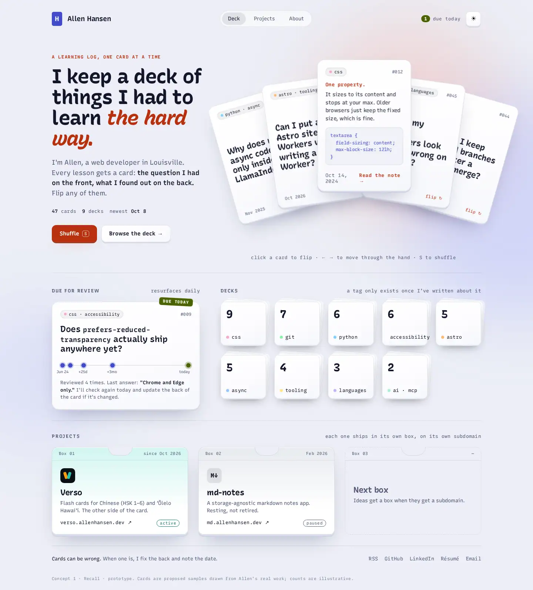
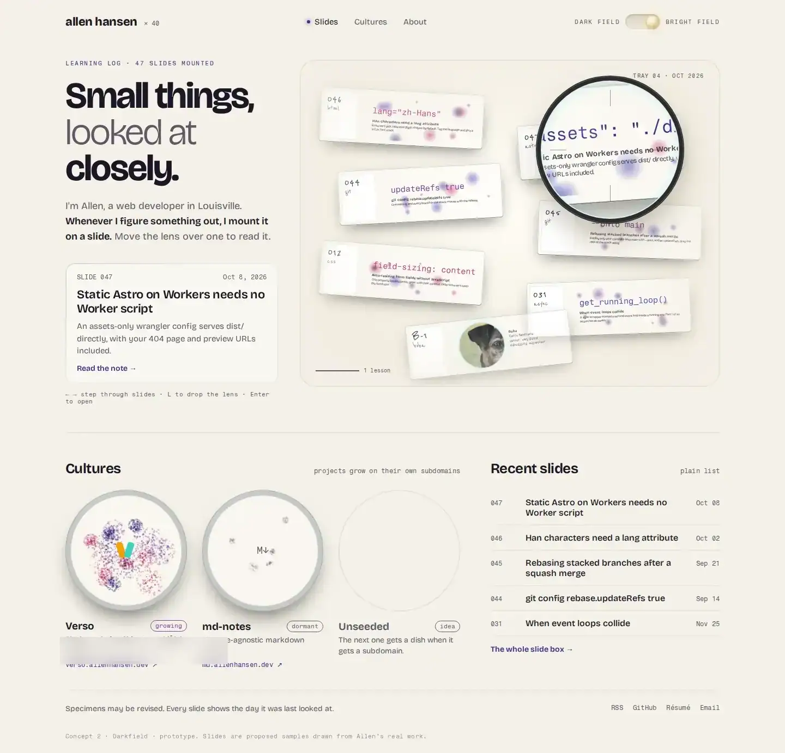
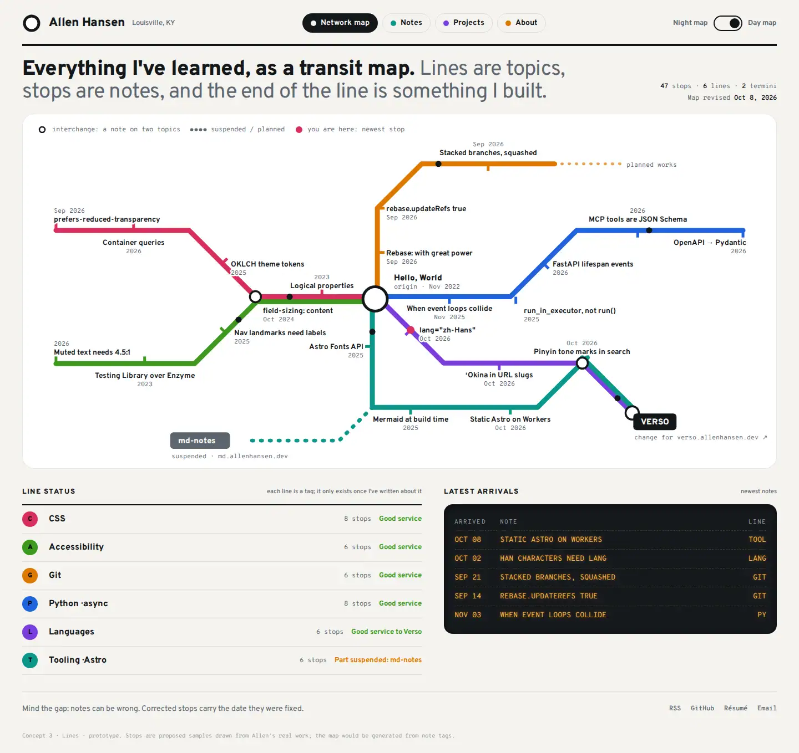
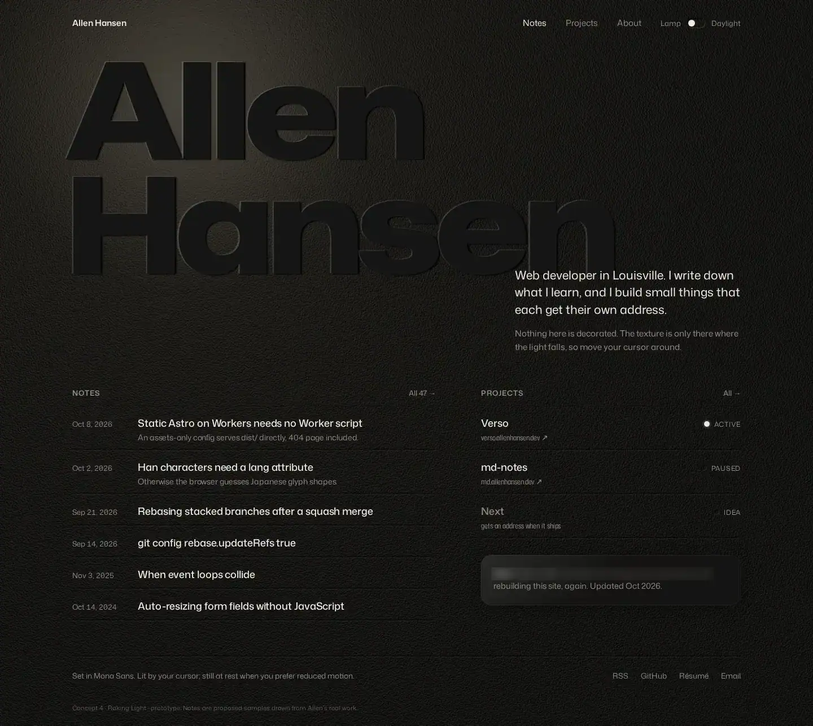

# Round 3: six concepts built around an interaction

[All images](../README.md) · [Narrative](../../04-round-3-concepts.md)

Working prototypes, each built around an interaction instead of a palette. Allen
found Recall too close to Verso and liked Raking Light, which became the basis
for round 4. The interaction videos from this round aren't included here; the
screenshots stand in for them.

**[`1-recall-dark.webp`](1-recall-dark.webp)** · 1440 × 1594

Recall, dark: notes as flash cards with the question on the front and the answer
on the back, plus a card that comes up again for review each day. It was the
recommendation. Allen called it nice in theory but too deck-like and too close
to Verso.

**[`2-darkfield-dark.webp`](2-darkfield-dark.webp)** · 1440 × 1383

Darkfield, dark field: notes as microscope slides read through a lens you drag,
with fluorescent stains on black. Lines of draft copy with personal details that
never went on the site are blurred.

**[`3-lines-dark.webp`](3-lines-dark.webp)** · 1440 × 1359

Lines, night map: topics as transit lines, notes as stops, projects as termini.
The most ambitious concept and the hardest to lay out automatically.

**[`5-frequency-dark.webp`](5-frequency-dark.webp)** · 1440 × 1102

Frequency: a minimalist hi-fi receiver whose dial is time, with notes as
stations and projects as presets. Lines of draft copy with personal details that
never went on the site are blurred.

**[`6-window-dark.webp`](6-window-dark.webp)** · 1155 × 1600

Window: a fogged pane looking out on the city at the current local time, which
visitors wipe clear. A finger-written "hi" sits in the fog. It said the least
about Allen's work.

**[`1-recall-light.webp`](1-recall-light.webp)** · 1440 × 1594

Recall in light mode.

**[`2-darkfield-brightfield-light.webp`](2-darkfield-brightfield-light.webp)** ·
1440 × 1383

Darkfield's light mode, bright field: H&E purple and pink on lit glass, so the
two themes meant something. Lines of draft copy with personal details that never
went on the site are blurred.

**[`3-lines-light.webp`](3-lines-light.webp)** · 1440 × 1359

Lines, day map.

**[`4-raking-light-dark.webp`](4-raking-light-dark.webp)** · 1440 × 1286

Raking Light, with the lamp near the name: a flat page whose embossed name and
grooves only show where the cursor's light falls. Allen said he was "kind of
digging" this one, and it became the basis for rounds 4 and 5. Lines of draft
copy with personal details that never went on the site are blurred.
