# Round 4: Raking Light, four ways

[All images](../README.md) · [Narrative](../../05-round-4-raking-light.md)

Four variations of Raking Light, each with six pages (Home, Notes, a Note,
Projects, About, Résumé) in dark and light, at 1440px desktop and 390px phone
width. The comparison sheets put all four side by side, page by page.
Letterpress won on its ink color. The QA captures show the accessibility
fallbacks and the baked paper texture that replaced a live SVG filter.

## Lamp

### Home

Home, with the large name, the intro line, the latest notes, and the "From the
archive" resurfaced note. Allen liked its minimalism, but with no color it could
read as severe.

**[`1-lamp-home-dark.webp`](1-lamp-home-dark.webp)** · 1281 × 1600

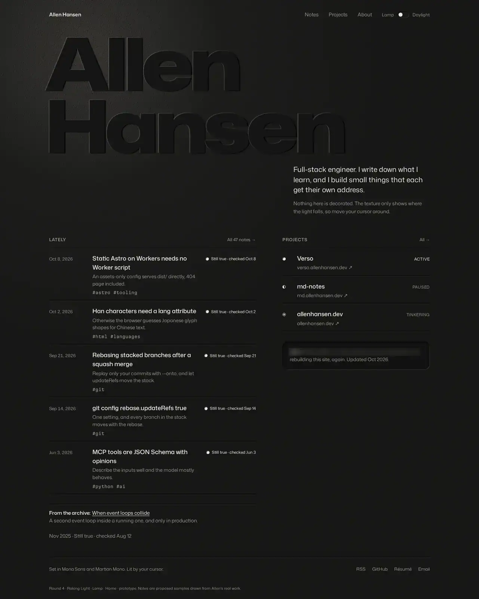

Lamp Home, Lamp theme (dark mode), desktop. Lines of draft copy with personal
details that never went on the site are blurred.

**[`1-lamp-video-contact-sheet.webp`](1-lamp-video-contact-sheet.webp)** · 1600
× 800

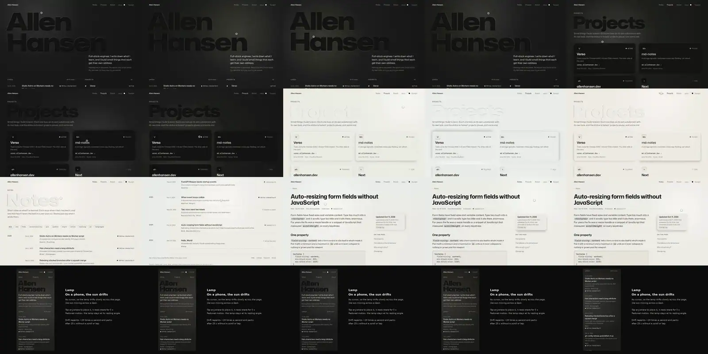

Frames from the Lamp interaction video: the desktop pointer segment, then the
phone segment. The video isn't included here; this sheet stands in for it.

**[`1-lamp-home-dark-mobile.webp`](1-lamp-home-dark-mobile.webp)** · 600 × 3609,
full-page capture

Lamp Home, Lamp theme (dark mode), phone. Lines of draft copy with personal
details that never went on the site are blurred.

**[`1-lamp-home-light.webp`](1-lamp-home-light.webp)** · 1281 × 1600

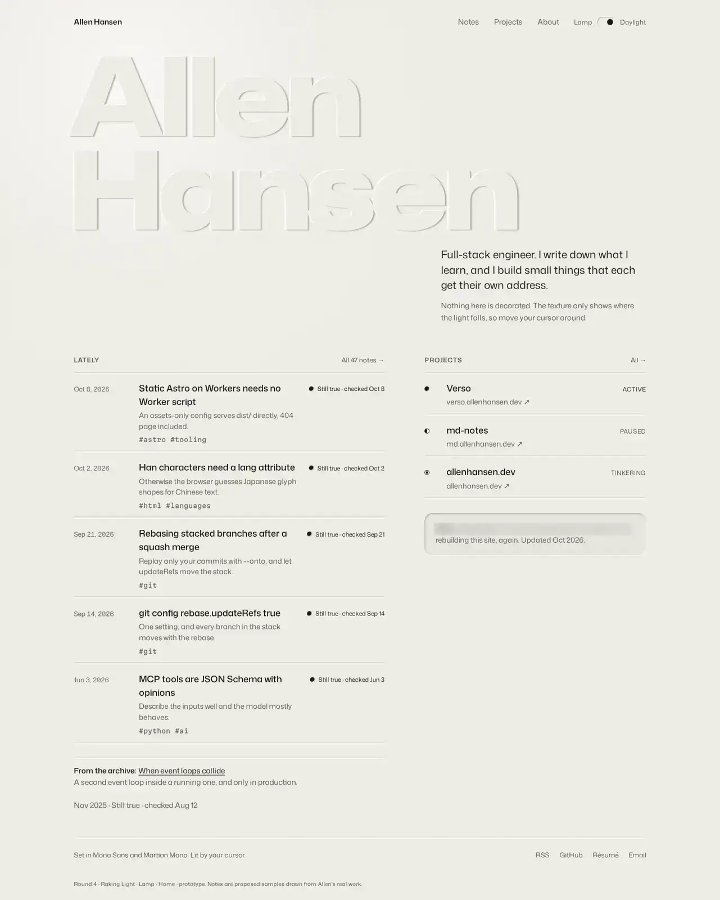

Lamp Home, Daylight theme (light mode), desktop. Lines of draft copy with
personal details that never went on the site are blurred.

**[`1-lamp-home-light-mobile.webp`](1-lamp-home-light-mobile.webp)** · 600 ×
3609, full-page capture

Lamp Home, Daylight theme (light mode), phone. Lines of draft copy with personal
details that never went on the site are blurred.

### Notes

The Notes index, where every row says when the note was last checked.

**[`1-lamp-notes-dark.webp`](1-lamp-notes-dark.webp)** · 1239 × 1600

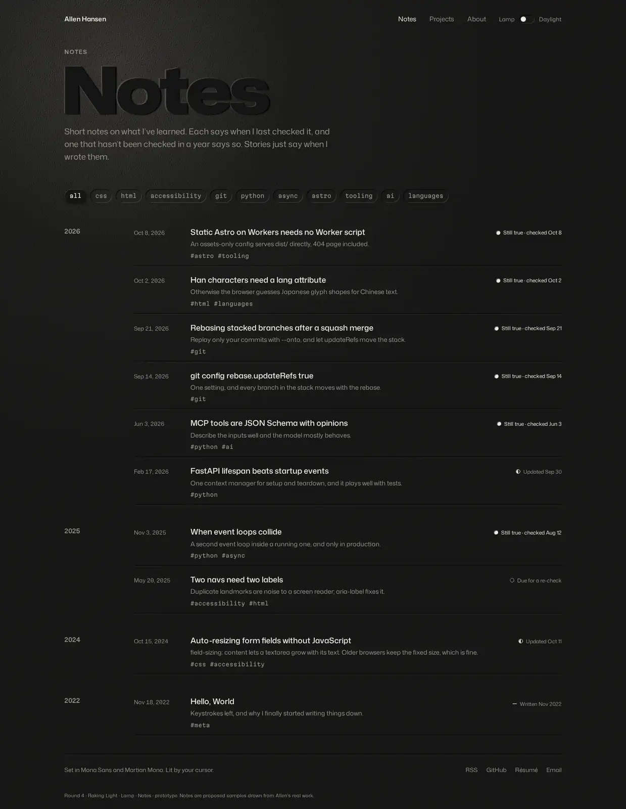

Lamp Notes, Lamp theme (dark mode), desktop.

**[`1-lamp-notes-dark-mobile.webp`](1-lamp-notes-dark-mobile.webp)** · 600 ×
4526, full-page capture

Lamp Notes, Lamp theme (dark mode), phone.

**[`1-lamp-notes-light.webp`](1-lamp-notes-light.webp)** · 1239 × 1600

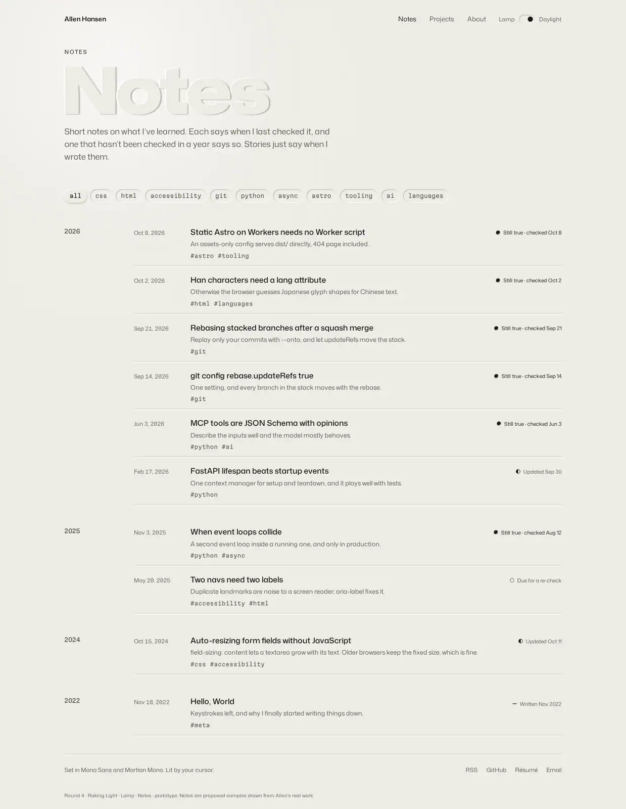

Lamp Notes, Daylight theme (light mode), desktop.

**[`1-lamp-notes-light-mobile.webp`](1-lamp-notes-light-mobile.webp)** · 600 ×
4526, full-page capture

Lamp Notes, Daylight theme (light mode), phone.

### Note

A note page (a paraphrase of the field-sizing post) with a freshness status, a
sample inline correction, a dated change log, and the "Spot something wrong or
outdated?" link.

**[`1-lamp-note-dark.webp`](1-lamp-note-dark.webp)** · 1046 × 1600

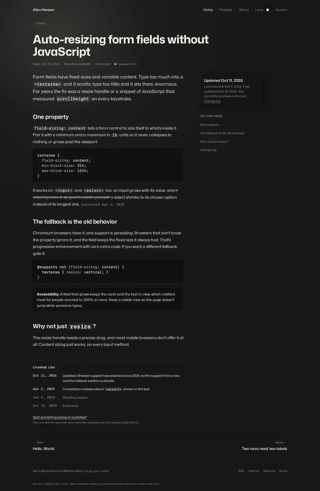

Lamp Note, Lamp theme (dark mode), desktop.

**[`1-lamp-note-dark-mobile.webp`](1-lamp-note-dark-mobile.webp)** · 600 × 5078,
full-page capture

Lamp Note, Lamp theme (dark mode), phone.

**[`1-lamp-note-light.webp`](1-lamp-note-light.webp)** · 1046 × 1600

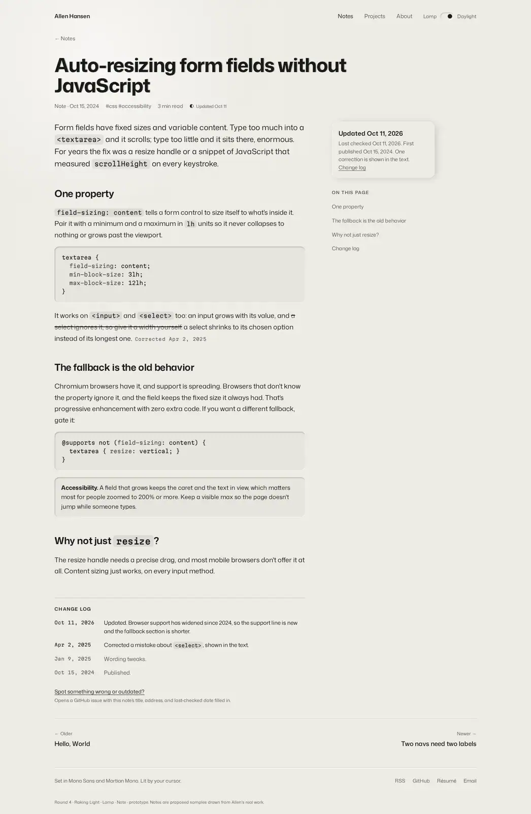

Lamp Note, Daylight theme (light mode), desktop.

**[`1-lamp-note-light-mobile.webp`](1-lamp-note-light-mobile.webp)** · 600 ×
5078, full-page capture

Lamp Note, Daylight theme (light mode), phone.

### Projects

Projects, as subdomain cards with an honest status.

**[`1-lamp-projects-dark.webp`](1-lamp-projects-dark.webp)** · 1440 × 1101

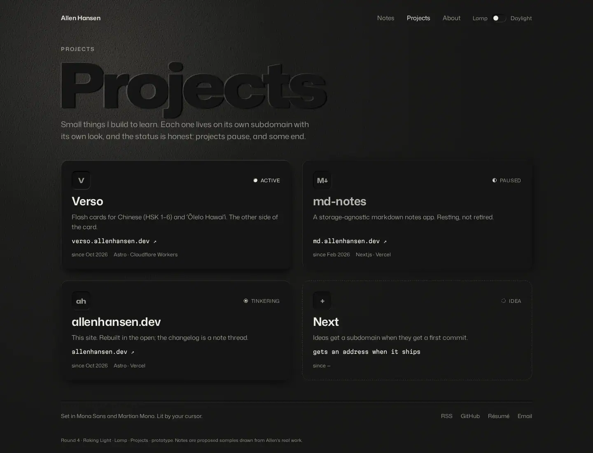

Lamp Projects, Lamp theme (dark mode), desktop.

**[`1-lamp-projects-dark-mobile.webp`](1-lamp-projects-dark-mobile.webp)** · 600
× 2748, full-page capture

Lamp Projects, Lamp theme (dark mode), phone.

**[`1-lamp-projects-light.webp`](1-lamp-projects-light.webp)** · 1440 × 1101

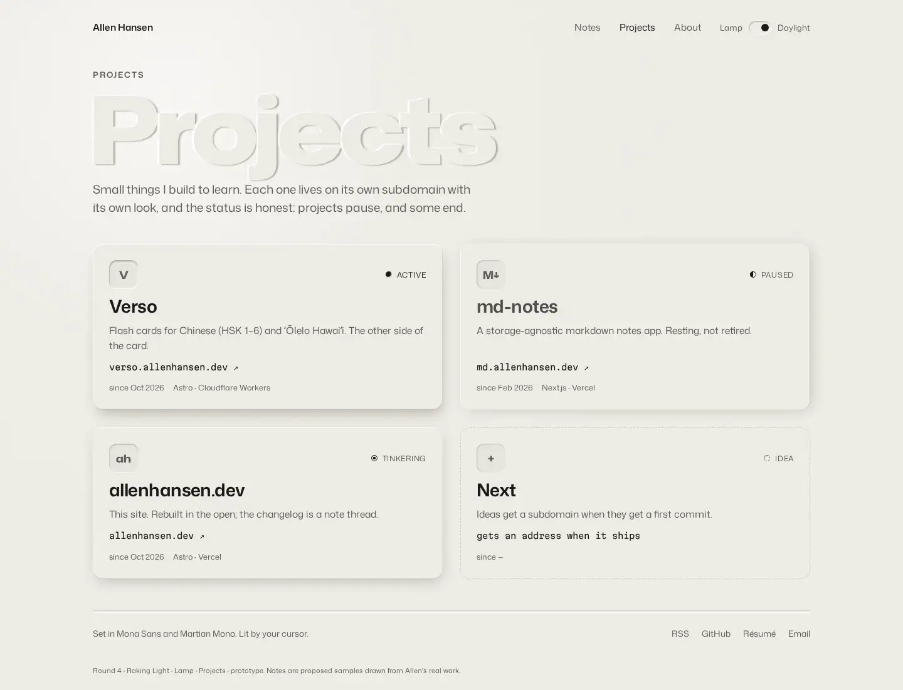

Lamp Projects, Daylight theme (light mode), desktop.

**[`1-lamp-projects-light-mobile.webp`](1-lamp-projects-light-mobile.webp)** ·
600 × 2748, full-page capture

Lamp Projects, Daylight theme (light mode), phone.

### About

About, with the short bio, contact links, the timed Boba photo rotator, and a
colophon.

**[`1-lamp-about-dark.webp`](1-lamp-about-dark.webp)** · 1440 × 1089

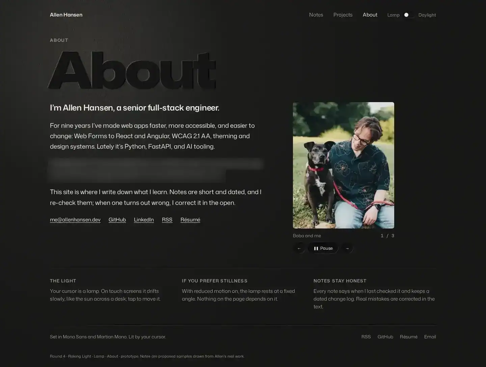

Lamp About, Lamp theme (dark mode), desktop. Lines of draft copy with personal
details that never went on the site are blurred.

**[`1-lamp-about-dark-mobile.webp`](1-lamp-about-dark-mobile.webp)** · 600 ×
3028, full-page capture

Lamp About, Lamp theme (dark mode), phone. Lines of draft copy with personal
details that never went on the site are blurred.

**[`1-lamp-about-light.webp`](1-lamp-about-light.webp)** · 1440 × 1089

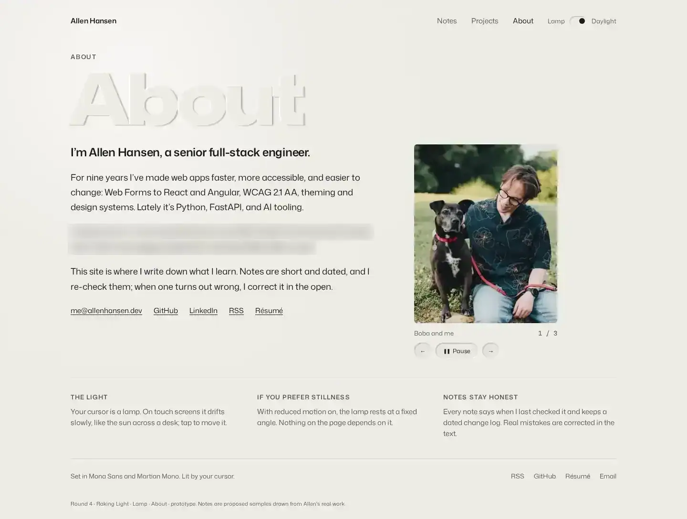

Lamp About, Daylight theme (light mode), desktop. Lines of draft copy with
personal details that never went on the site are blurred.

**[`1-lamp-about-light-mobile.webp`](1-lamp-about-light-mobile.webp)** · 600 ×
3028, full-page capture

Lamp About, Daylight theme (light mode), phone. Lines of draft copy with
personal details that never went on the site are blurred.

### Résumé

The Résumé, built from the real résumé data, with the current role shown as a
marked placeholder.

**[`1-lamp-resume-dark.webp`](1-lamp-resume-dark.webp)** · 1000 × 2083

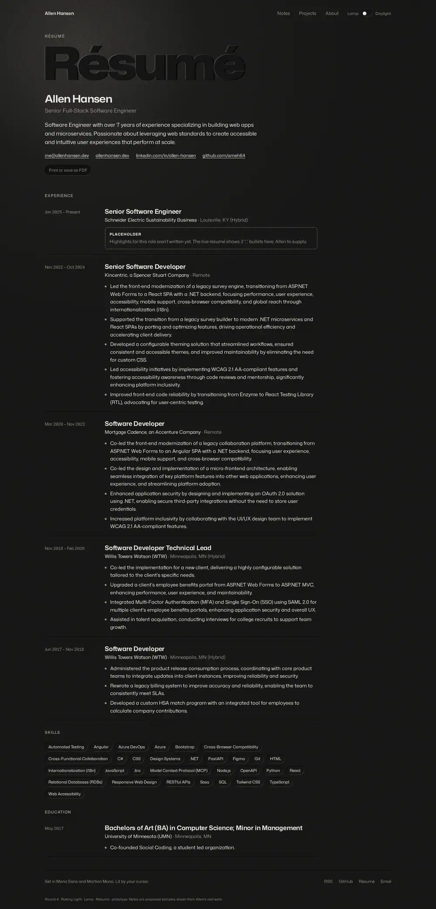

Lamp Résumé, Lamp theme (dark mode), desktop.

**[`1-lamp-resume-dark-mobile.webp`](1-lamp-resume-dark-mobile.webp)** · 600 ×
7286, full-page capture

Lamp Résumé, Lamp theme (dark mode), phone.

**[`1-lamp-resume-light.webp`](1-lamp-resume-light.webp)** · 1000 × 2083

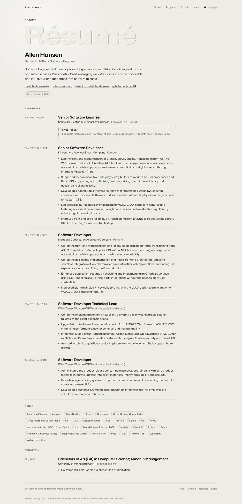

Lamp Résumé, Daylight theme (light mode), desktop.

**[`1-lamp-resume-light-mobile.webp`](1-lamp-resume-light-mobile.webp)** · 600 ×
7286, full-page capture

Lamp Résumé, Daylight theme (light mode), phone.

## Letterpress

### Home

Home, with the large name, the intro line, the latest notes, and the "From the
archive" resurfaced note. This is the variation Allen leaned toward for its ink,
and it became the site.

**[`2-letterpress-home-dark.webp`](2-letterpress-home-dark.webp)** · 1283 × 1600

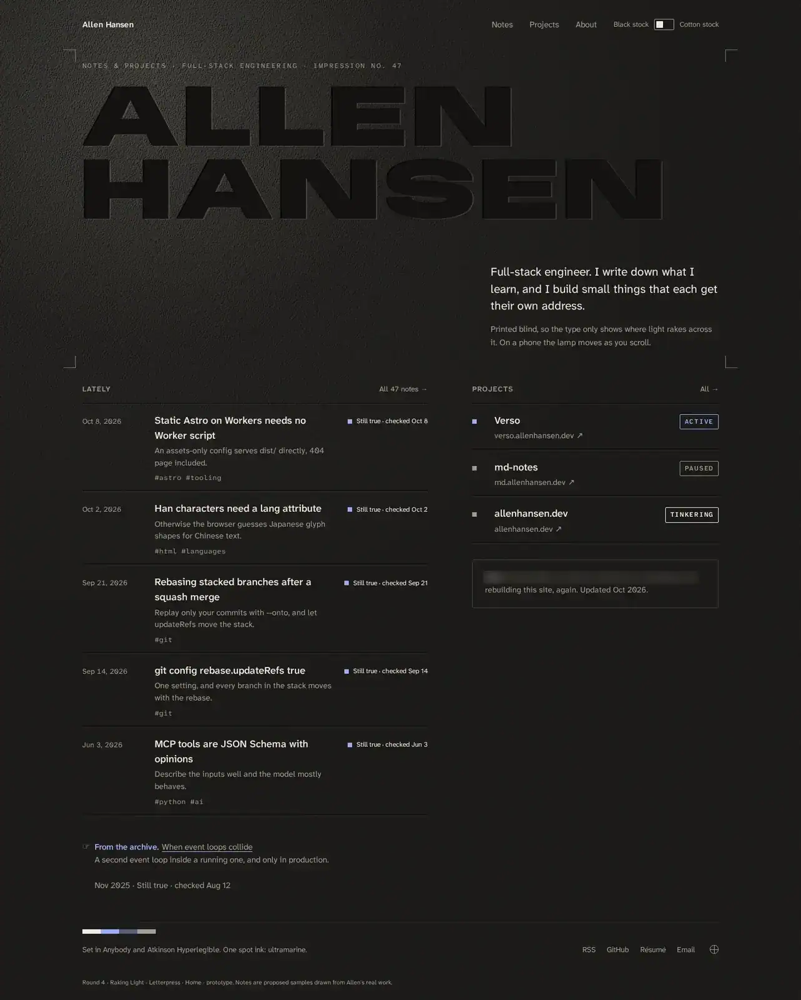

Letterpress Home, Black stock theme (dark mode), desktop. Lines of draft copy
with personal details that never went on the site are blurred.

**[`2-letterpress-video-contact-sheet.webp`](2-letterpress-video-contact-sheet.webp)**
· 1600 × 800

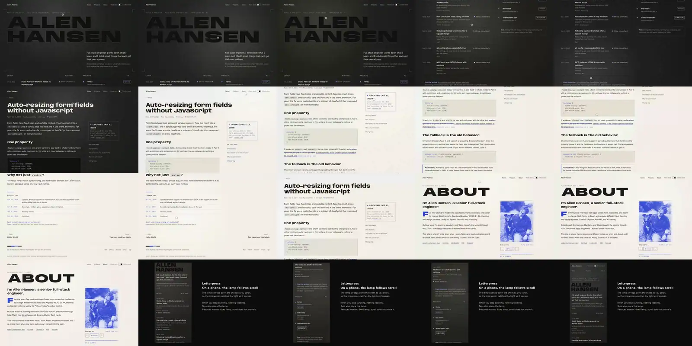

Frames from the Letterpress interaction video: the desktop pointer segment, then
the phone segment. The video isn't included here; this sheet stands in for it.

**[`2-letterpress-home-dark-mobile.webp`](2-letterpress-home-dark-mobile.webp)**
· 600 × 3840, full-page capture

Letterpress Home, Black stock theme (dark mode), phone. Lines of draft copy with
personal details that never went on the site are blurred.

**[`2-letterpress-home-light.webp`](2-letterpress-home-light.webp)** · 1283 ×
1600

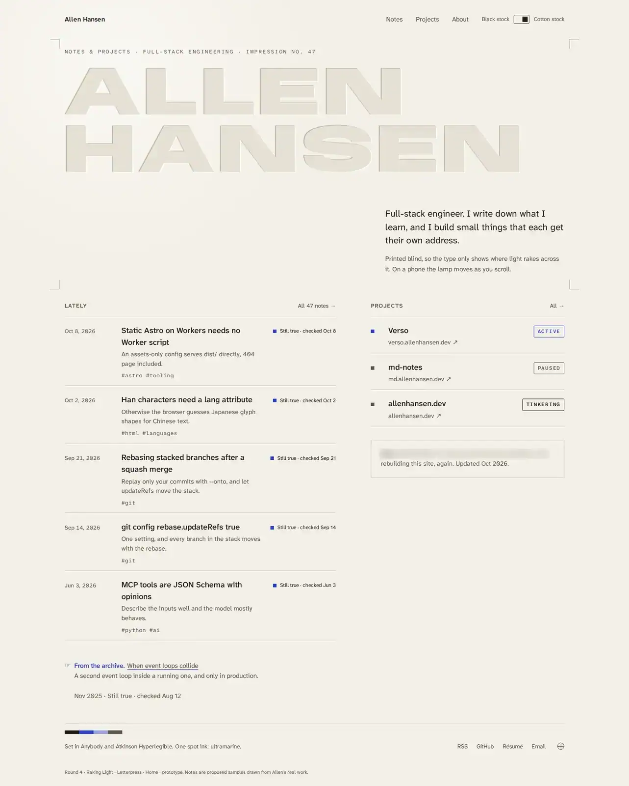

Letterpress Home, Cotton stock theme (light mode), desktop. Lines of draft copy
with personal details that never went on the site are blurred.

**[`2-letterpress-home-light-mobile.webp`](2-letterpress-home-light-mobile.webp)**
· 600 × 3840, full-page capture

Letterpress Home, Cotton stock theme (light mode), phone. Lines of draft copy
with personal details that never went on the site are blurred.

### Notes

The Notes index, where every row says when the note was last checked.

**[`2-letterpress-notes-dark.webp`](2-letterpress-notes-dark.webp)** · 1254 ×
1600

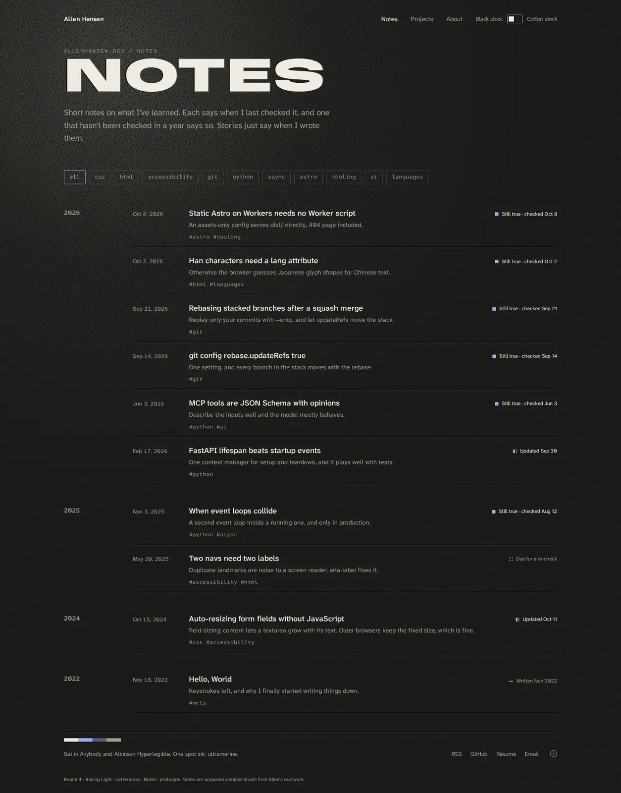

Letterpress Notes, Black stock theme (dark mode), desktop.

**[`2-letterpress-notes-dark-mobile.webp`](2-letterpress-notes-dark-mobile.webp)**
· 600 × 4540, full-page capture

Letterpress Notes, Black stock theme (dark mode), phone.

**[`2-letterpress-notes-light.webp`](2-letterpress-notes-light.webp)** · 1254 ×
1600

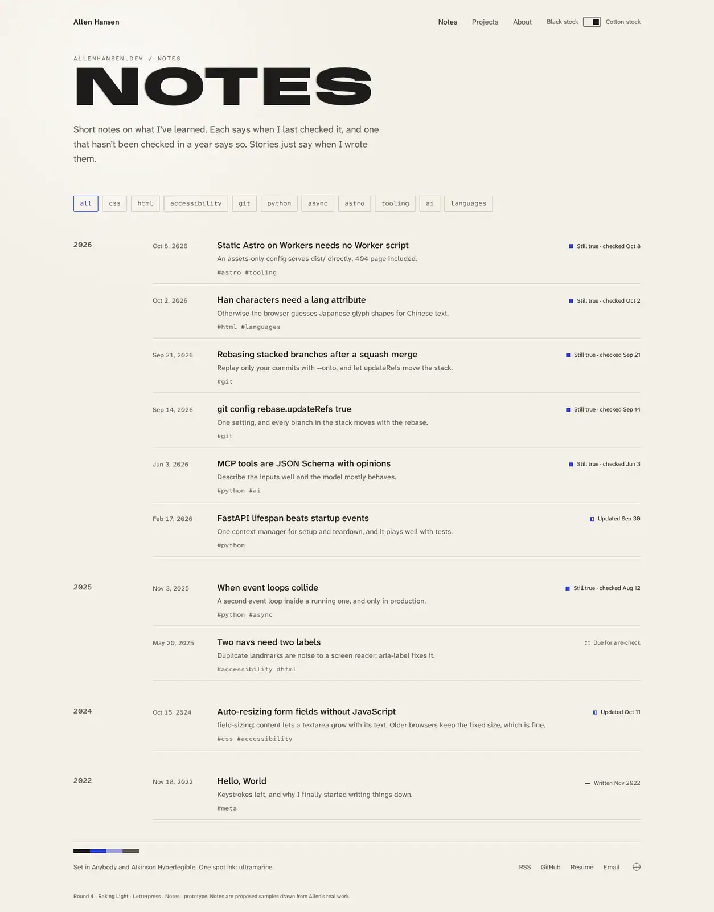

Letterpress Notes, Cotton stock theme (light mode), desktop.

**[`2-letterpress-notes-light-mobile.webp`](2-letterpress-notes-light-mobile.webp)**
· 600 × 4540, full-page capture

Letterpress Notes, Cotton stock theme (light mode), phone.

### Note

A note page (a paraphrase of the field-sizing post) with a freshness status, a
sample inline correction, a dated change log, and the "Spot something wrong or
outdated?" link. The freshness labels and inline corrections were later removed
at Allen's request; the change log and issue link stayed.

**[`2-letterpress-note-dark.webp`](2-letterpress-note-dark.webp)** · 1042 × 1600

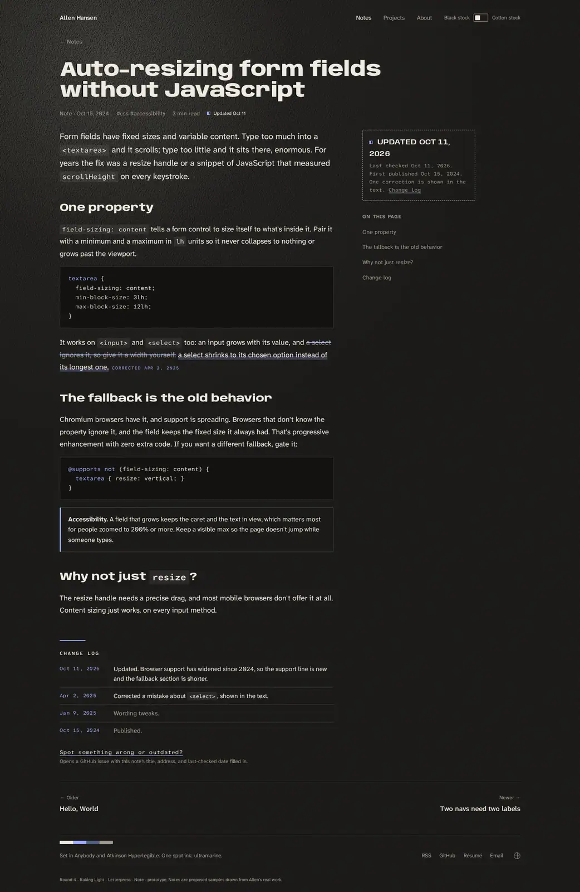

Letterpress Note, Black stock theme (dark mode), desktop.

**[`2-letterpress-note-dark-mobile.webp`](2-letterpress-note-dark-mobile.webp)**
· 600 × 5212, full-page capture

Letterpress Note, Black stock theme (dark mode), phone.

**[`2-letterpress-note-light.webp`](2-letterpress-note-light.webp)** · 1042 ×
1600

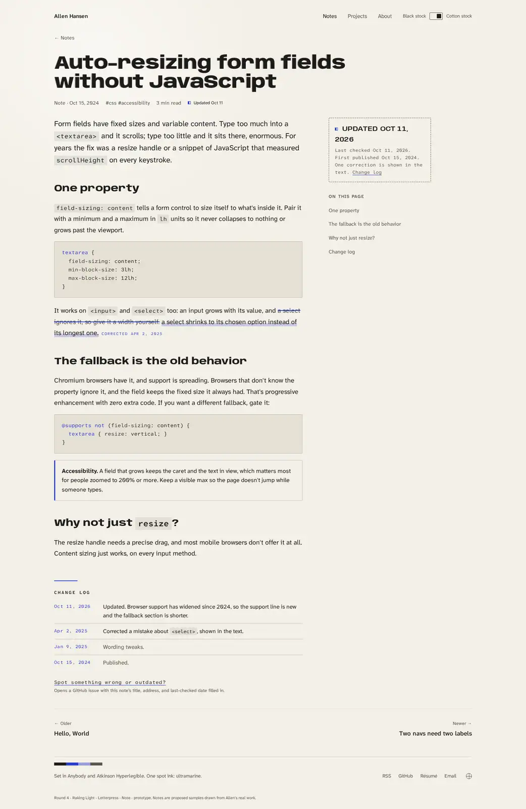

Letterpress Note, Cotton stock theme (light mode), desktop.

**[`2-letterpress-note-light-mobile.webp`](2-letterpress-note-light-mobile.webp)**
· 600 × 5212, full-page capture

Letterpress Note, Cotton stock theme (light mode), phone.

### Projects

Projects, as subdomain cards with an honest status.

**[`2-letterpress-projects-dark.webp`](2-letterpress-projects-dark.webp)** ·
1440 × 1099

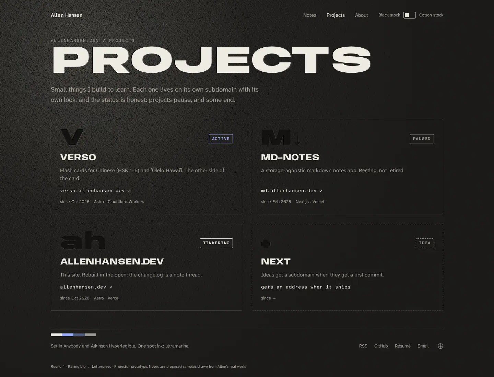

Letterpress Projects, Black stock theme (dark mode), desktop.

**[`2-letterpress-projects-dark-mobile.webp`](2-letterpress-projects-dark-mobile.webp)**
· 600 × 2755, full-page capture

Letterpress Projects, Black stock theme (dark mode), phone.

**[`2-letterpress-projects-light.webp`](2-letterpress-projects-light.webp)** ·
1440 × 1099

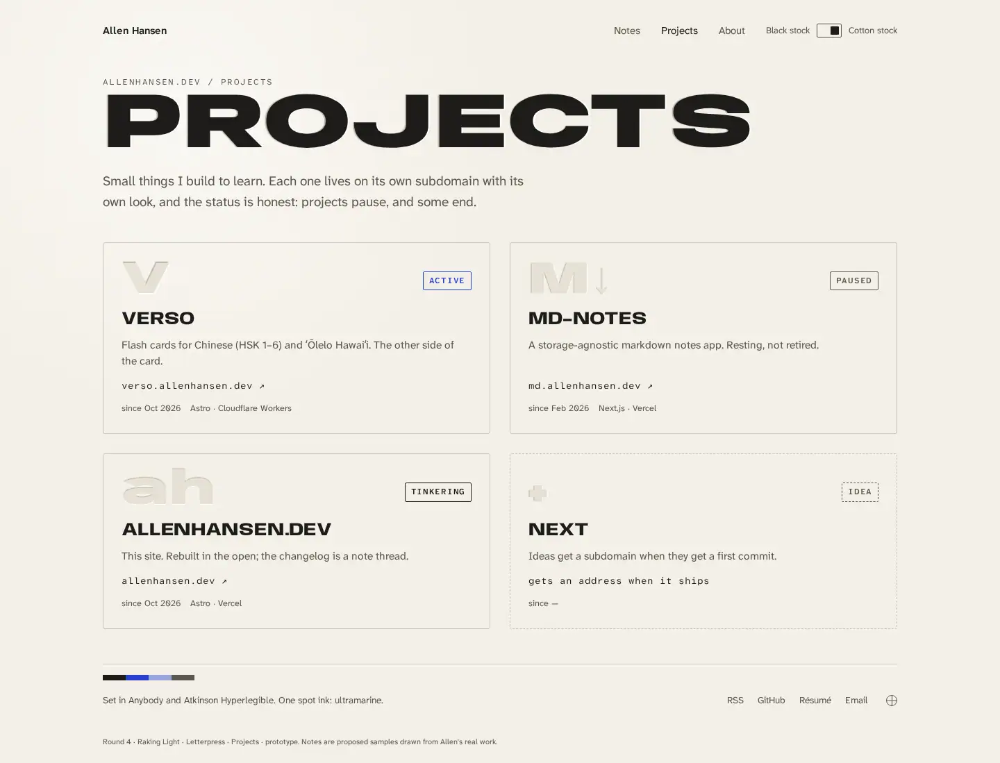

Letterpress Projects, Cotton stock theme (light mode), desktop.

**[`2-letterpress-projects-light-mobile.webp`](2-letterpress-projects-light-mobile.webp)**
· 600 × 2755, full-page capture

Letterpress Projects, Cotton stock theme (light mode), phone.

### About

About, with the short bio, contact links, the timed Boba photo rotator, and a
colophon. The rotator later became two still photos.

**[`2-letterpress-about-dark.webp`](2-letterpress-about-dark.webp)** · 1440 ×
1349

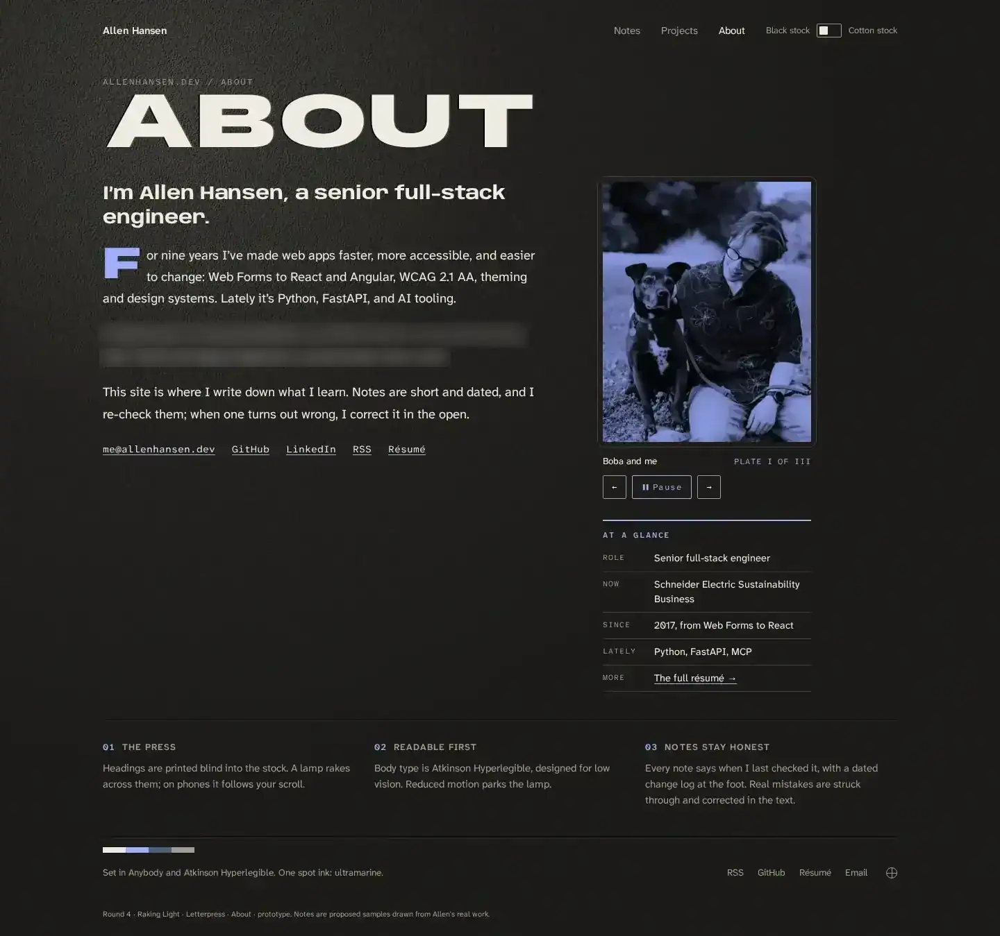

Letterpress About, Black stock theme (dark mode), desktop. Lines of draft copy
with personal details that never went on the site are blurred.

**[`2-letterpress-about-dark-mobile.webp`](2-letterpress-about-dark-mobile.webp)**
· 600 × 3443, full-page capture

Letterpress About, Black stock theme (dark mode), phone. Lines of draft copy
with personal details that never went on the site are blurred.

**[`2-letterpress-about-light.webp`](2-letterpress-about-light.webp)** · 1440 ×
1349

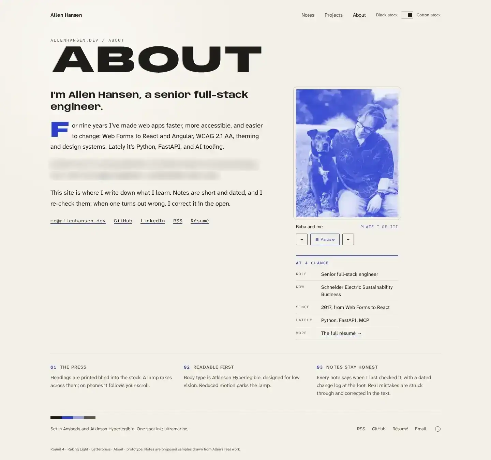

Letterpress About, Cotton stock theme (light mode), desktop. Lines of draft copy
with personal details that never went on the site are blurred.

**[`2-letterpress-about-light-mobile.webp`](2-letterpress-about-light-mobile.webp)**
· 600 × 3443, full-page capture

Letterpress About, Cotton stock theme (light mode), phone. Lines of draft copy
with personal details that never went on the site are blurred.

### Résumé

The Résumé, built from the real résumé data, with the current role shown as a
marked placeholder.

**[`2-letterpress-resume-dark.webp`](2-letterpress-resume-dark.webp)** · 827 ×
1600

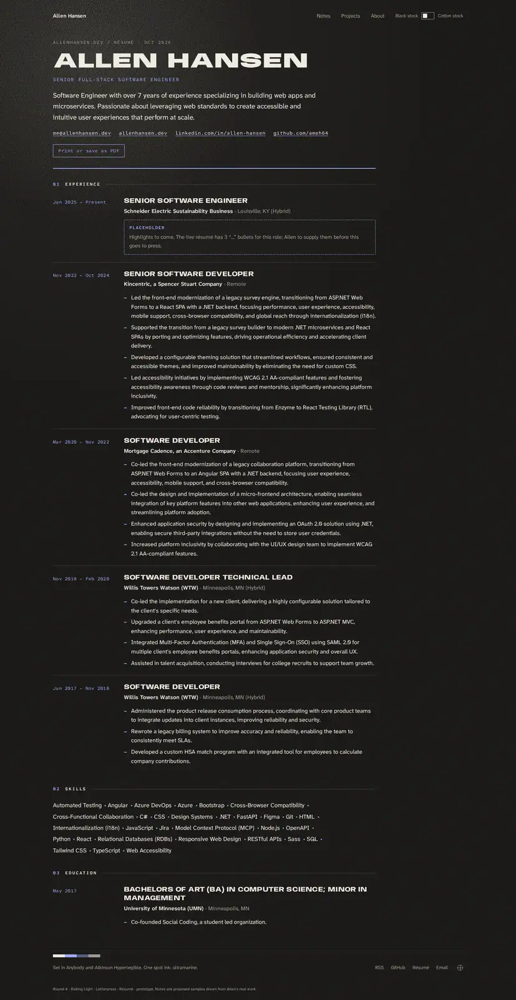

Letterpress Résumé, Black stock theme (dark mode), desktop.

**[`2-letterpress-resume-dark-mobile.webp`](2-letterpress-resume-dark-mobile.webp)**
· 600 × 7089, full-page capture

Letterpress Résumé, Black stock theme (dark mode), phone.

**[`2-letterpress-resume-light.webp`](2-letterpress-resume-light.webp)** · 827 ×
1600

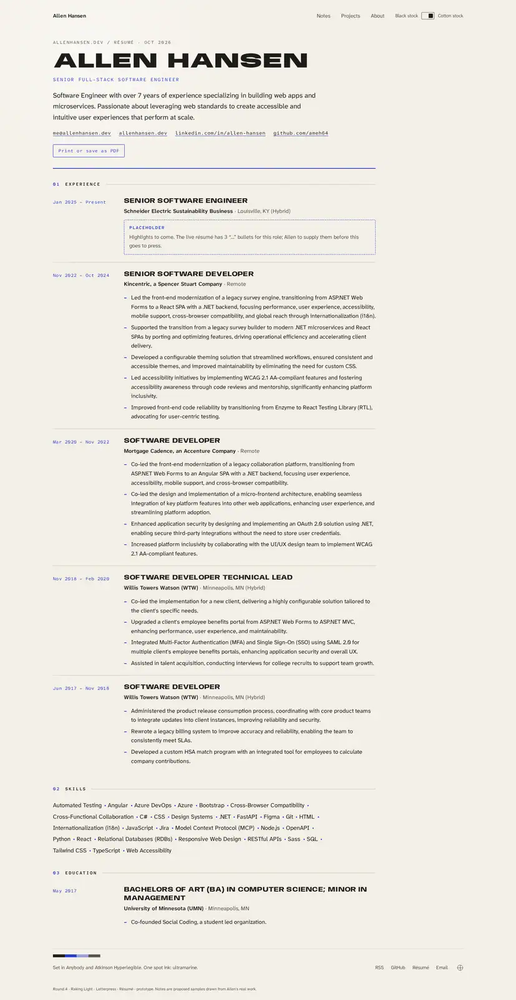

Letterpress Résumé, Cotton stock theme (light mode), desktop.

**[`2-letterpress-resume-light-mobile.webp`](2-letterpress-resume-light-mobile.webp)**
· 600 × 7089, full-page capture

Letterpress Résumé, Cotton stock theme (light mode), phone.

## Etched Glass

### Home

Home, with the large name, the intro line, the latest notes, and the "From the
archive" resurfaced note. Allen liked its colors but felt it read too much like
Verso.

**[`3-etched-glass-home-dark.webp`](3-etched-glass-home-dark.webp)** · 1289 ×
1600

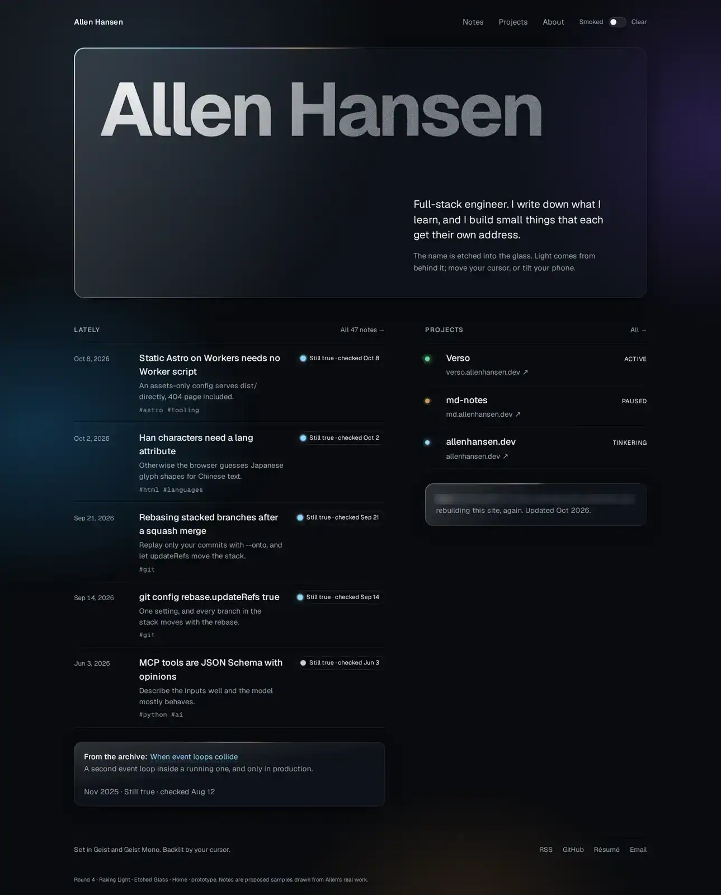

Etched Glass Home, Smoked theme (dark mode), desktop. Lines of draft copy with
personal details that never went on the site are blurred.

**[`3-etched-glass-video-contact-sheet.webp`](3-etched-glass-video-contact-sheet.webp)**
· 1600 × 800

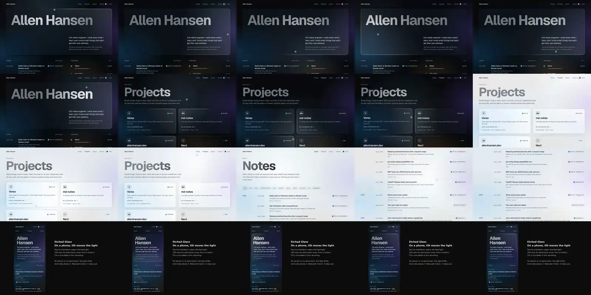

Frames from the Etched Glass interaction video: the desktop pointer segment,
then the phone segment. The video isn't included here; this sheet stands in for
it.

**[`3-etched-glass-home-dark-mobile.webp`](3-etched-glass-home-dark-mobile.webp)**
· 600 × 3795, full-page capture

Etched Glass Home, Smoked theme (dark mode), phone. Lines of draft copy with
personal details that never went on the site are blurred.

**[`3-etched-glass-home-light.webp`](3-etched-glass-home-light.webp)** · 1289 ×
1600

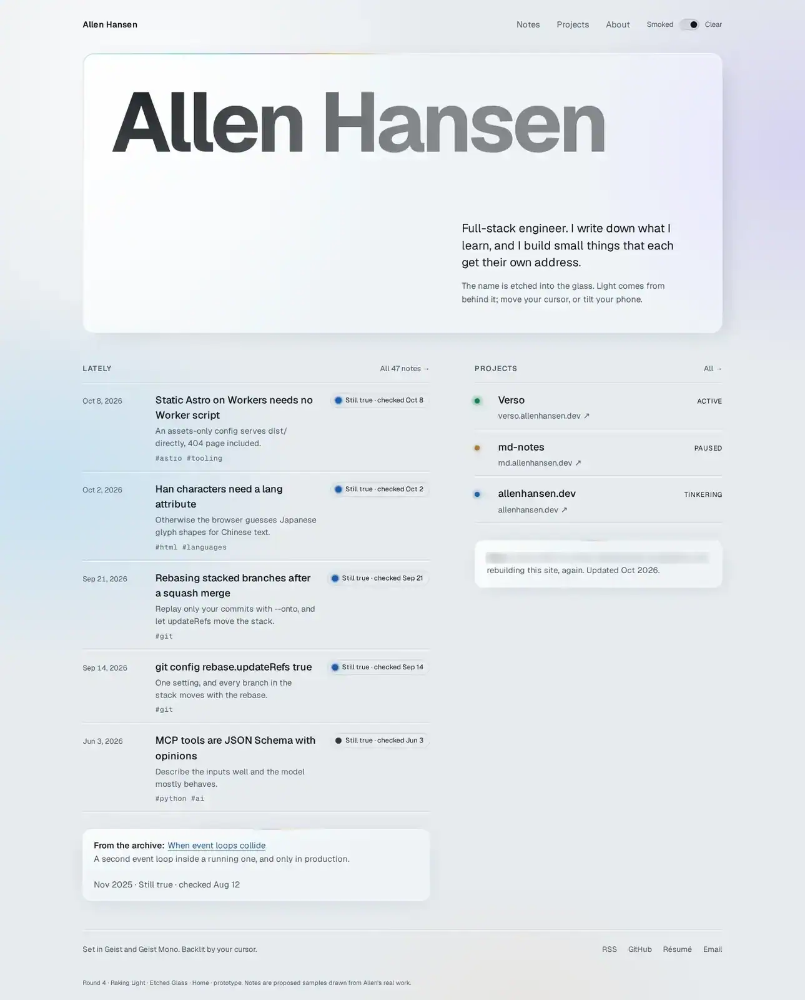

Etched Glass Home, Clear theme (light mode), desktop. Lines of draft copy with
personal details that never went on the site are blurred.

**[`3-etched-glass-home-light-mobile.webp`](3-etched-glass-home-light-mobile.webp)**
· 600 × 3795, full-page capture

Etched Glass Home, Clear theme (light mode), phone. Lines of draft copy with
personal details that never went on the site are blurred.

### Notes

The Notes index, where every row says when the note was last checked.

**[`3-etched-glass-notes-dark.webp`](3-etched-glass-notes-dark.webp)** · 1243 ×
1600

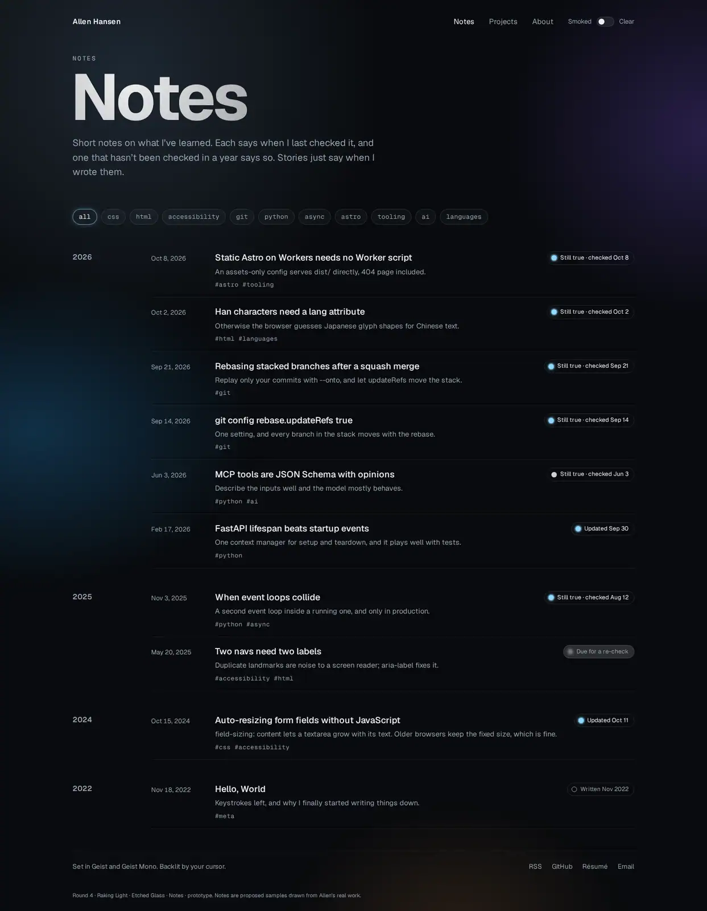

Etched Glass Notes, Smoked theme (dark mode), desktop.

**[`3-etched-glass-notes-dark-mobile.webp`](3-etched-glass-notes-dark-mobile.webp)**
· 600 × 4723, full-page capture

Etched Glass Notes, Smoked theme (dark mode), phone.

**[`3-etched-glass-notes-light.webp`](3-etched-glass-notes-light.webp)** · 1243
× 1600

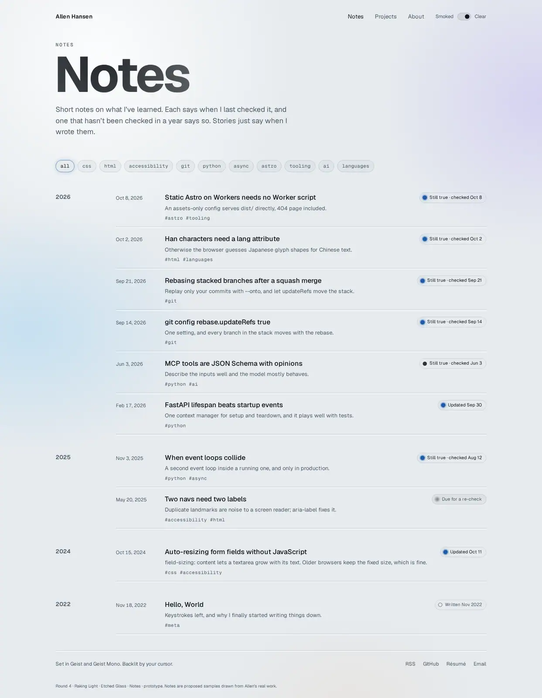

Etched Glass Notes, Clear theme (light mode), desktop.

**[`3-etched-glass-notes-light-mobile.webp`](3-etched-glass-notes-light-mobile.webp)**
· 600 × 4723, full-page capture

Etched Glass Notes, Clear theme (light mode), phone.

### Note

A note page (a paraphrase of the field-sizing post) with a freshness status, a
sample inline correction, a dated change log, and the "Spot something wrong or
outdated?" link.

**[`3-etched-glass-note-dark.webp`](3-etched-glass-note-dark.webp)** · 1041 ×
1600

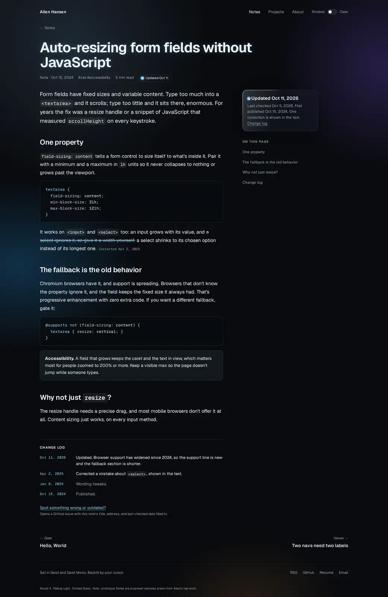

Etched Glass Note, Smoked theme (dark mode), desktop.

**[`3-etched-glass-note-dark-mobile.webp`](3-etched-glass-note-dark-mobile.webp)**
· 600 × 5095, full-page capture

Etched Glass Note, Smoked theme (dark mode), phone.

**[`3-etched-glass-note-light.webp`](3-etched-glass-note-light.webp)** · 1041 ×
1600

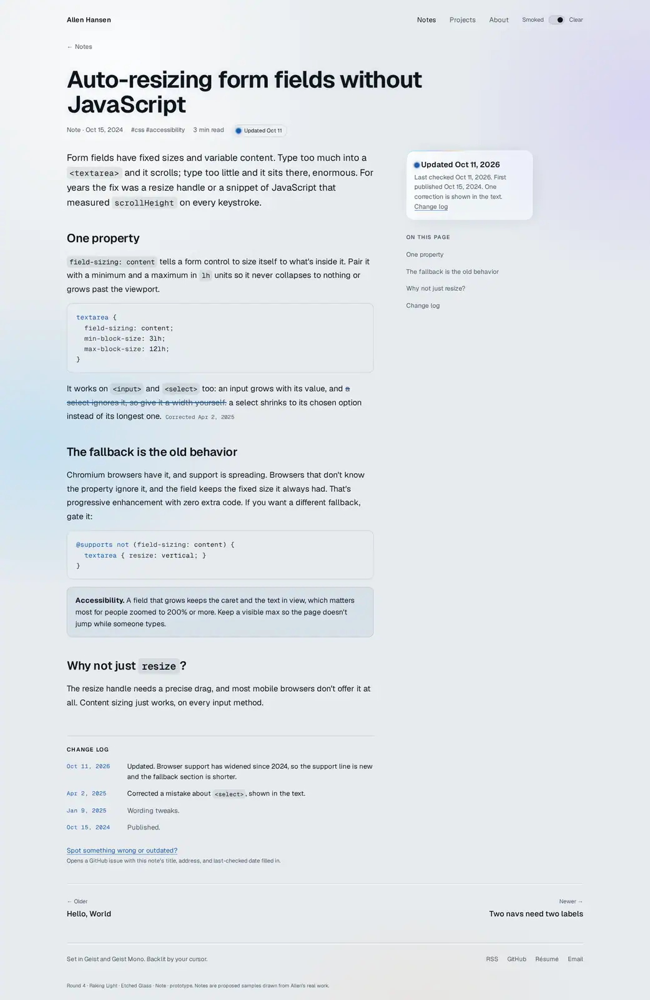

Etched Glass Note, Clear theme (light mode), desktop.

**[`3-etched-glass-note-light-mobile.webp`](3-etched-glass-note-light-mobile.webp)**
· 600 × 5095, full-page capture

Etched Glass Note, Clear theme (light mode), phone.

### Projects

Projects, as subdomain cards with an honest status.

**[`3-etched-glass-projects-dark.webp`](3-etched-glass-projects-dark.webp)** ·
1440 × 1099

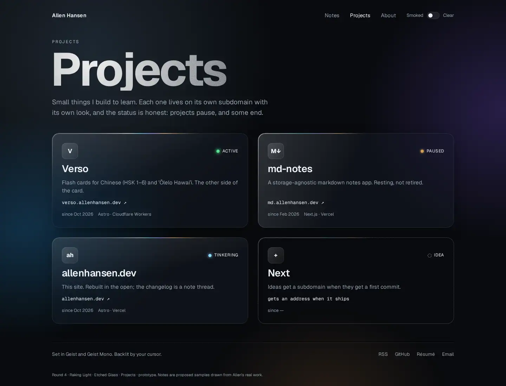

Etched Glass Projects, Smoked theme (dark mode), desktop.

**[`3-etched-glass-projects-dark-mobile.webp`](3-etched-glass-projects-dark-mobile.webp)**
· 600 × 2780, full-page capture

Etched Glass Projects, Smoked theme (dark mode), phone.

**[`3-etched-glass-projects-light.webp`](3-etched-glass-projects-light.webp)** ·
1440 × 1099

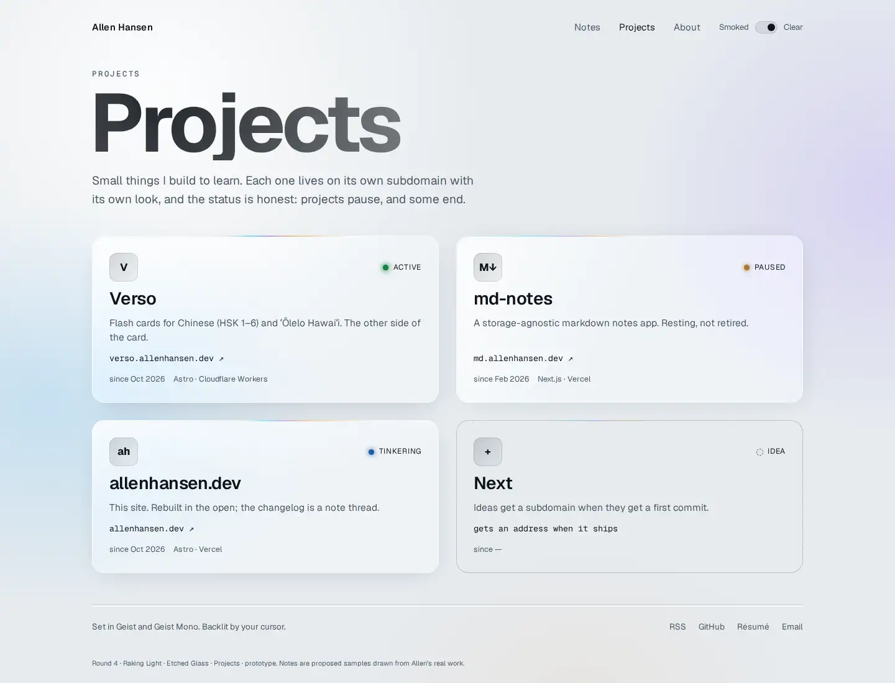

Etched Glass Projects, Clear theme (light mode), desktop.

**[`3-etched-glass-projects-light-mobile.webp`](3-etched-glass-projects-light-mobile.webp)**
· 600 × 2780, full-page capture

Etched Glass Projects, Clear theme (light mode), phone.

### About

About, with the short bio, contact links, the timed Boba photo rotator, and a
colophon.

**[`3-etched-glass-about-dark.webp`](3-etched-glass-about-dark.webp)** · 1440 ×
1087

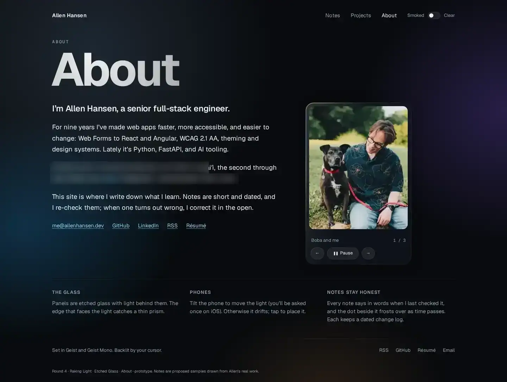

Etched Glass About, Smoked theme (dark mode), desktop. Lines of draft copy with
personal details that never went on the site are blurred.

**[`3-etched-glass-about-dark-mobile.webp`](3-etched-glass-about-dark-mobile.webp)**
· 600 × 3000, full-page capture

Etched Glass About, Smoked theme (dark mode), phone. Lines of draft copy with
personal details that never went on the site are blurred.

**[`3-etched-glass-about-light.webp`](3-etched-glass-about-light.webp)** · 1440
× 1087

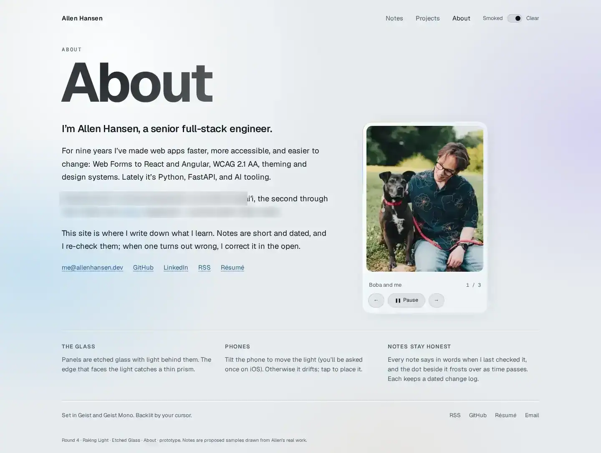

Etched Glass About, Clear theme (light mode), desktop. Lines of draft copy with
personal details that never went on the site are blurred.

**[`3-etched-glass-about-light-mobile.webp`](3-etched-glass-about-light-mobile.webp)**
· 600 × 3000, full-page capture

Etched Glass About, Clear theme (light mode), phone. Lines of draft copy with
personal details that never went on the site are blurred.

### Résumé

The Résumé, built from the real résumé data, with the current role shown as a
marked placeholder.

**[`3-etched-glass-resume-dark.webp`](3-etched-glass-resume-dark.webp)** · 1000
× 2103

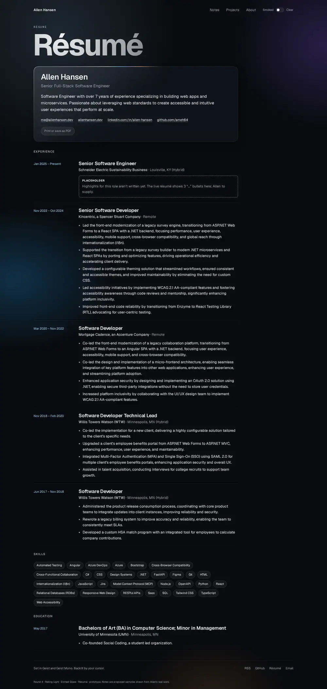

Etched Glass Résumé, Smoked theme (dark mode), desktop.

**[`3-etched-glass-resume-dark-mobile.webp`](3-etched-glass-resume-dark-mobile.webp)**
· 600 × 7402, full-page capture

Etched Glass Résumé, Smoked theme (dark mode), phone.

**[`3-etched-glass-resume-light.webp`](3-etched-glass-resume-light.webp)** ·
1000 × 2103

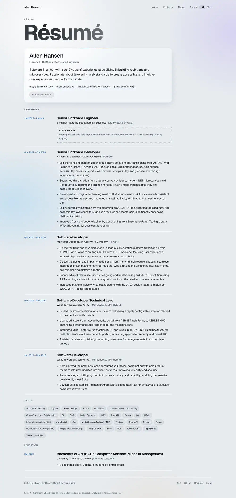

Etched Glass Résumé, Clear theme (light mode), desktop.

**[`3-etched-glass-resume-light-mobile.webp`](3-etched-glass-resume-light-mobile.webp)**
· 600 × 7402, full-page capture

Etched Glass Résumé, Clear theme (light mode), phone.

## Lamp + Ink

### Home

Home, with the large name, the intro line, the latest notes, and the "From the
archive" resurfaced note. Built as a quieter fallback; Allen was lukewarm on its
"ah" monogram.

**[`4-lamp-ink-home-dark.webp`](4-lamp-ink-home-dark.webp)** · 1281 × 1600

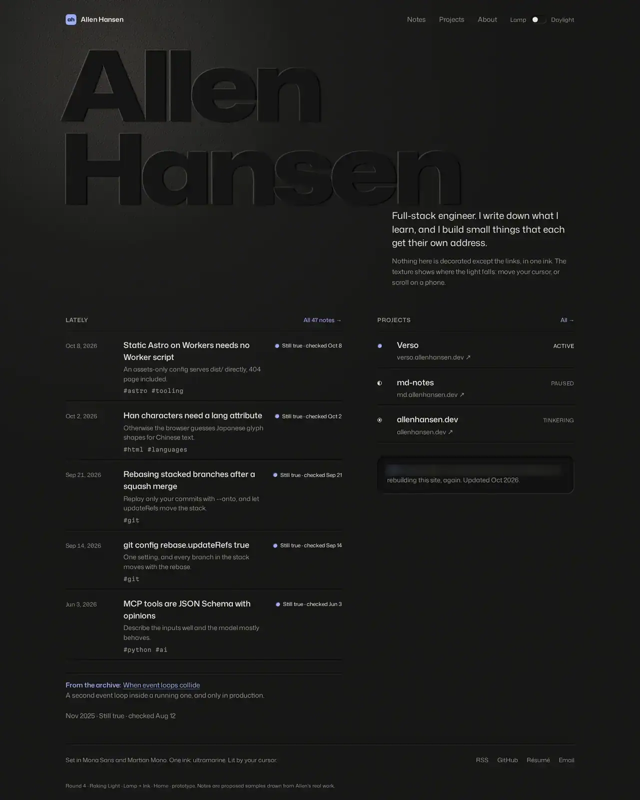

Lamp + Ink Home, Lamp theme (dark mode), desktop. Lines of draft copy with
personal details that never went on the site are blurred.

**[`4-lamp-ink-video-contact-sheet.webp`](4-lamp-ink-video-contact-sheet.webp)**
· 1600 × 800

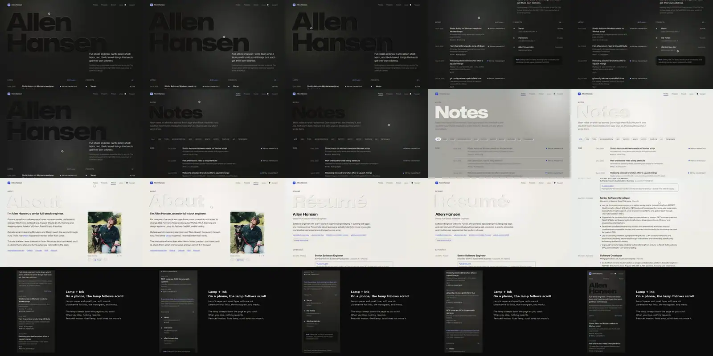

Frames from the Lamp + Ink interaction video: the desktop pointer segment, then
the phone segment. The video isn't included here; this sheet stands in for it.

**[`4-lamp-ink-home-dark-mobile.webp`](4-lamp-ink-home-dark-mobile.webp)** · 600
× 3680, full-page capture

Lamp + Ink Home, Lamp theme (dark mode), phone. Lines of draft copy with
personal details that never went on the site are blurred.

**[`4-lamp-ink-home-light.webp`](4-lamp-ink-home-light.webp)** · 1281 × 1600

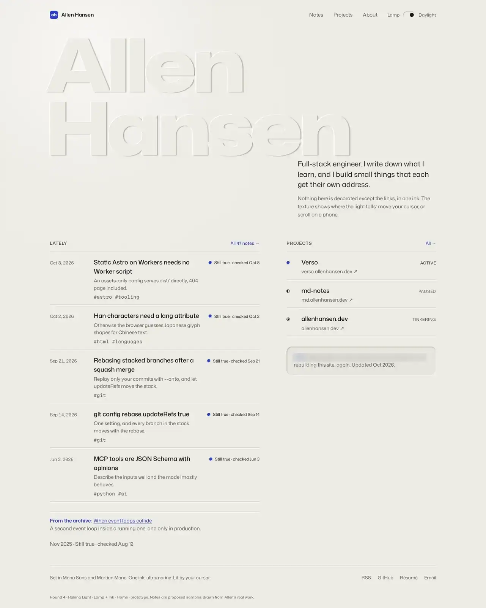

Lamp + Ink Home, Daylight theme (light mode), desktop. Lines of draft copy with
personal details that never went on the site are blurred.

**[`4-lamp-ink-home-light-mobile.webp`](4-lamp-ink-home-light-mobile.webp)** ·
600 × 3680, full-page capture

Lamp + Ink Home, Daylight theme (light mode), phone. Lines of draft copy with
personal details that never went on the site are blurred.

### Notes

The Notes index, where every row says when the note was last checked.

**[`4-lamp-ink-notes-dark.webp`](4-lamp-ink-notes-dark.webp)** · 1239 × 1600

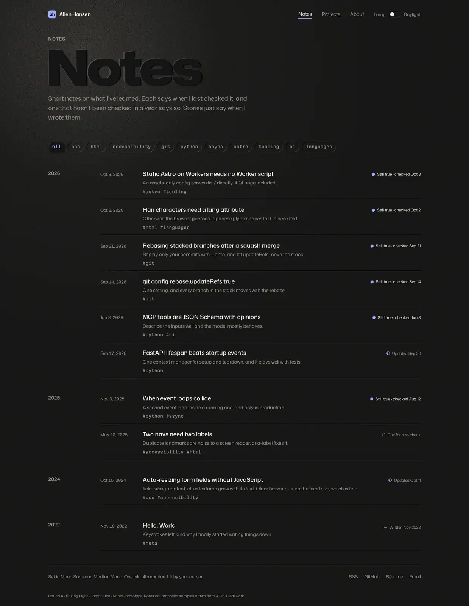

Lamp + Ink Notes, Lamp theme (dark mode), desktop.

**[`4-lamp-ink-notes-dark-mobile.webp`](4-lamp-ink-notes-dark-mobile.webp)** ·
600 × 4565, full-page capture

Lamp + Ink Notes, Lamp theme (dark mode), phone.

**[`4-lamp-ink-notes-light.webp`](4-lamp-ink-notes-light.webp)** · 1239 × 1600

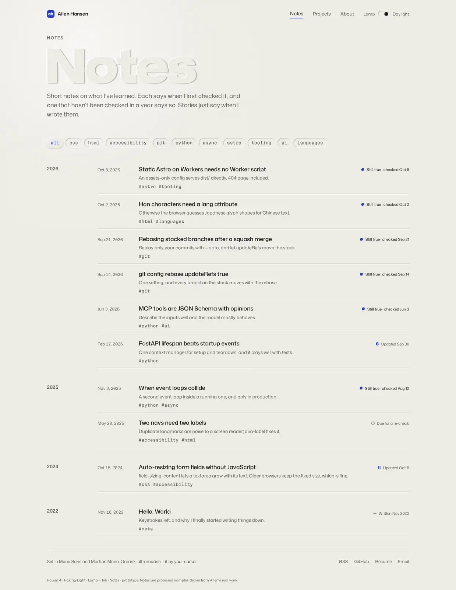

Lamp + Ink Notes, Daylight theme (light mode), desktop.

**[`4-lamp-ink-notes-light-mobile.webp`](4-lamp-ink-notes-light-mobile.webp)** ·
600 × 4565, full-page capture

Lamp + Ink Notes, Daylight theme (light mode), phone.

### Note

A note page (a paraphrase of the field-sizing post) with a freshness status, a
sample inline correction, a dated change log, and the "Spot something wrong or
outdated?" link.

**[`4-lamp-ink-note-dark.webp`](4-lamp-ink-note-dark.webp)** · 1046 × 1600

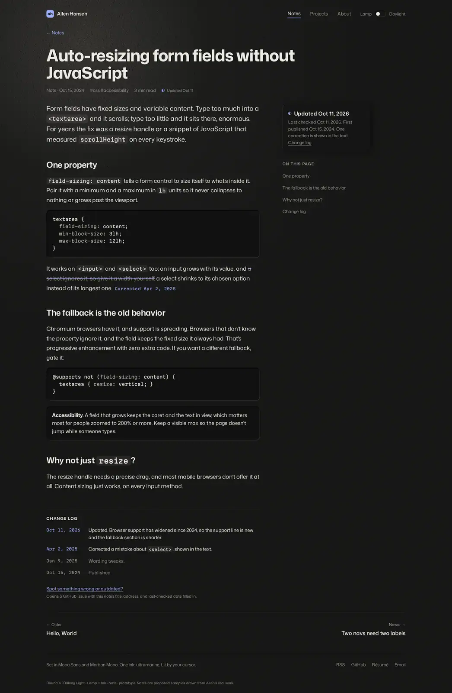

Lamp + Ink Note, Lamp theme (dark mode), desktop.

**[`4-lamp-ink-note-dark-mobile.webp`](4-lamp-ink-note-dark-mobile.webp)** · 600
× 5117, full-page capture

Lamp + Ink Note, Lamp theme (dark mode), phone.

**[`4-lamp-ink-note-light.webp`](4-lamp-ink-note-light.webp)** · 1046 × 1600

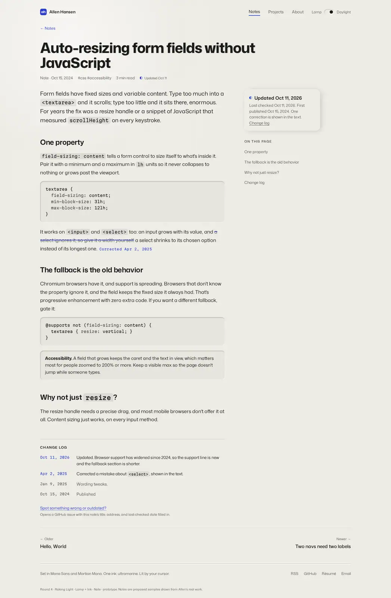

Lamp + Ink Note, Daylight theme (light mode), desktop.

**[`4-lamp-ink-note-light-mobile.webp`](4-lamp-ink-note-light-mobile.webp)** ·
600 × 5117, full-page capture

Lamp + Ink Note, Daylight theme (light mode), phone.

### Projects

Projects, as subdomain cards with an honest status.

**[`4-lamp-ink-projects-dark.webp`](4-lamp-ink-projects-dark.webp)** · 1440 ×
1101

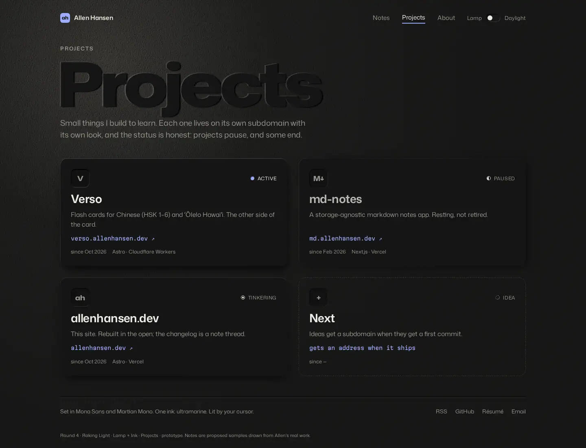

Lamp + Ink Projects, Lamp theme (dark mode), desktop.

**[`4-lamp-ink-projects-dark-mobile.webp`](4-lamp-ink-projects-dark-mobile.webp)**
· 600 × 2786, full-page capture

Lamp + Ink Projects, Lamp theme (dark mode), phone.

**[`4-lamp-ink-projects-light.webp`](4-lamp-ink-projects-light.webp)** · 1440 ×
1101

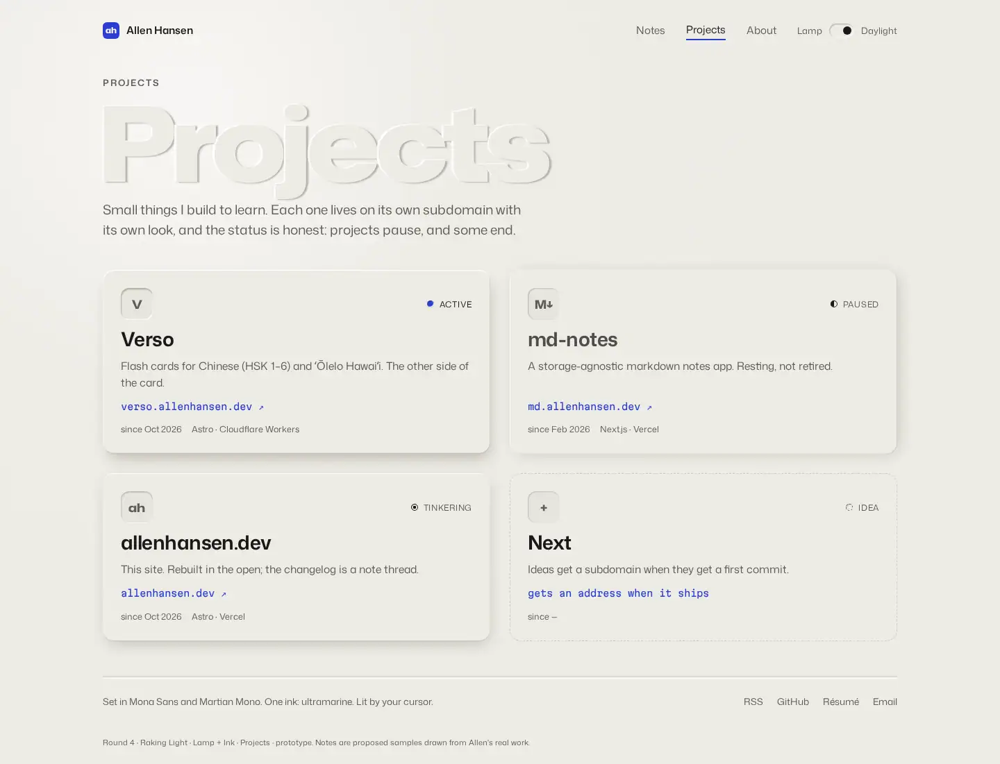

Lamp + Ink Projects, Daylight theme (light mode), desktop.

**[`4-lamp-ink-projects-light-mobile.webp`](4-lamp-ink-projects-light-mobile.webp)**
· 600 × 2786, full-page capture

Lamp + Ink Projects, Daylight theme (light mode), phone.

### About

About, with the short bio, contact links, the timed Boba photo rotator, and a
colophon.

**[`4-lamp-ink-about-dark.webp`](4-lamp-ink-about-dark.webp)** · 1440 × 1089

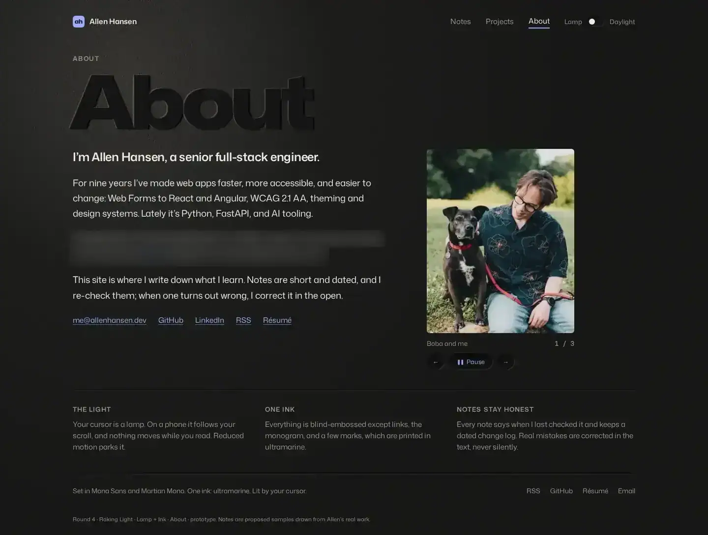

Lamp + Ink About, Lamp theme (dark mode), desktop. Lines of draft copy with
personal details that never went on the site are blurred.

**[`4-lamp-ink-about-dark-mobile.webp`](4-lamp-ink-about-dark-mobile.webp)** ·
600 × 3137, full-page capture

Lamp + Ink About, Lamp theme (dark mode), phone. Lines of draft copy with
personal details that never went on the site are blurred.

**[`4-lamp-ink-about-light.webp`](4-lamp-ink-about-light.webp)** · 1440 × 1089

Lamp + Ink About, Daylight theme (light mode), desktop. Lines of draft copy with
personal details that never went on the site are blurred.

**[`4-lamp-ink-about-light-mobile.webp`](4-lamp-ink-about-light-mobile.webp)** ·
600 × 3137, full-page capture

Lamp + Ink About, Daylight theme (light mode), phone. Lines of draft copy with
personal details that never went on the site are blurred.

### Résumé

The Résumé, built from the real résumé data, with the current role shown as a
marked placeholder.

**[`4-lamp-ink-resume-dark.webp`](4-lamp-ink-resume-dark.webp)** · 1000 × 2083

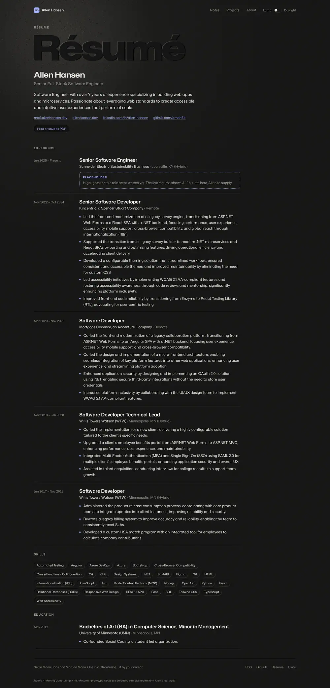

Lamp + Ink Résumé, Lamp theme (dark mode), desktop.

**[`4-lamp-ink-resume-dark-mobile.webp`](4-lamp-ink-resume-dark-mobile.webp)** ·
600 × 7320, full-page capture

Lamp + Ink Résumé, Lamp theme (dark mode), phone.

**[`4-lamp-ink-resume-light.webp`](4-lamp-ink-resume-light.webp)** · 1000 × 2083

Lamp + Ink Résumé, Daylight theme (light mode), desktop.

**[`4-lamp-ink-resume-light-mobile.webp`](4-lamp-ink-resume-light-mobile.webp)**
· 600 × 7320, full-page capture

Lamp + Ink Résumé, Daylight theme (light mode), phone.

## Comparison sheets

**[`compare-about-desktop-dark.webp`](compare-about-desktop-dark.webp)** · 1600
× 457

All four variations side by side: About, desktop, dark mode. Allen compared the
variations page by page with sheets like this.

**[`compare-home-desktop-dark.webp`](compare-home-desktop-dark.webp)** · 1600 ×
574

All four variations side by side: Home, desktop, dark mode. Allen compared the
variations page by page with sheets like this.

**[`compare-note-desktop-dark.webp`](compare-note-desktop-dark.webp)** · 1600 ×
682

All four variations side by side: Note, desktop, dark mode. Allen compared the
variations page by page with sheets like this.

**[`compare-notes-desktop-dark.webp`](compare-notes-desktop-dark.webp)** · 1600
× 590

All four variations side by side: Notes, desktop, dark mode. Allen compared the
variations page by page with sheets like this.

**[`compare-projects-desktop-dark.webp`](compare-projects-desktop-dark.webp)** ·
1600 × 392

All four variations side by side: Projects, desktop, dark mode. Allen compared
the variations page by page with sheets like this.

**[`compare-resume-desktop-dark.webp`](compare-resume-desktop-dark.webp)** ·
1600 × 895

All four variations side by side: Résumé, desktop, dark mode. Allen compared the
variations page by page with sheets like this.

**[`compare-about-mobile-dark.webp`](compare-about-mobile-dark.webp)** · 1148 ×
1600

All four variations side by side: About, phone, dark mode. Allen compared the
variations page by page with sheets like this. Lines of draft copy with personal
details that never went on the site are blurred.

**[`compare-home-mobile-dark.webp`](compare-home-mobile-dark.webp)** · 1039 ×
1600

All four variations side by side: Home, phone, dark mode. Allen compared the
variations page by page with sheets like this. Lines of draft copy with personal
details that never went on the site are blurred.

**[`compare-note-mobile-dark.webp`](compare-note-mobile-dark.webp)** · 600 ×
1229

All four variations side by side: Note, phone, dark mode. Allen compared the
variations page by page with sheets like this.

**[`compare-notes-mobile-dark.webp`](compare-notes-mobile-dark.webp)** · 857 ×
1600

All four variations side by side: Notes, phone, dark mode. Allen compared the
variations page by page with sheets like this.

**[`compare-projects-mobile-dark.webp`](compare-projects-mobile-dark.webp)** ·
1391 × 1600

All four variations side by side: Projects, phone, dark mode. Allen compared the
variations page by page with sheets like this.

**[`compare-resume-mobile-dark.webp`](compare-resume-mobile-dark.webp)** · 600 ×
1715, full-page capture

All four variations side by side: Résumé, phone, dark mode. Allen compared the
variations page by page with sheets like this.

**[`compare-about-desktop-light.webp`](compare-about-desktop-light.webp)** ·
1600 × 457

All four variations side by side: About, desktop, light mode. Allen compared the
variations page by page with sheets like this.

**[`compare-home-desktop-light.webp`](compare-home-desktop-light.webp)** · 1600
× 574

All four variations side by side: Home, desktop, light mode. Allen compared the
variations page by page with sheets like this.

**[`compare-note-desktop-light.webp`](compare-note-desktop-light.webp)** · 1600
× 682

All four variations side by side: Note, desktop, light mode. Allen compared the
variations page by page with sheets like this.

**[`compare-notes-desktop-light.webp`](compare-notes-desktop-light.webp)** ·
1600 × 590

All four variations side by side: Notes, desktop, light mode. Allen compared the
variations page by page with sheets like this.

**[`compare-projects-desktop-light.webp`](compare-projects-desktop-light.webp)**
· 1600 × 392

All four variations side by side: Projects, desktop, light mode. Allen compared
the variations page by page with sheets like this.

**[`compare-resume-desktop-light.webp`](compare-resume-desktop-light.webp)** ·
1600 × 895

All four variations side by side: Résumé, desktop, light mode. Allen compared
the variations page by page with sheets like this.

**[`compare-about-mobile-light.webp`](compare-about-mobile-light.webp)** · 1148
× 1600

All four variations side by side: About, phone, light mode. Allen compared the
variations page by page with sheets like this. Lines of draft copy with personal
details that never went on the site are blurred.

**[`compare-home-mobile-light.webp`](compare-home-mobile-light.webp)** · 1039 ×
1600

All four variations side by side: Home, phone, light mode. Allen compared the
variations page by page with sheets like this. Lines of draft copy with personal
details that never went on the site are blurred.

**[`compare-note-mobile-light.webp`](compare-note-mobile-light.webp)** · 600 ×
1229

All four variations side by side: Note, phone, light mode. Allen compared the
variations page by page with sheets like this.

**[`compare-notes-mobile-light.webp`](compare-notes-mobile-light.webp)** · 857 ×
1600

All four variations side by side: Notes, phone, light mode. Allen compared the
variations page by page with sheets like this.

**[`compare-projects-mobile-light.webp`](compare-projects-mobile-light.webp)** ·
1391 × 1600

All four variations side by side: Projects, phone, light mode. Allen compared
the variations page by page with sheets like this.

**[`compare-resume-mobile-light.webp`](compare-resume-mobile-light.webp)** · 600
× 1715, full-page capture

All four variations side by side: Résumé, phone, light mode. Allen compared the
variations page by page with sheets like this.

## QA captures

**[`qa-fallbacks.webp`](qa-fallbacks.webp)** · 1600 × 330

Accessibility fallbacks side by side: Lamp with `prefers-contrast: more`, Lamp
in forced colors, and Etched Glass with reduced transparency. With the effects
off, every page is still plain readable type.

**[`qa-paper-baked-vs-live.webp`](qa-paper-baked-vs-live.webp)** · 1440 × 1214

The live SVG lighting filter (top) and the pre-rendered paper layers (bottom) at
the same lamp position. The baked layers ran at about 54 fps under a 4× CPU
throttle against about 31 for the live filter, so they became the default and
later shipped.

**[`qa-v1-contrast-more.webp`](qa-v1-contrast-more.webp)** · 1440 × 900

Lamp with `prefers-contrast: more`: paper and emboss shading are off and display
text is solid ink.

**[`qa-v1-forced-colors.webp`](qa-v1-forced-colors.webp)** · 1440 × 900

Lamp in forced-colors mode, using system colors, with the theme switch knob
still visible.

**[`qa-v3-default.webp`](qa-v3-default.webp)** · 1440 × 900

Etched Glass with its normal backdrop blur, the baseline for the next two
captures.

**[`qa-v3-low-power.webp`](qa-v3-low-power.webp)** · 1440 × 900

Etched Glass in low-power mode: the blur is dropped and the panes turn
near-solid, which got it to 60 fps.

**[`qa-v3-reduced-transparency.webp`](qa-v3-reduced-transparency.webp)** · 1440
× 900

Etched Glass with `prefers-reduced-transparency`: solid tinted panes.

**[`qa-v2-contrast-more-light.webp`](qa-v2-contrast-more-light.webp)** · 1440 ×
900

Letterpress on Cotton stock with `prefers-contrast: more`.
