# Round 5: refined Letterpress or a Letterpress and Etched Glass hybrid

[All images](../README.md) · [Narrative](../../06-round-5-letterpress.md)

Two options built to settle Letterpress against Etched Glass, plus the
photo-treatment and toggle-wording studies. Allen picked 2-refined with the
"Lights" switch and the low ink tint photo, then chose the indigo-black dark
stock from the last comparison.

## 2-refined

### Home

The narrower wordmark and the ultramarine-square logo shipped as designed here.

**[`2-refined-home-dark.webp`](2-refined-home-dark.webp)** · 1283 × 1600

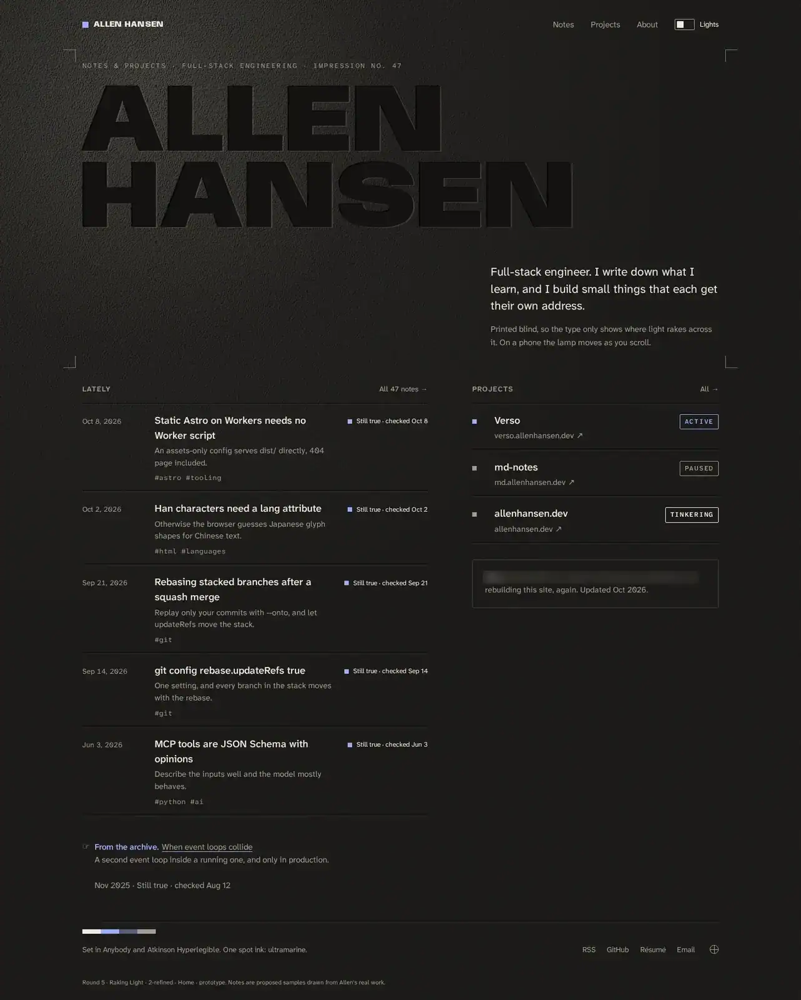

2-refined, Home, dark mode, desktop. Lines of draft copy with personal details
that never went on the site are blurred.

**[`2-refined-home-dark-mobile.webp`](2-refined-home-dark-mobile.webp)** · 600 ×
3848, full-page capture

2-refined, Home, dark mode, phone. Lines of draft copy with personal details
that never went on the site are blurred.

**[`2-refined-home-light.webp`](2-refined-home-light.webp)** · 1283 × 1600

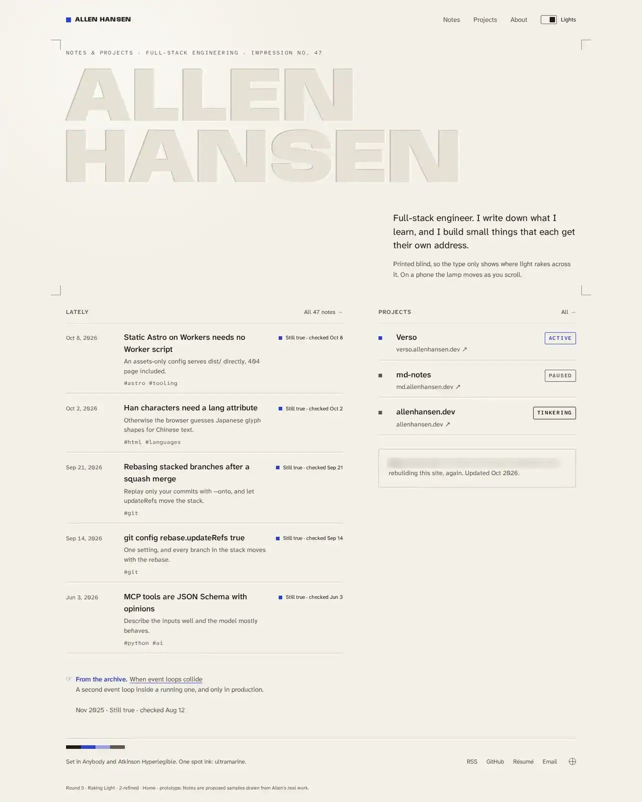

2-refined, Home, light mode, desktop. Lines of draft copy with personal details
that never went on the site are blurred.

**[`2-refined-home-light-mobile.webp`](2-refined-home-light-mobile.webp)** · 600
× 3848, full-page capture

2-refined, Home, light mode, phone. Lines of draft copy with personal details
that never went on the site are blurred.

### About

The About capture was updated to the low ink tint Allen picked, with no frame.

**[`2-refined-about-dark.webp`](2-refined-about-dark.webp)** · 1440 × 1346

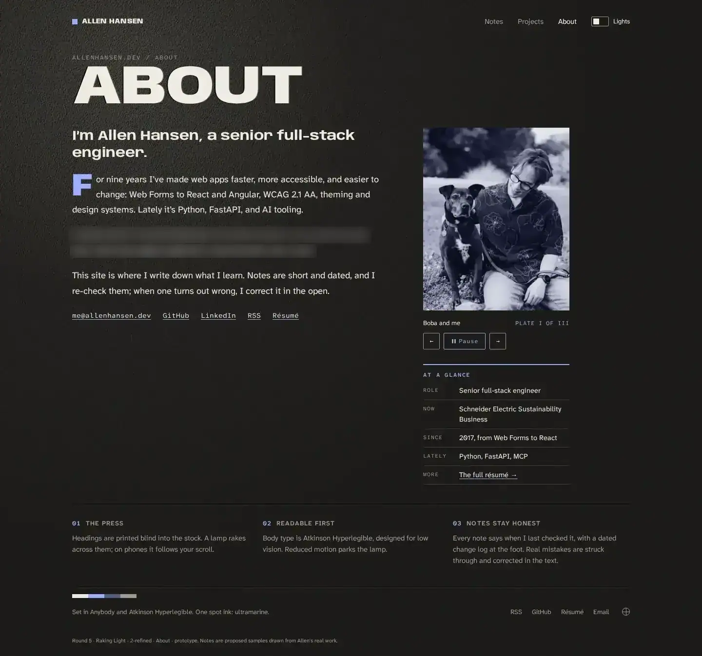

2-refined, About, dark mode, desktop. Lines of draft copy with personal details
that never went on the site are blurred.

**[`2-refined-about-dark-mobile.webp`](2-refined-about-dark-mobile.webp)** · 600
× 3440, full-page capture

2-refined, About, dark mode, phone. Lines of draft copy with personal details
that never went on the site are blurred.

**[`2-refined-about-light.webp`](2-refined-about-light.webp)** · 1440 × 1346

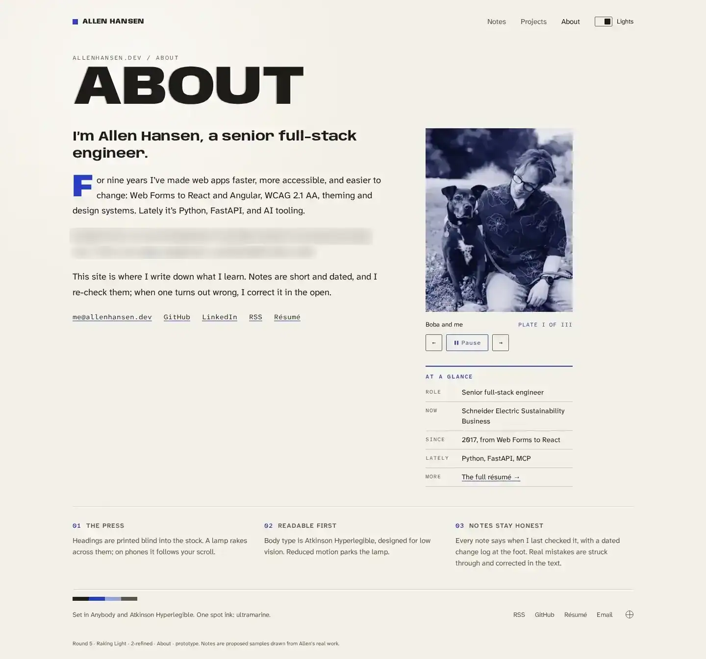

2-refined, About, light mode, desktop. Lines of draft copy with personal details
that never went on the site are blurred.

**[`2-refined-about-light-mobile.webp`](2-refined-about-light-mobile.webp)** ·
600 × 3440, full-page capture

2-refined, About, light mode, phone. Lines of draft copy with personal details
that never went on the site are blurred.

### Photo treatments

Each treatment is a CSS or SVG filter on the same photo.

**[`2-refined-photos-dark.webp`](2-refined-photos-dark.webp)** · 1440 × 995

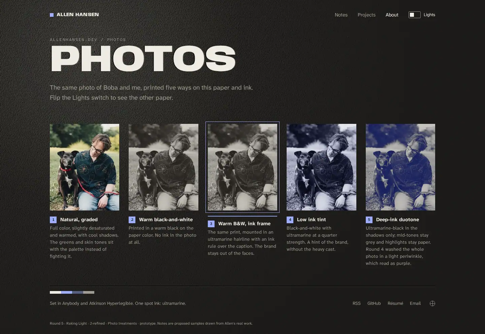

2-refined, the photo-treatment page, dark mode, desktop.

**[`2-refined-photos-dark-mobile.webp`](2-refined-photos-dark-mobile.webp)** ·
600 × 2906, full-page capture

2-refined, the photo-treatment page, dark mode, phone.

**[`2-refined-photos-light.webp`](2-refined-photos-light.webp)** · 1440 × 995

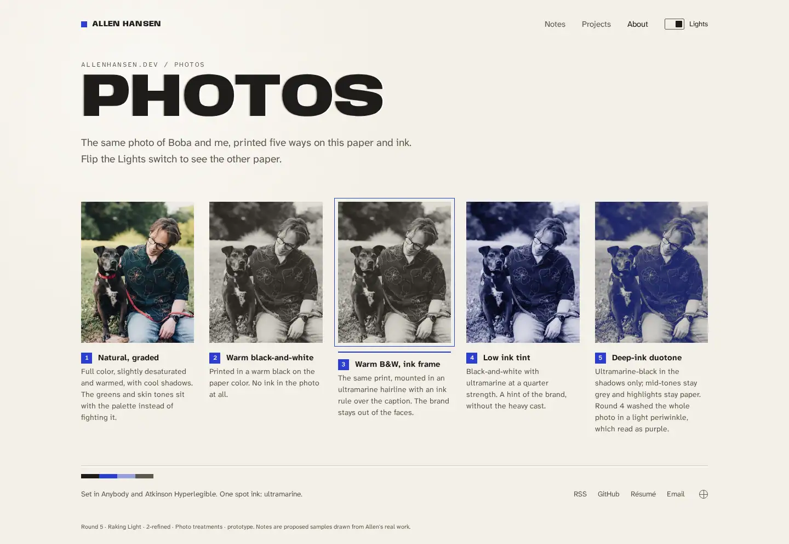

2-refined, the photo-treatment page, light mode, desktop.

**[`2-refined-photos-light-mobile.webp`](2-refined-photos-light-mobile.webp)** ·
600 × 2906, full-page capture

2-refined, the photo-treatment page, light mode, phone.

### Toggle wording

All four wordings work on the page; "Lights" won.

**[`2-refined-toggles-dark.webp`](2-refined-toggles-dark.webp)** · 1440 × 1008

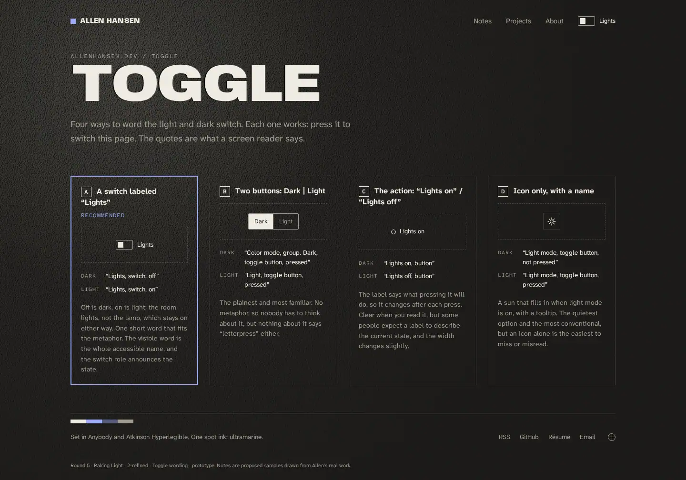

2-refined, the toggle-wording page, dark mode, desktop.

**[`2-refined-toggles-dark-mobile.webp`](2-refined-toggles-dark-mobile.webp)** ·
600 × 3272, full-page capture

2-refined, the toggle-wording page, dark mode, phone.

**[`2-refined-toggles-light.webp`](2-refined-toggles-light.webp)** · 1440 × 1008

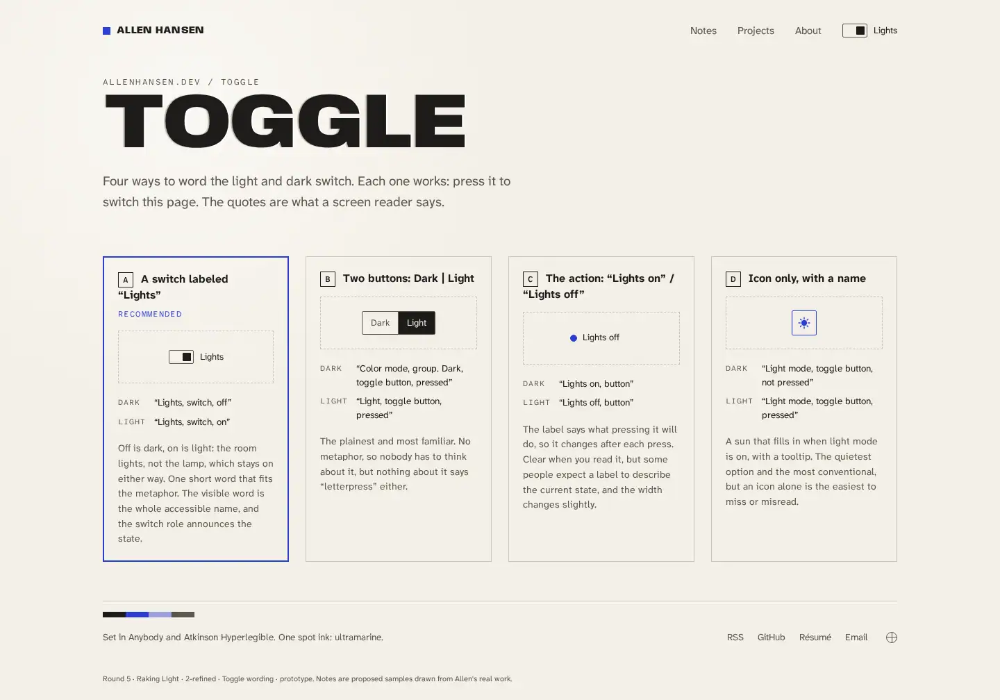

2-refined, the toggle-wording page, light mode, desktop.

**[`2-refined-toggles-light-mobile.webp`](2-refined-toggles-light-mobile.webp)**
· 600 × 3272, full-page capture

2-refined, the toggle-wording page, light mode, phone.

## 2×3 hybrid

### Home

Indigo-black stock, a two-ink name, and one glass pane over the intro. Only the
indigo stock made it into the final design.

**[`2x3-hybrid-home-dark.webp`](2x3-hybrid-home-dark.webp)** · 1284 × 1600

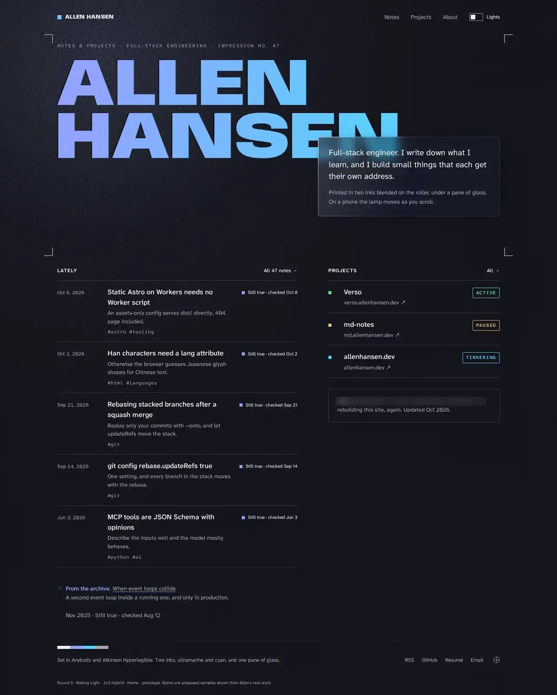

2×3 hybrid, Home, dark mode, desktop. Lines of draft copy with personal details
that never went on the site are blurred.

**[`2x3-hybrid-home-dark-mobile.webp`](2x3-hybrid-home-dark-mobile.webp)** · 600
× 3866, full-page capture

2×3 hybrid, Home, dark mode, phone. Lines of draft copy with personal details
that never went on the site are blurred.

**[`2x3-hybrid-home-light.webp`](2x3-hybrid-home-light.webp)** · 1284 × 1600

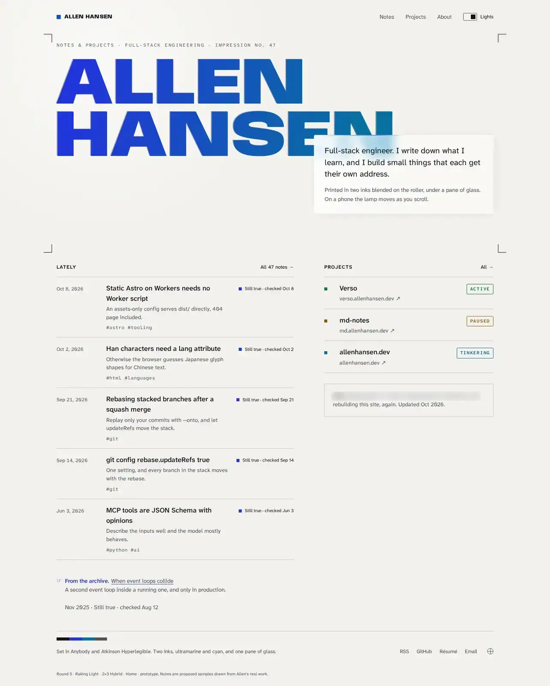

2×3 hybrid, Home, light mode, desktop. Lines of draft copy with personal details
that never went on the site are blurred.

**[`2x3-hybrid-home-light-mobile.webp`](2x3-hybrid-home-light-mobile.webp)** ·
600 × 3866, full-page capture

2×3 hybrid, Home, light mode, phone. Lines of draft copy with personal details
that never went on the site are blurred.

### About

The natural, graded photo sits under a single glass pane.

**[`2x3-hybrid-about-dark.webp`](2x3-hybrid-about-dark.webp)** · 1440 × 1333

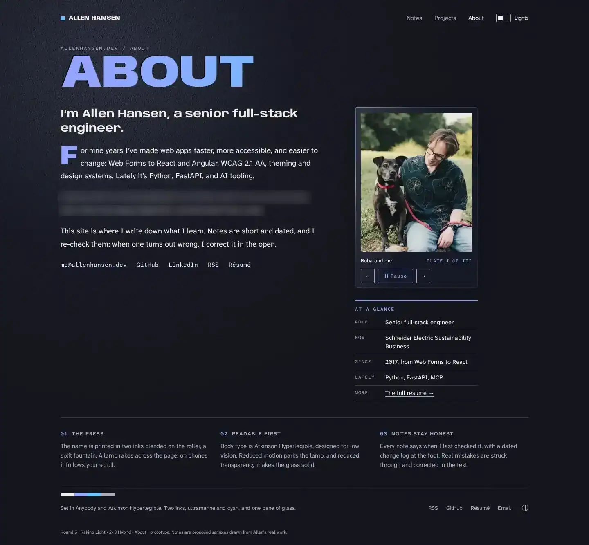

2×3 hybrid, About, dark mode, desktop. Lines of draft copy with personal details
that never went on the site are blurred.

**[`2x3-hybrid-about-dark-mobile.webp`](2x3-hybrid-about-dark-mobile.webp)** ·
600 × 3491, full-page capture

2×3 hybrid, About, dark mode, phone. Lines of draft copy with personal details
that never went on the site are blurred.

**[`2x3-hybrid-about-light.webp`](2x3-hybrid-about-light.webp)** · 1440 × 1333

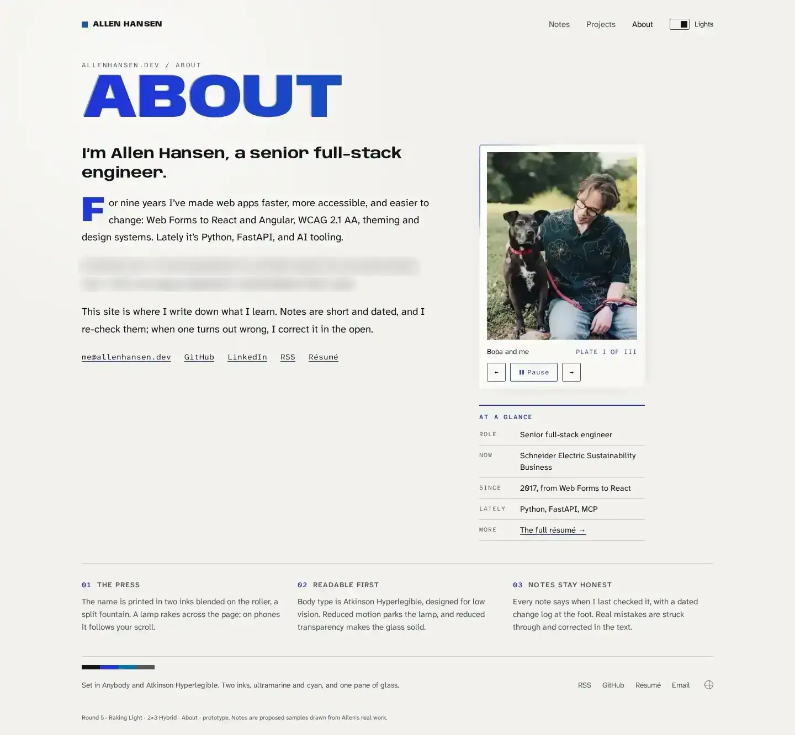

2×3 hybrid, About, light mode, desktop. Lines of draft copy with personal
details that never went on the site are blurred.

**[`2x3-hybrid-about-light-mobile.webp`](2x3-hybrid-about-light-mobile.webp)** ·
600 × 3491, full-page capture

2×3 hybrid, About, light mode, phone. Lines of draft copy with personal details
that never went on the site are blurred.

### Photo treatments

The same treatments on the hybrid palette.

**[`2x3-hybrid-photos-dark.webp`](2x3-hybrid-photos-dark.webp)** · 1440 × 995

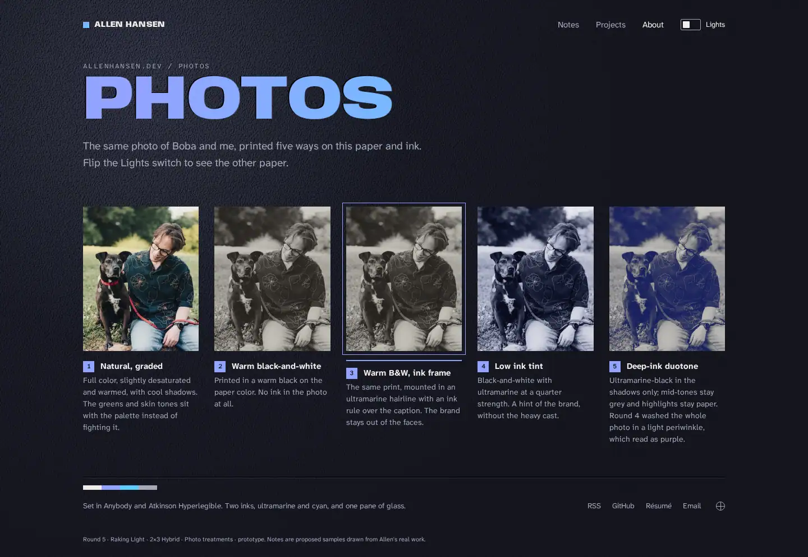

2×3 hybrid, the photo-treatment page, dark mode, desktop.

**[`2x3-hybrid-photos-dark-mobile.webp`](2x3-hybrid-photos-dark-mobile.webp)** ·
600 × 2906, full-page capture

2×3 hybrid, the photo-treatment page, dark mode, phone.

**[`2x3-hybrid-photos-light.webp`](2x3-hybrid-photos-light.webp)** · 1440 × 995

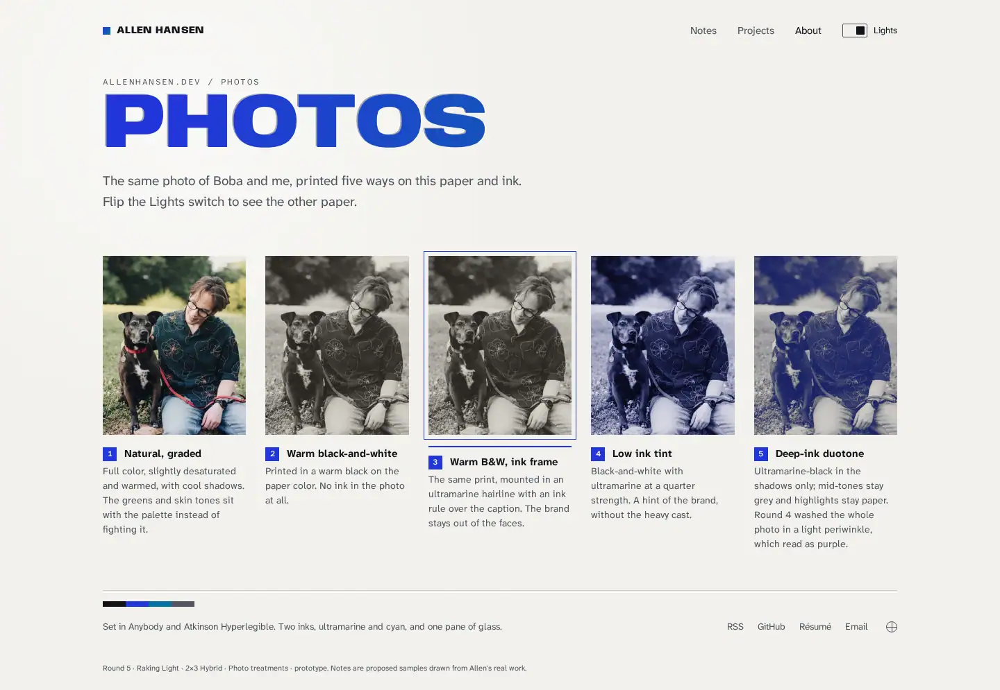

2×3 hybrid, the photo-treatment page, light mode, desktop.

**[`2x3-hybrid-photos-light-mobile.webp`](2x3-hybrid-photos-light-mobile.webp)**
· 600 × 2906, full-page capture

2×3 hybrid, the photo-treatment page, light mode, phone.

## Four-way comparisons

**[`compare-about-desktop-dark.webp`](compare-about-desktop-dark.webp)** · 1600
× 459

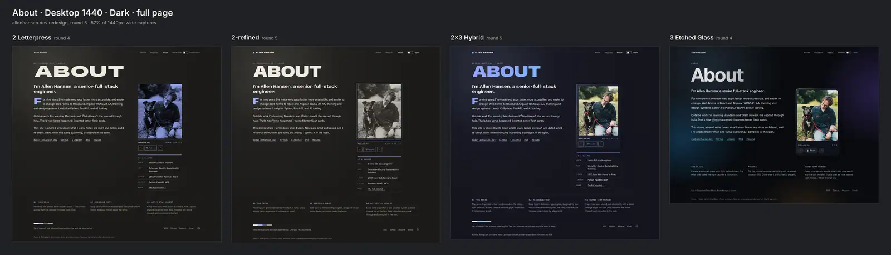

About, desktop, dark mode, in four columns: the original Letterpress, 2-refined,
the 2×3 hybrid, and the original Etched Glass.

**[`compare-home-desktop-dark.webp`](compare-home-desktop-dark.webp)** · 1600 ×
573

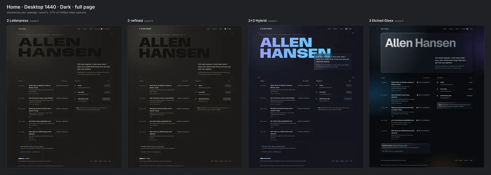

Home, desktop, dark mode, in four columns: the original Letterpress, 2-refined,
the 2×3 hybrid, and the original Etched Glass.

**[`compare-overview-desktop.webp`](compare-overview-desktop.webp)** · 1600 ×
1060

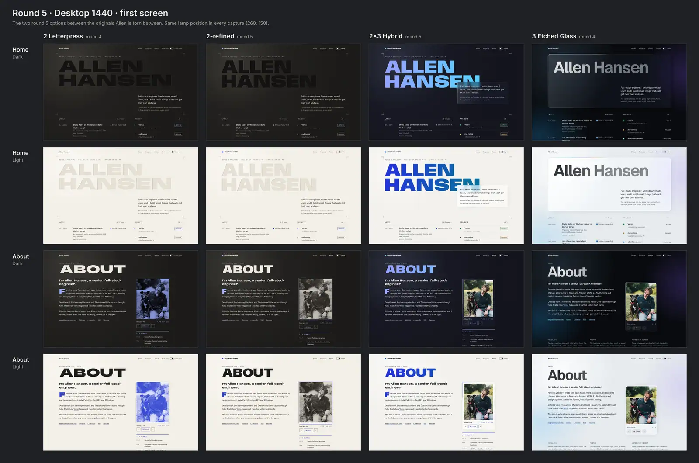

First screens of Home and About, desktop, in four columns: the original
Letterpress, 2-refined, the 2×3 hybrid, and the original Etched Glass.

**[`compare-about-mobile-dark.webp`](compare-about-mobile-dark.webp)** · 1134 ×
1600

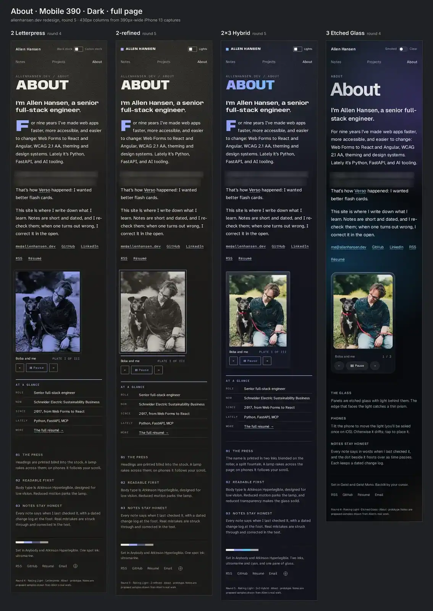

About, phone, dark mode, in four columns: the original Letterpress, 2-refined,
the 2×3 hybrid, and the original Etched Glass. Lines of draft copy with personal
details that never went on the site are blurred.

**[`compare-home-mobile-dark.webp`](compare-home-mobile-dark.webp)** · 1032 ×
1600

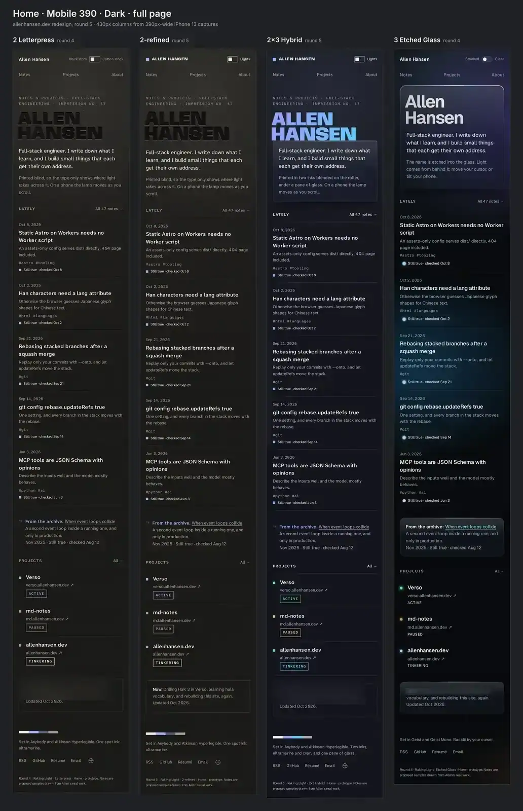

Home, phone, dark mode, in four columns: the original Letterpress, 2-refined,
the 2×3 hybrid, and the original Etched Glass. Lines of draft copy with personal
details that never went on the site are blurred.

**[`compare-overview-mobile.webp`](compare-overview-mobile.webp)** · 1600 × 910

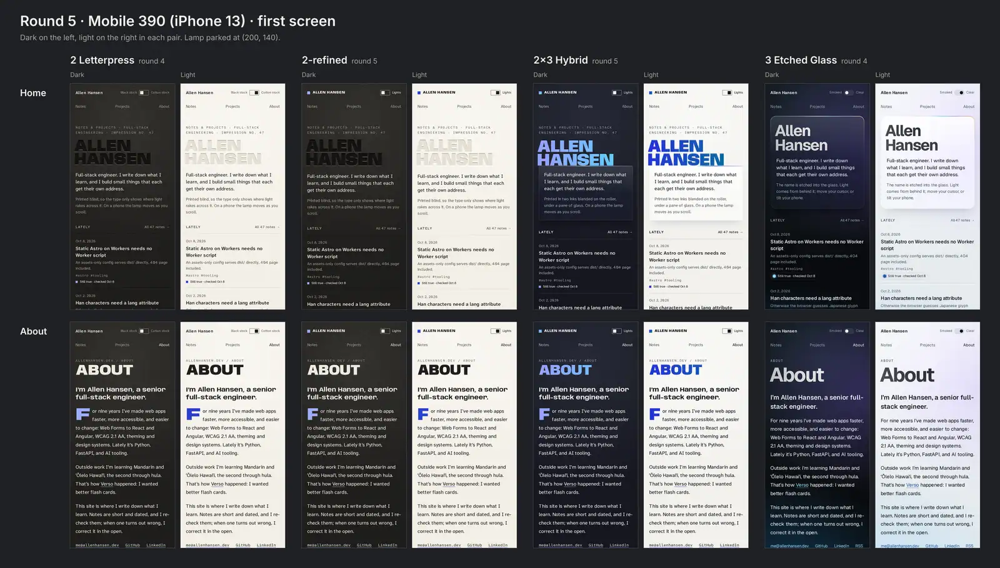

The same four columns on a phone, dark and light pairs.

**[`compare-about-desktop-light.webp`](compare-about-desktop-light.webp)** ·
1600 × 459

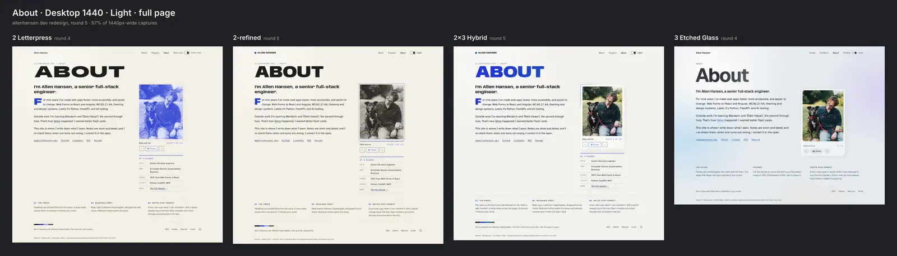

About, desktop, light mode, in four columns: the original Letterpress,
2-refined, the 2×3 hybrid, and the original Etched Glass.

**[`compare-home-desktop-light.webp`](compare-home-desktop-light.webp)** · 1600
× 573

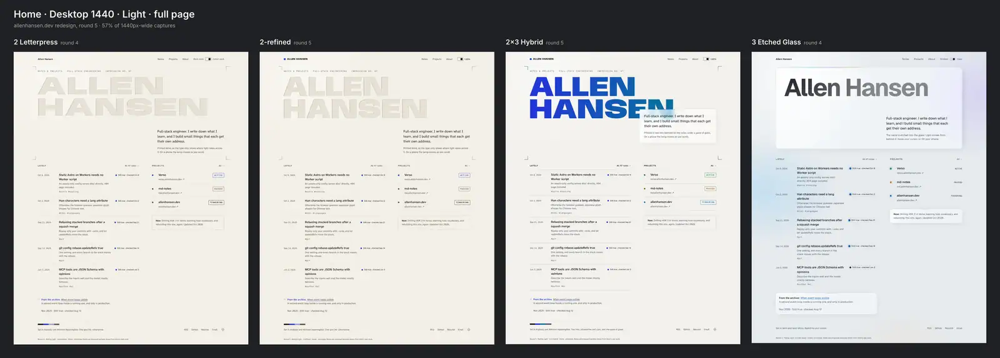

Home, desktop, light mode, in four columns: the original Letterpress, 2-refined,
the 2×3 hybrid, and the original Etched Glass.

**[`compare-about-mobile-light.webp`](compare-about-mobile-light.webp)** · 1134
× 1600

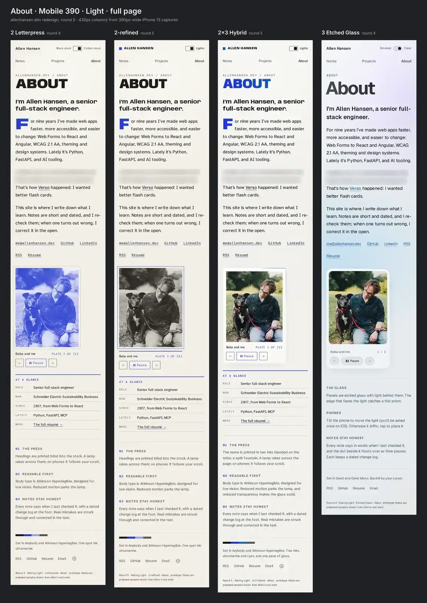

About, phone, light mode, in four columns: the original Letterpress, 2-refined,
the 2×3 hybrid, and the original Etched Glass. Lines of draft copy with personal
details that never went on the site are blurred.

**[`compare-home-mobile-light.webp`](compare-home-mobile-light.webp)** · 1032 ×
1600

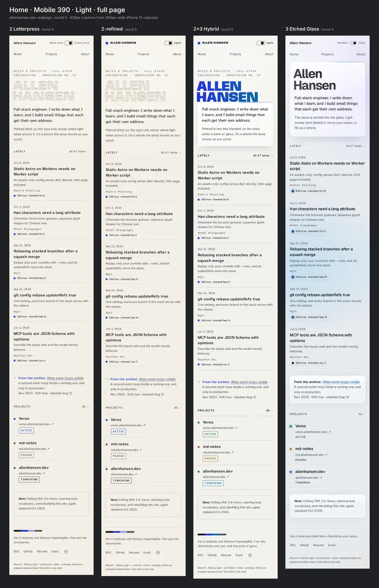

Home, phone, light mode, in four columns: the original Letterpress, 2-refined,
the 2×3 hybrid, and the original Etched Glass.

## Dark stock: warm black or indigo-black

**[`compare-dark-bg-about-desktop.webp`](compare-dark-bg-about-desktop.webp)** ·
1600 × 855

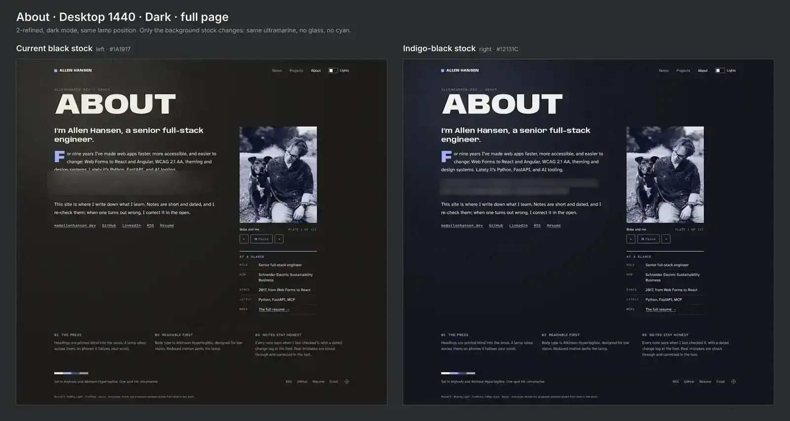

Dark mode only, About on desktop: the warm black stock on the left and the
indigo-black stock on the right. Allen chose indigo. Lines of draft copy with
personal details that never went on the site are blurred.

**[`compare-dark-bg-home-desktop.webp`](compare-dark-bg-home-desktop.webp)** ·
1600 × 1089

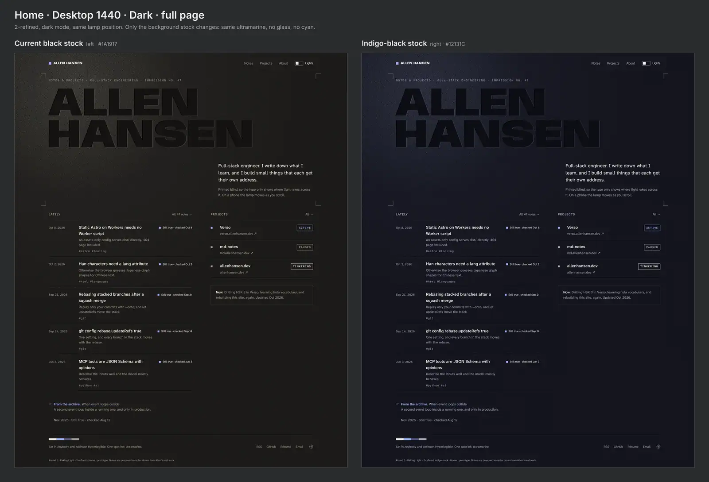

Dark mode only, Home on desktop: the warm black stock on the left and the
indigo-black stock on the right. Allen chose indigo.

**[`compare-dark-bg-note-desktop.webp`](compare-dark-bg-note-desktop.webp)** ·
1600 × 1306

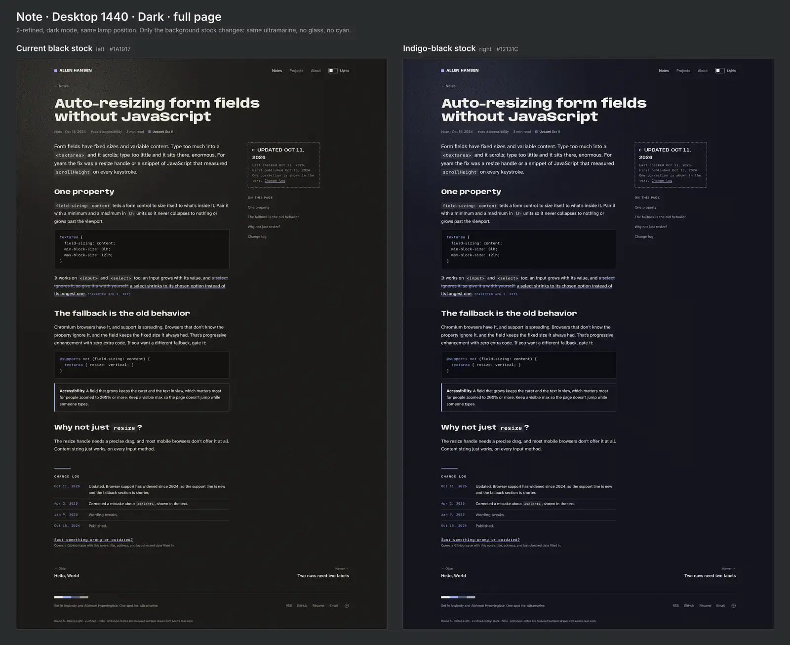

Dark mode only, Note on desktop: the warm black stock on the left and the
indigo-black stock on the right. Allen chose indigo.

**[`compare-dark-bg-overview.webp`](compare-dark-bg-overview.webp)** · 1600 ×
1263

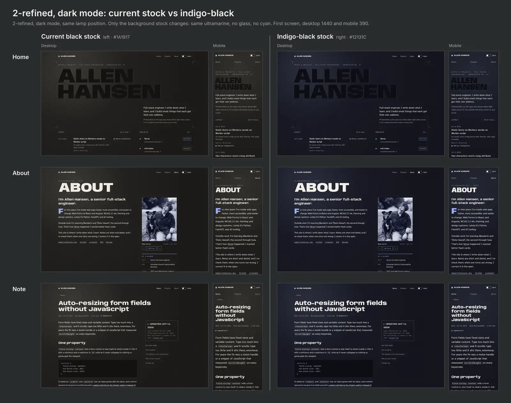

The last design decision before the build: refined Letterpress in dark mode on
the warm black stock (left) and on the hybrid's indigo-black stock (right), for
Home, About, and a Note on desktop and phone. Contrast improved slightly on
indigo, and Allen went with it.

**[`compare-dark-bg-about-mobile.webp`](compare-dark-bg-about-mobile.webp)** ·
600 × 1624, full-page capture

Dark mode only, About on phone: the warm black stock on the left and the
indigo-black stock on the right. Allen chose indigo. Lines of draft copy with
personal details that never went on the site are blurred.

**[`compare-dark-bg-home-mobile.webp`](compare-dark-bg-home-mobile.webp)** · 600
× 1804, full-page capture

Dark mode only, Home on phone: the warm black stock on the left and the
indigo-black stock on the right. Allen chose indigo. Lines of draft copy with
personal details that never went on the site are blurred.

**[`compare-dark-bg-note-mobile.webp`](compare-dark-bg-note-mobile.webp)** · 600
× 2403, full-page capture

Dark mode only, Note on phone: the warm black stock on the left and the
indigo-black stock on the right. Allen chose indigo.

## Photo, toggle, and Verso studies

**[`hybrid-vs-verso.webp`](hybrid-vs-verso.webp)** · 1600 × 538

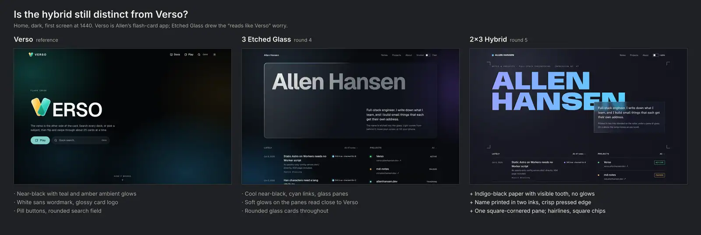

Verso, Etched Glass, and the hybrid, home in dark mode. The check was whether
the hybrid read as an app like Verso; its paper, uppercase ink wordmark, and
square corners kept it in print territory.

**[`photo-strip.webp`](photo-strip.webp)** · 802 × 1600

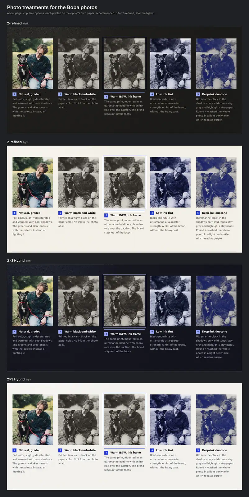

Five treatments of the Boba photo on 2-refined and the hybrid, dark and light:
natural graded, warm black-and-white, black-and-white in an ink frame, low ink
tint, and deep-ink duotone. Allen picked the low ink tint, which is still the
treatment on the site.

**[`toggle-options.webp`](toggle-options.webp)** · 1503 × 1600

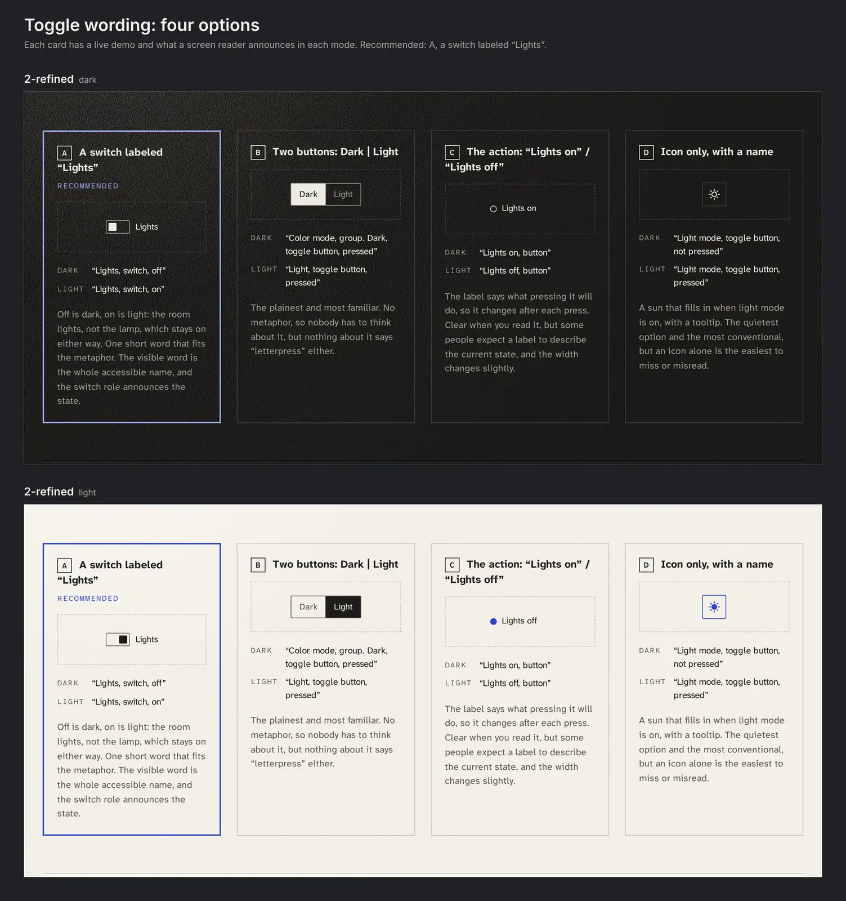

Four toggle wordings with what a screen reader announces for each. Option A, a
switch labeled "Lights", was picked and shipped.

## QA captures

**[`qa-hybrid-forced-colors.webp`](qa-hybrid-forced-colors.webp)** · 1440 × 900

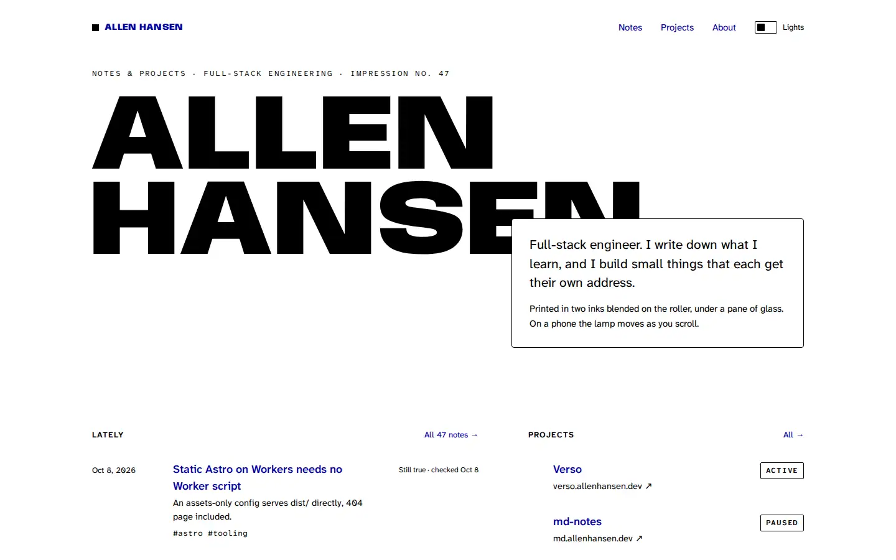

The hybrid in forced-colors mode. The glass pane becomes a solid bordered box
and the name prints in the system text color; this was fixed in round 5 after
the blurred name showed through.

**[`qa-hybrid-low-power.webp`](qa-hybrid-low-power.webp)** · 1440 × 900

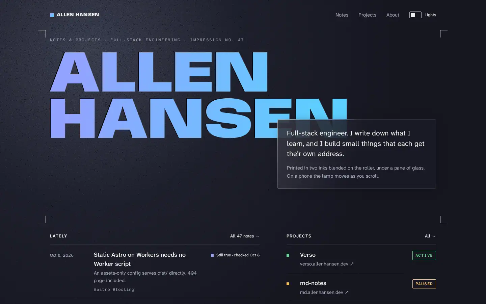

The hybrid in low-power mode, with the glass made solid.

**[`qa-hybrid-reduced-transparency-light.webp`](qa-hybrid-reduced-transparency-light.webp)**
· 1440 × 900

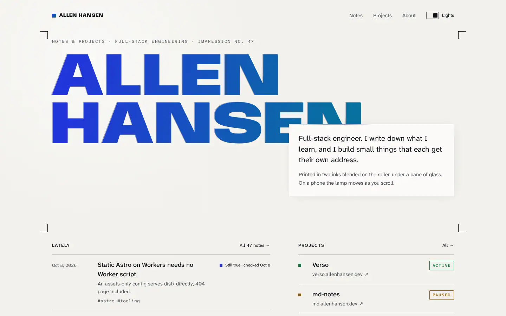

The hybrid with reduced transparency, light mode.
