# Building Letterpress and the changes after it

[All images](../README.md) · [Narrative](../../07-build-and-refinements.md)

Screenshots from the build in
[PR #136](https://github.com/AMEH64/allenhansen.dev/pull/136) and the
follow-ups: review rounds on the preview, the About photo variants, the favicon
fix, the blog filters, the production smoke test after merge, the copy cleanup
in [#144](https://github.com/AMEH64/allenhansen.dev/pull/144), and the Tailwind
migration in [#145](https://github.com/AMEH64/allenhansen.dev/pull/145). Files
named `prod-*` are from production right after #136 merged; most are
byte-identical to the v6.0.0 release screenshots and are stored once, in
`10-releases/v6.0.0/`.

## About photo variants

**[`about-photo-variant-a.webp`](about-photo-variant-a.webp)** · 1600 × 616

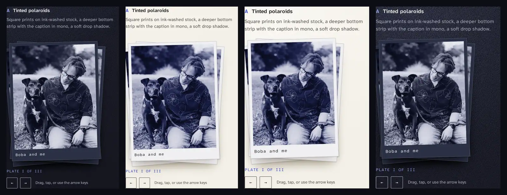

About photo variant A, tinted polaroids: square-cornered prints with a paper
border, the ink-tinted photo, and a mono caption, stacked with a slight
rotation. Allen asked for this iMessage-style stack in place of the timed
rotator.

**[`about-photo-variant-b.webp`](about-photo-variant-b.webp)** · 1600 × 617

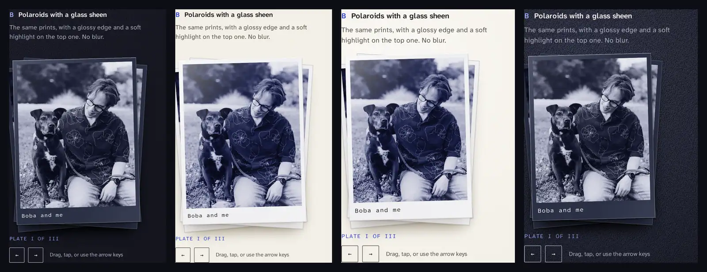

Variant B, the same polaroids with a subtle glossy highlight on the top print.

**[`about-photo-variant-c.webp`](about-photo-variant-c.webp)** · 1600 × 603

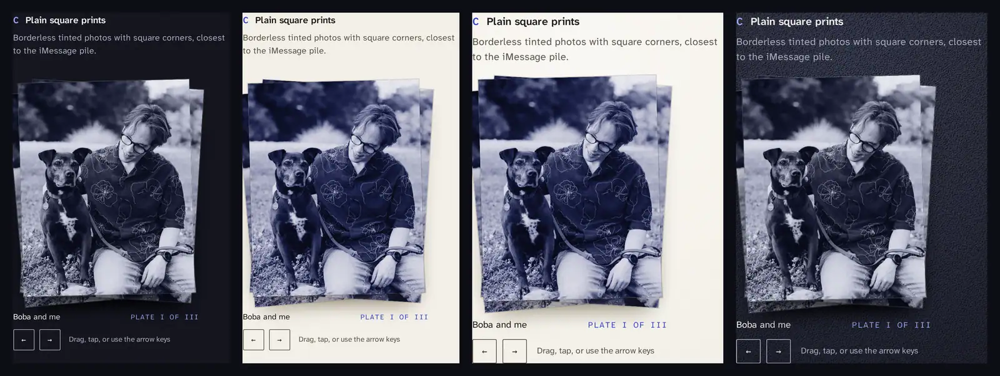

Variant C, borderless tinted prints stacked with square corners, closest to the
iMessage look.

**[`about-photo-variant-d.webp`](about-photo-variant-d.webp)** · 1600 × 828

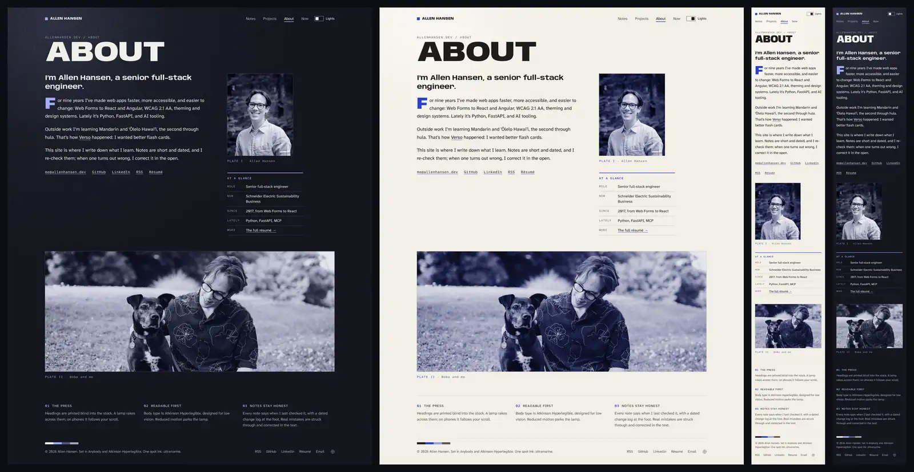

Variant D, two editorial plates: a solo portrait beside the opener and "Boba and
me" full width between sections, with no JavaScript. Allen picked D; the stack
variants and their script were removed.

## Favicon

**[`favicon-after-dark.webp`](favicon-after-dark.webp)** · 1000 × 84

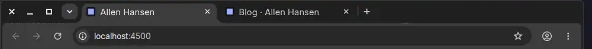

After: the Letterpress mark (an ultramarine square on indigo-black) in the tab,
dark browser theme.

**[`favicon-after-dark-zoom.webp`](favicon-after-dark-zoom.webp)** · 750 × 120

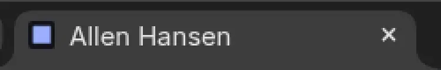

After, zoomed, dark.

**[`favicon-audit.webp`](favicon-audit.webp)** · 1490 × 1600

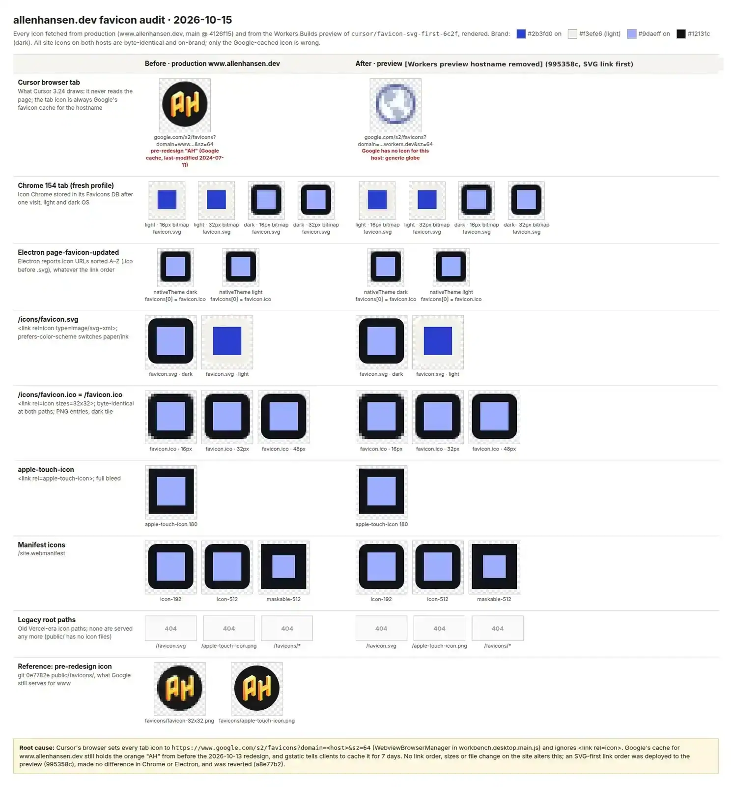

A later audit of every icon the site serves, production against a preview. All
the site's icons were correct; Cursor's browser tab showed Google's cached
favicon for the host, so Allen chose not to chase it further. The preview's
hostname has been removed from the image.

**[`favicon-before-branch-dark.webp`](favicon-before-branch-dark.webp)** · 1000
× 84

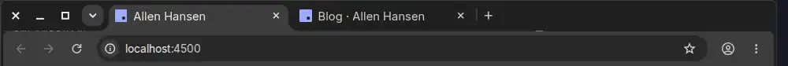

The branch before the icon fix, on a local dev server, dark browser theme.

**[`favicon-after-light.webp`](favicon-after-light.webp)** · 1000 × 84

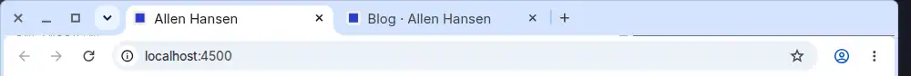

After, light browser theme, where the SVG icon switches to its light variant.

**[`favicon-after-light-zoom.webp`](favicon-after-light-zoom.webp)** · 750 × 120

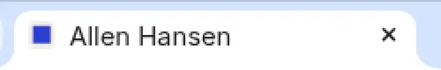

After, zoomed, light.

**[`favicon-before-branch-light.webp`](favicon-before-branch-light.webp)** ·
1000 × 84

The same, light browser theme.

**[`favicon-before-live-light.webp`](favicon-before-live-light.webp)** · 1000 ×
84

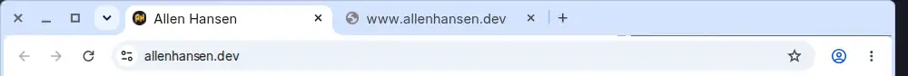

Before: the browser tab on the live site still showed the orange "AH" icon from
the old site.

**[`favicon-before-live-light-zoom.webp`](favicon-before-live-light-zoom.webp)**
· 750 × 120

Before, zoomed in on the tab icon.

## Feature flags

**`flags-off-home-dark-desktop.webp`** · byte-identical to
[`10-releases/v6.0.0/home-dark-desktop.webp`](../10-releases/v6.0.0/home-dark-desktop.webp),
so it's stored once

Home with the flags off.

**[`flags-on-about-new-dark-desktop.webp`](flags-on-about-new-dark-desktop.webp)**
· 1246 × 1600

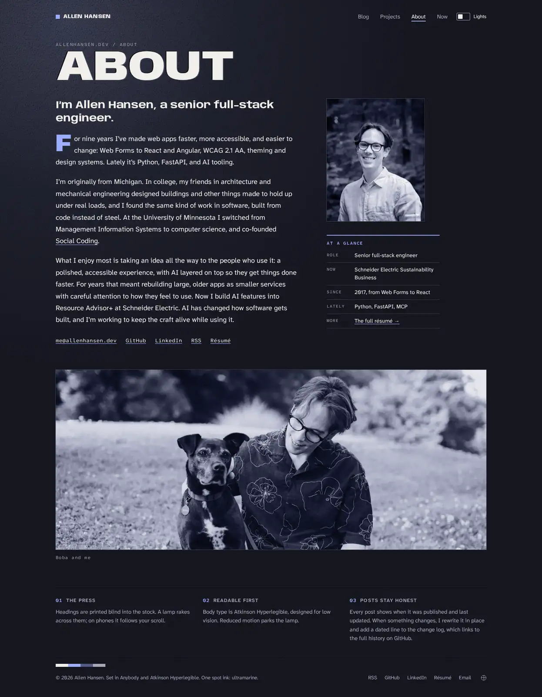

About with its flag on and the "new" draft copy selected, to check that turning
a flag on restored the page.

**[`flags-on-now-new-dark-desktop.webp`](flags-on-now-new-dark-desktop.webp)** ·
1440 × 900

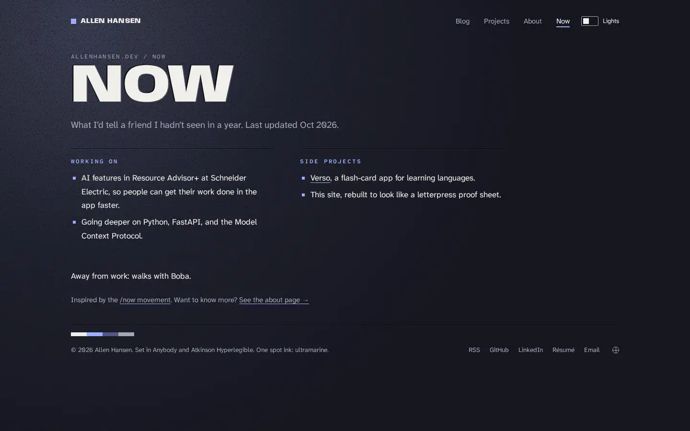

Now with its flag on and the new draft copy.

**[`flags-off-404-dark-mobile.webp`](flags-off-404-dark-mobile.webp)** · 600 ×
1298

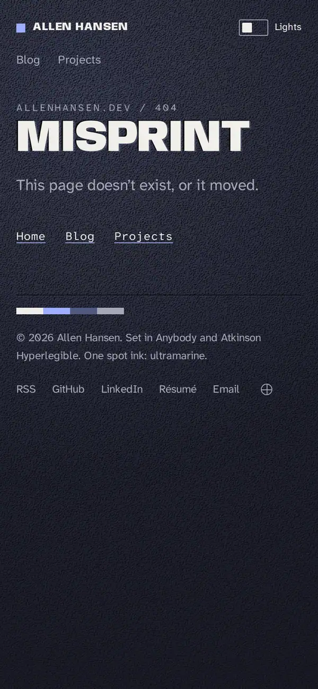

The 404 page with the About and Now flags off: no About link. #136 shipped with
both pages switched off until their copy was final.

**[`flags-on-now-new-dark-mobile.webp`](flags-on-now-new-dark-mobile.webp)** ·
600 × 1645, full-page capture

Now, flag on, on a phone.

## Production smoke test after merge

**`prod-blog-css-note-dark-desktop.webp`** · byte-identical to
[`10-releases/v6.0.0/blog-filtered-dark-desktop.webp`](../10-releases/v6.0.0/blog-filtered-dark-desktop.webp),
so it's stored once

Production after #136 merged: /blog/ filtered to CSS notes. Dark mode, desktop.

**`prod-blog-dark-desktop.webp`** · byte-identical to
[`10-releases/v6.0.0/blog-dark-desktop.webp`](../10-releases/v6.0.0/blog-dark-desktop.webp),
so it's stored once

prod-blog Dark mode, desktop.

**`prod-footer-after.webp`** · byte-identical to
[`08-build/footer-after.webp`](footer-after.webp), so it's stored once

The new footer on production.

**`prod-hero-copy-after.webp`** · byte-identical to
[`08-build/hero-copy-after.webp`](hero-copy-after.webp), so it's stored once

The new hero on production.

**`prod-home-dark-desktop.webp`** · byte-identical to
[`10-releases/v6.0.0/home-dark-desktop.webp`](../10-releases/v6.0.0/home-dark-desktop.webp),
so it's stored once

prod-home Dark mode, desktop.

**`prod-note-dark-desktop.webp`** · byte-identical to
[`10-releases/v6.0.0/note-dark-desktop.webp`](../10-releases/v6.0.0/note-dark-desktop.webp),
so it's stored once

prod-note Dark mode, desktop.

**`prod-projects-dark-desktop.webp`** · byte-identical to
[`10-releases/v6.0.0/projects-dark-desktop.webp`](../10-releases/v6.0.0/projects-dark-desktop.webp),
so it's stored once

prod-projects Dark mode, desktop.

**`prod-resume-dark-desktop.webp`** · byte-identical to
[`10-releases/v6.0.0/resume-dark-desktop.webp`](../10-releases/v6.0.0/resume-dark-desktop.webp),
so it's stored once

prod-resume Dark mode, desktop.

**`prod-story-dark-desktop.webp`** · byte-identical to
[`10-releases/v6.0.0/story-dark-desktop.webp`](../10-releases/v6.0.0/story-dark-desktop.webp),
so it's stored once

prod-story Dark mode, desktop.

**`prod-blog-dark-mobile.webp`** · byte-identical to
[`10-releases/v6.0.0/blog-dark-mobile.webp`](../10-releases/v6.0.0/blog-dark-mobile.webp),
so it's stored once

prod-blog Dark mode, phone.

**`prod-home-dark-mobile.webp`** · byte-identical to
[`10-releases/v6.0.0/home-dark-mobile.webp`](../10-releases/v6.0.0/home-dark-mobile.webp),
so it's stored once

prod-home Dark mode, phone.

**`prod-note-dark-mobile.webp`** · byte-identical to
[`10-releases/v6.0.0/note-dark-mobile.webp`](../10-releases/v6.0.0/note-dark-mobile.webp),
so it's stored once

prod-note Dark mode, phone.

**`prod-projects-dark-mobile.webp`** · byte-identical to
[`10-releases/v6.0.0/projects-dark-mobile.webp`](../10-releases/v6.0.0/projects-dark-mobile.webp),
so it's stored once

prod-projects Dark mode, phone.

**`prod-resume-dark-mobile.webp`** · byte-identical to
[`10-releases/v6.0.0/resume-dark-mobile.webp`](../10-releases/v6.0.0/resume-dark-mobile.webp),
so it's stored once

prod-resume Dark mode, phone.

**`prod-story-dark-mobile.webp`** · byte-identical to
[`10-releases/v6.0.0/story-dark-mobile.webp`](../10-releases/v6.0.0/story-dark-mobile.webp),
so it's stored once

prod-story Dark mode, phone.

## Copy cleanup (#144)

**[`footer-after.webp`](footer-after.webp)** · 1600 × 131

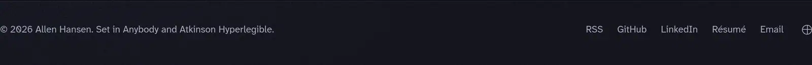

Footer after #144: "© 2026 Allen Hansen. Set in Anybody and Atkinson
Hyperlegible."

**[`footer-before.webp`](footer-before.webp)** · 1600 × 145

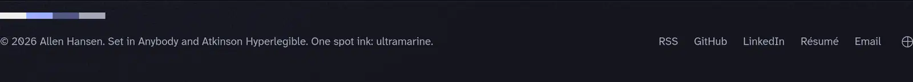

Footer before [#144](https://github.com/AMEH64/allenhansen.dev/pull/144): "One
spot ink: ultramarine" and a swatch strip. Allen decided the copy shouldn't
describe the site's own design.

**[`hero-copy-after.webp`](hero-copy-after.webp)** · 1600 × 785

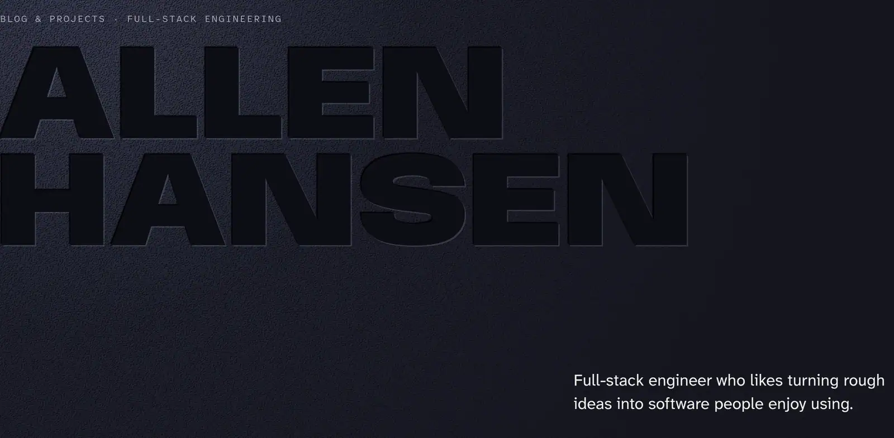

Home hero after #144: "Full-stack engineer who likes turning rough ideas into
software people enjoy using."

**[`hero-copy-before.webp`](hero-copy-before.webp)** · 1600 × 785

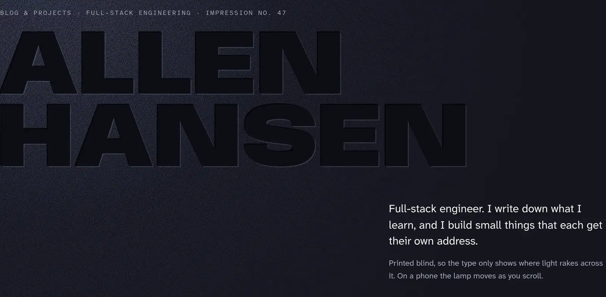

Home hero before #144, with "Impression No. 47" in the slug line and the
"Printed blind…" paragraph explaining the lamp.

**[`project-cards-without-links.webp`](project-cards-without-links.webp)** ·
1600 × 1241

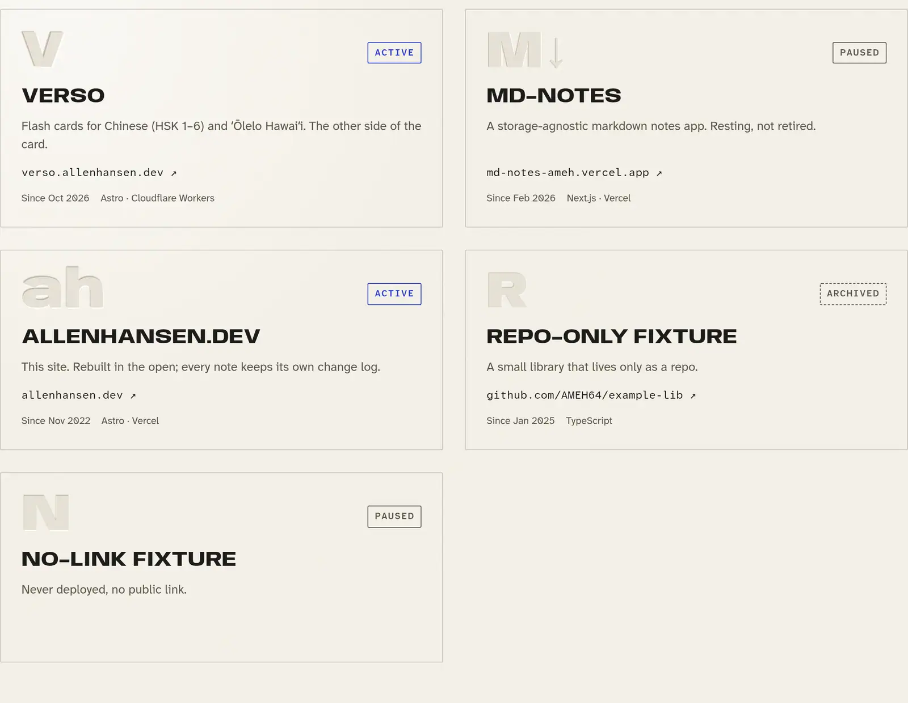

Project cards with no link after #144. The "Gets an address when it ships" line
was removed, since not every project gets its own subdomain.

**[`projects-lead-after.webp`](projects-lead-after.webp)** · 1600 × 1125

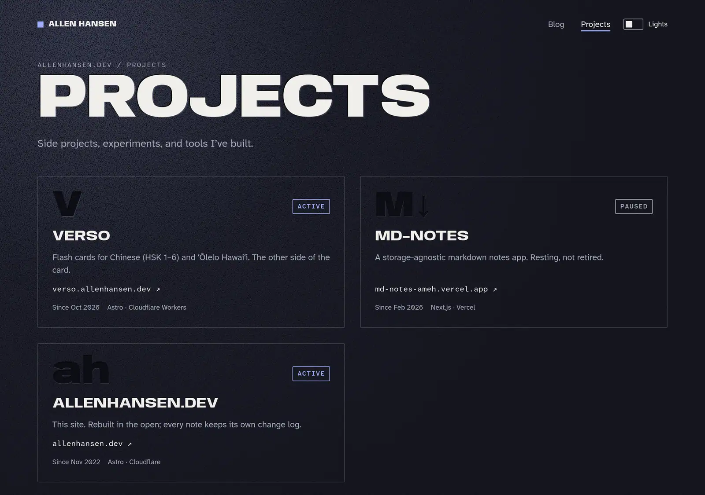

The Projects lead after #144: "Side projects, experiments, and tools I've
built."

## Share images

**[`og-home.webp`](og-home.webp)** · 1200 × 630

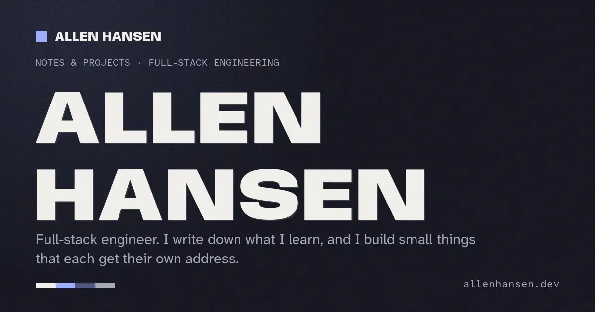

The typographic share image for Home as built in #136. These replaced a share
image that returned 404.

**[`og-home-after.webp`](og-home-after.webp)** · 1200 × 630

The Home share image after the #144 copy change.

**[`og-note-css-field-sizing.webp`](og-note-css-field-sizing.webp)** · 1200 ×
630

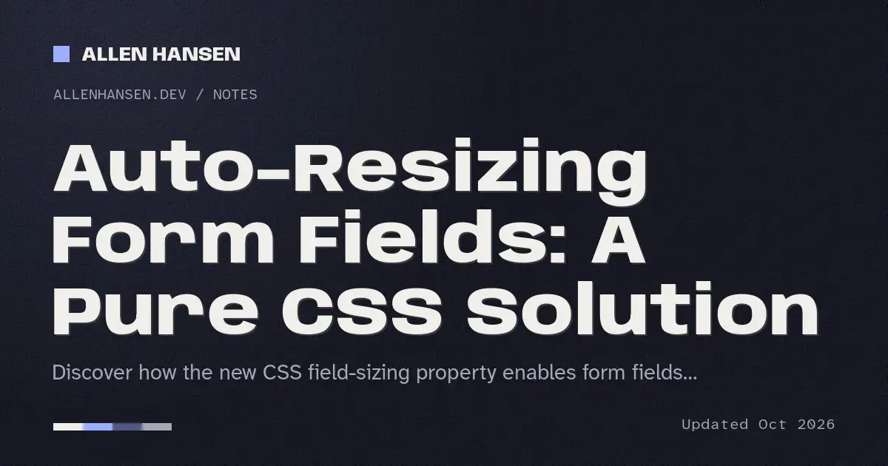

The share image generated for the field-sizing note.

**[`og-projects-after.webp`](og-projects-after.webp)** · 1200 × 630

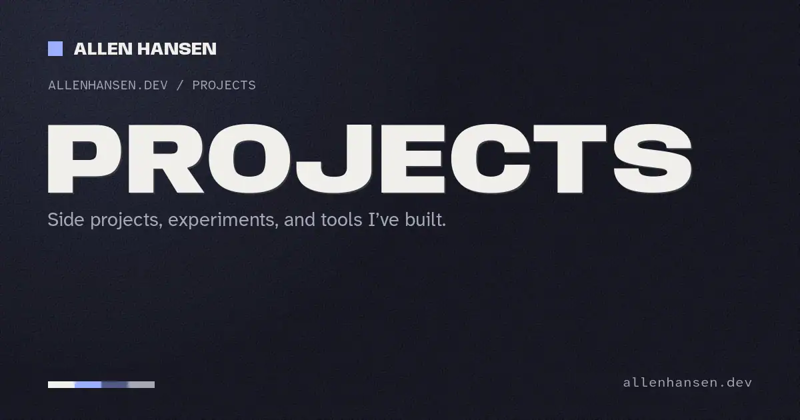

The Projects share image after #144.

## Post layout

**[`field-sizing-baseline-callout.webp`](field-sizing-baseline-callout.webp)** ·
1360 × 324

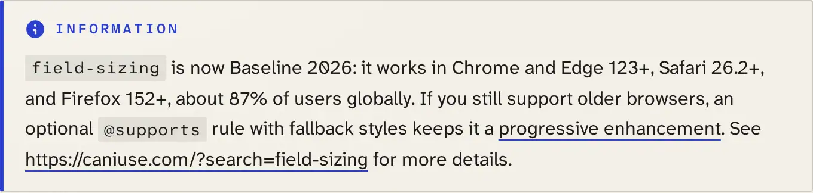

The updated callout in the field-sizing note: `field-sizing` is now Baseline
2026, rewritten in place. An earlier pass showed the old sentence struck
through; Allen found that noisy and the strikethrough pattern was dropped.

**[`post-change-log.webp`](post-change-log.webp)** · 1440 × 434

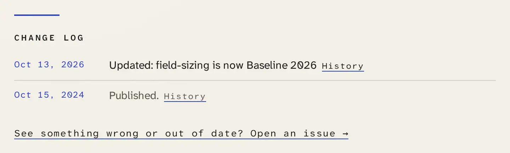

The change log at the foot of a post, followed by the "See something wrong or
out of date? Open an issue" line. This is what was left after Allen removed the
freshness labels: dates, a change log linked to Git history, and an issue link.

**[`post-head-note-dark.webp`](post-head-note-dark.webp)** · 1440 × 560

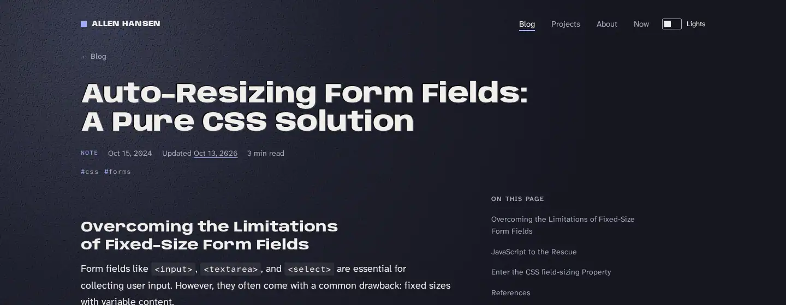

A post header for a note: published date, "Updated" date, type label, and tags.

**[`post-head-story-light.webp`](post-head-story-light.webp)** · 1440 × 560

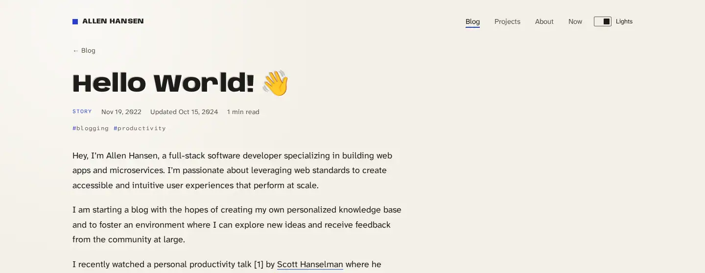

A post header for a story, which reads the same way as a note apart from the
label.

## Résumé details

**[`resume-current-role-dark.webp`](resume-current-role-dark.webp)** · 1600 ×
172

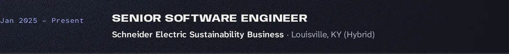

The current role on the résumé with no bullets. The placeholder box was removed
and the bullets became an array that defaults to empty.

**[`resume-education-dark.webp`](resume-education-dark.webp)** · 1600 × 384

The education entry with Social Coding as an inline link that opens in a new
tab.

**[`resume-print-page-1.webp`](resume-print-page-1.webp)** · 935 × 1210

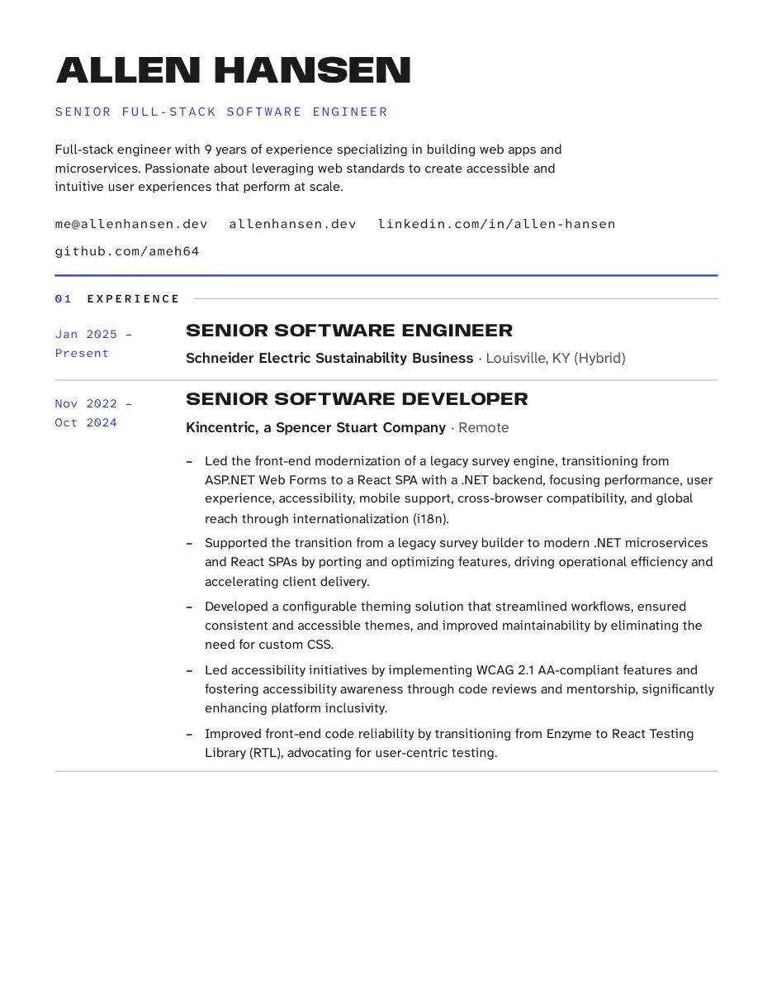

Résumé print output, page 1 of 3: dark ink on white, no site chrome.

**[`resume-print-page-2.webp`](resume-print-page-2.webp)** · 935 × 1210

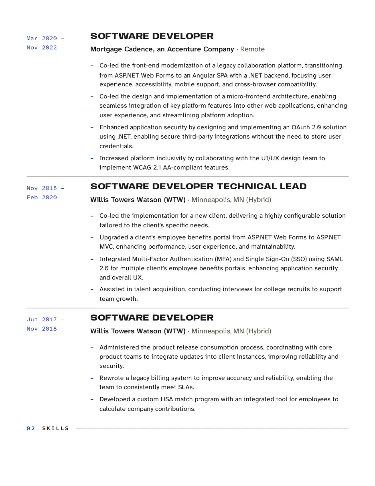

Résumé print output, page 2.

**[`resume-print-page-3.webp`](resume-print-page-3.webp)** · 935 × 1210

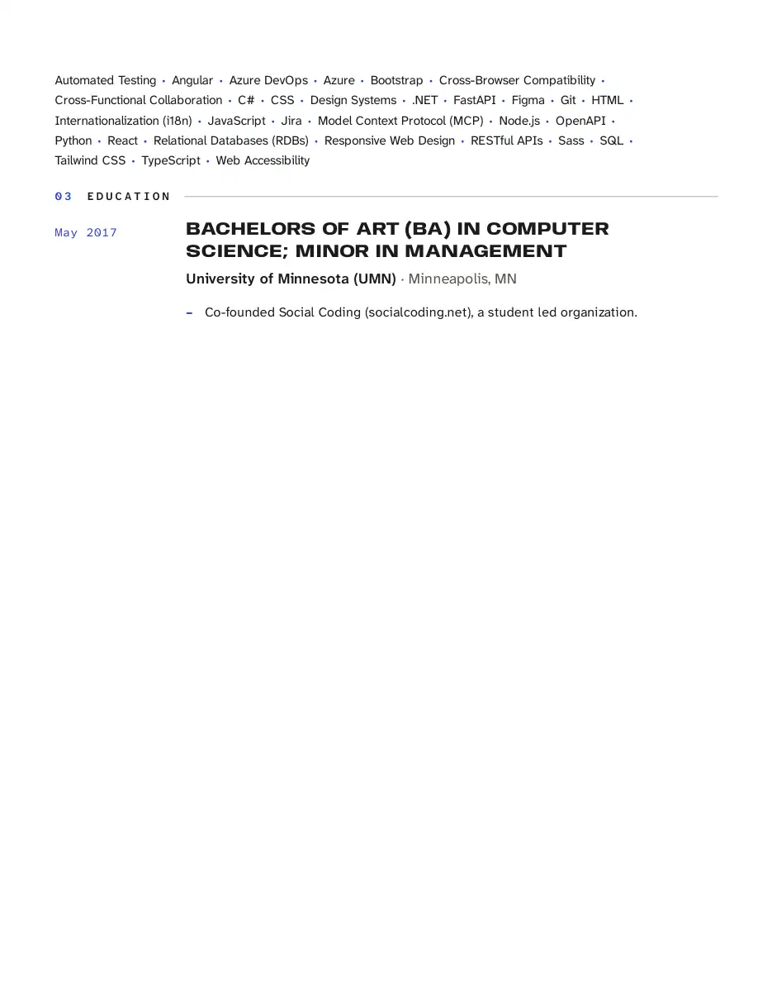

Résumé print output, page 3.

**[`resume-current-role-light.webp`](resume-current-role-light.webp)** · 1600 ×
172

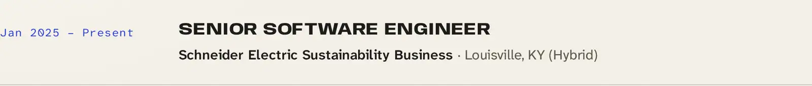

The same, light mode.

**[`resume-education-light.webp`](resume-education-light.webp)** · 1600 × 384

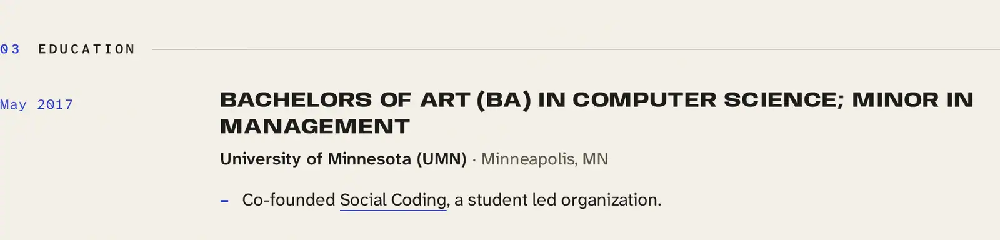

The same, light mode.

## Tailwind migration (#145)

**[`tailwind-visual-diff.webp`](tailwind-visual-diff.webp)** · 819 × 1600

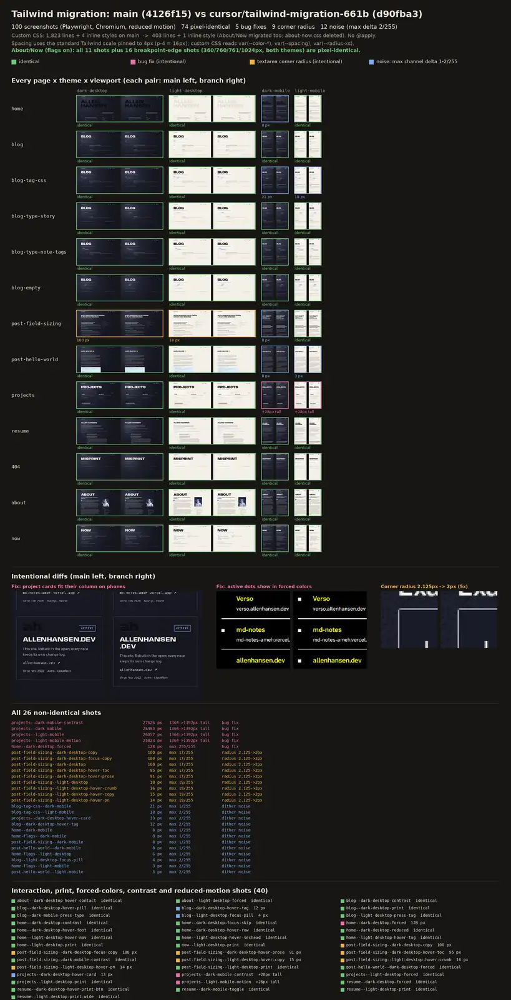

Summary of the visual diff for
[#145](https://github.com/AMEH64/allenhansen.dev/pull/145): 100 screenshots
against `main`, 76 identical, 5 showing the intended bug fixes, and the rest
differing by sub-pixel corner rounding or rendering noise.

## Blog and filters

**[`blog-css-dark-desktop.webp`](blog-css-dark-desktop.webp)** · 1440 × 900

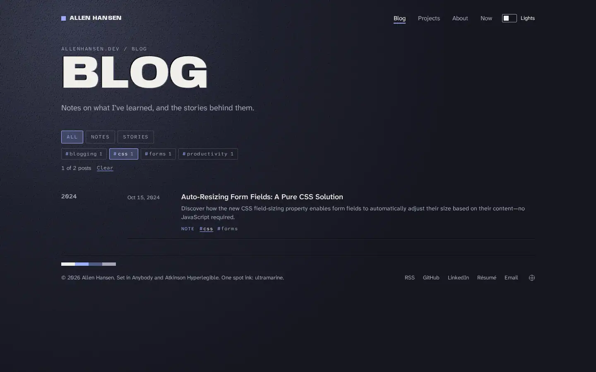

/blog/?tag=css, the tag filter applied from the URL. Dark mode, desktop.

**[`blog-dark-desktop.webp`](blog-dark-desktop.webp)** · 1440 × 900

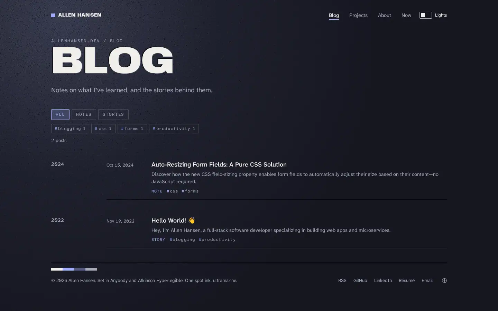

/blog/ with the All · Notes · Stories pills and the tag bar with post counts.
Filters live in the URL, so a filtered view can be shared. Dark mode, desktop.

**[`blog-multi-tag-dark-desktop.webp`](blog-multi-tag-dark-desktop.webp)** ·
1440 × 900

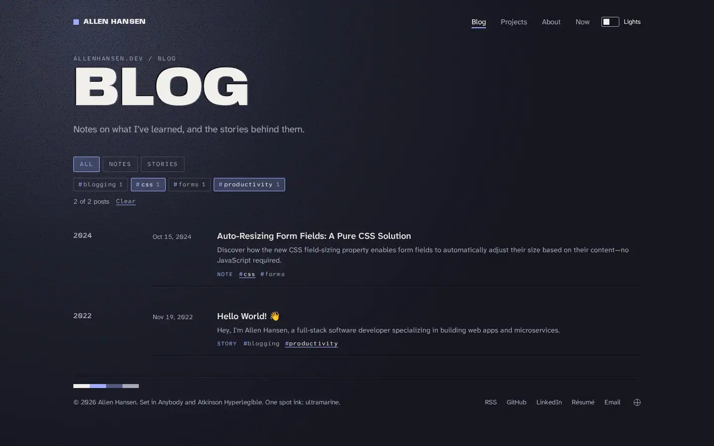

Two tags selected at once; a post matches if it has any selected tag. Dark mode,
desktop.

**[`blog-story-dark-desktop.webp`](blog-story-dark-desktop.webp)** · 1440 × 900

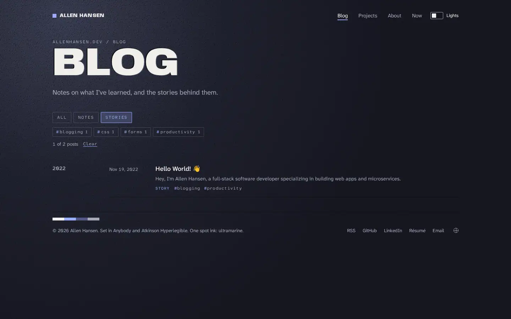

/blog/?type=story. Dark mode, desktop.

**[`blog-css-dark-mobile.webp`](blog-css-dark-mobile.webp)** · 600 × 1423,
full-page capture

/blog/?tag=css, the tag filter applied from the URL. Dark mode, phone.

**[`blog-dark-mobile.webp`](blog-dark-mobile.webp)** · 600 × 1771, full-page
capture

/blog/ with the All · Notes · Stories pills and the tag bar with post counts.
Filters live in the URL, so a filtered view can be shared. Dark mode, phone.

**[`blog-multi-tag-dark-mobile.webp`](blog-multi-tag-dark-mobile.webp)** · 600 ×
1771, full-page capture

Two tags selected at once; a post matches if it has any selected tag. Dark mode,
phone.

**[`blog-story-dark-mobile.webp`](blog-story-dark-mobile.webp)** · 600 × 1351,
full-page capture

/blog/?type=story. Dark mode, phone.

**[`blog-css-light-desktop.webp`](blog-css-light-desktop.webp)** · 1440 × 900

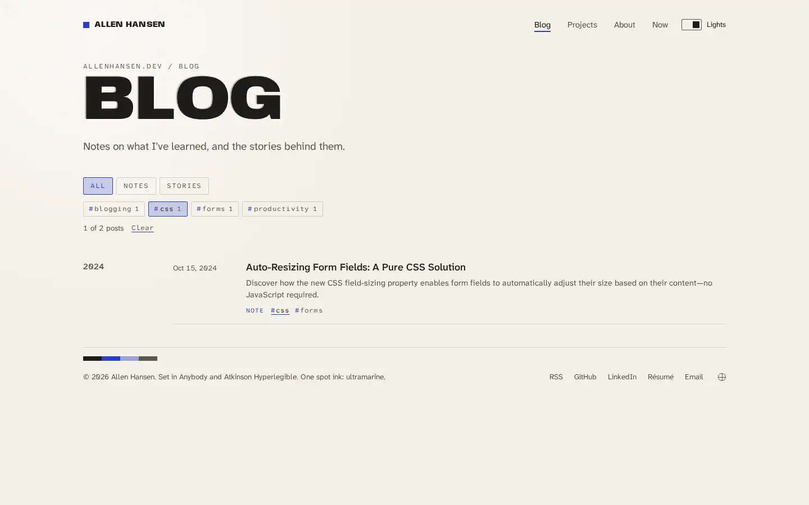

/blog/?tag=css, the tag filter applied from the URL. Light mode, desktop.

**[`blog-light-desktop.webp`](blog-light-desktop.webp)** · 1440 × 900

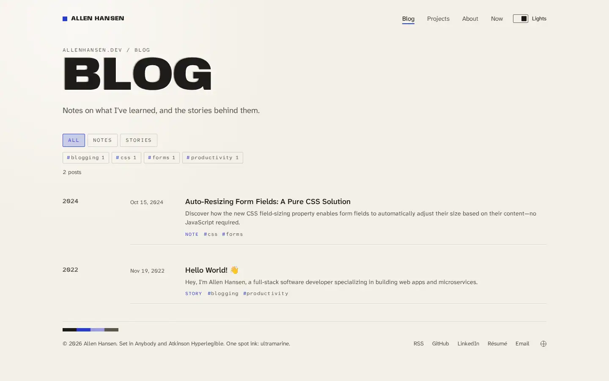

/blog/ with the All · Notes · Stories pills and the tag bar with post counts.
Filters live in the URL, so a filtered view can be shared. Light mode, desktop.

**[`blog-multi-tag-light-desktop.webp`](blog-multi-tag-light-desktop.webp)** ·
1440 × 900

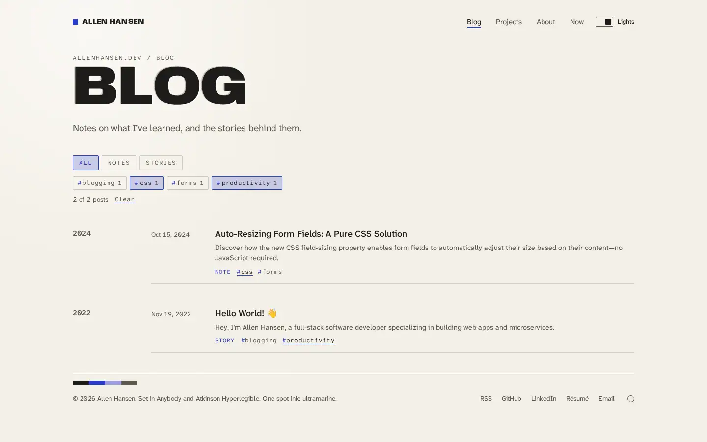

Two tags selected at once; a post matches if it has any selected tag. Light
mode, desktop.

**[`blog-story-light-desktop.webp`](blog-story-light-desktop.webp)** · 1440 ×
900

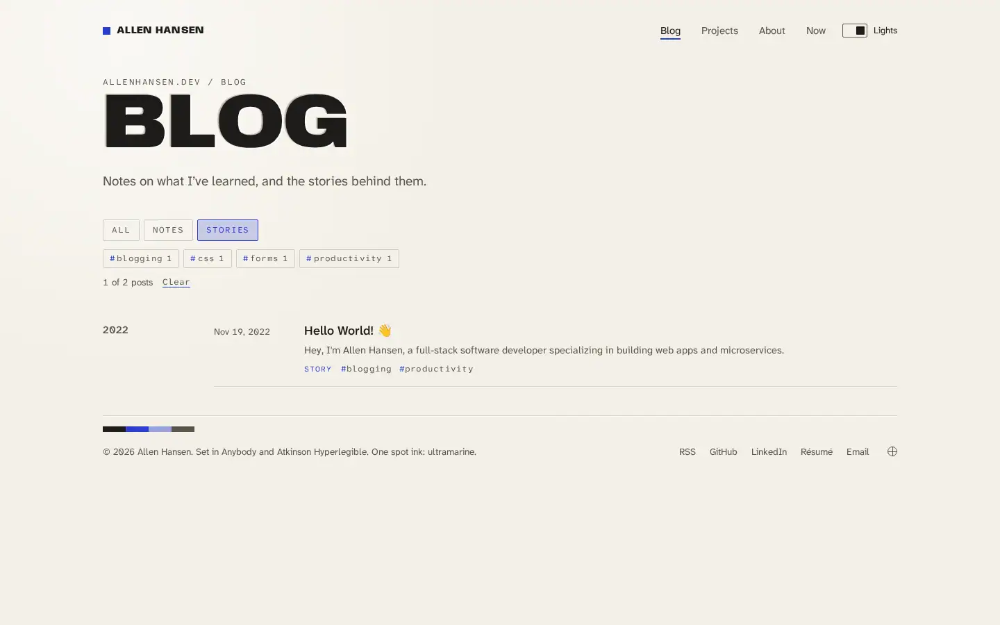

/blog/?type=story. Light mode, desktop.

**[`blog-css-light-mobile.webp`](blog-css-light-mobile.webp)** · 600 × 1423,
full-page capture

/blog/?tag=css, the tag filter applied from the URL. Light mode, phone.

**[`blog-light-mobile.webp`](blog-light-mobile.webp)** · 600 × 1771, full-page
capture

/blog/ with the All · Notes · Stories pills and the tag bar with post counts.
Filters live in the URL, so a filtered view can be shared. Light mode, phone.

**[`blog-multi-tag-light-mobile.webp`](blog-multi-tag-light-mobile.webp)** · 600
× 1771, full-page capture

Two tags selected at once; a post matches if it has any selected tag. Light
mode, phone.

**[`blog-story-light-mobile.webp`](blog-story-light-mobile.webp)** · 600 × 1351,
full-page capture

/blog/?type=story. Light mode, phone.

## Pages as built in PR #136

**[`404-dark-desktop.webp`](404-dark-desktop.webp)** · 1440 × 900

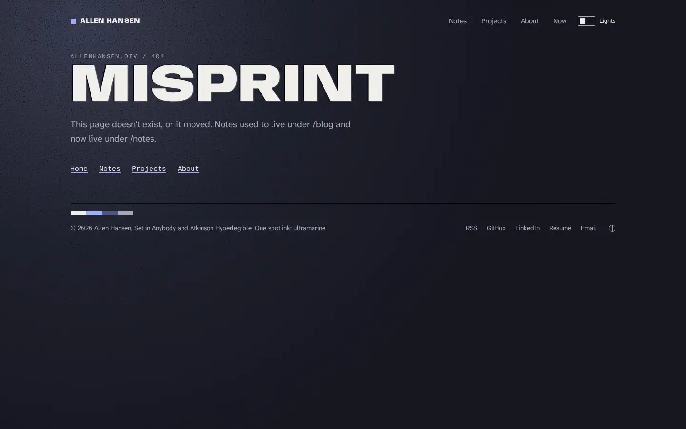

The "Misprint" 404 page. Dark mode, desktop.

**[`about-dark-desktop.webp`](about-dark-desktop.webp)** · 1279 × 1600

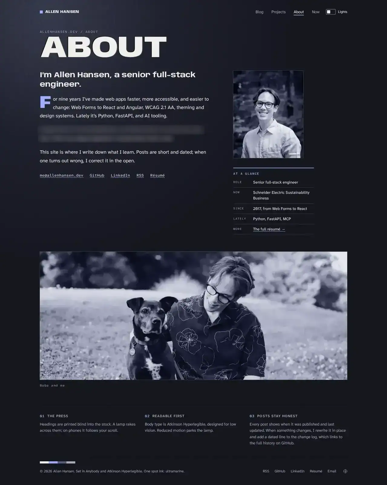

About as built in #136 with photo variant D: a portrait beside the opener and
"Boba and me" full width. It shipped switched off behind a feature flag. Dark
mode, desktop. Lines of draft copy with personal details that never went on the
site are blurred.

**[`home-dark-desktop.webp`](home-dark-desktop.webp)** · 1440 × 1246

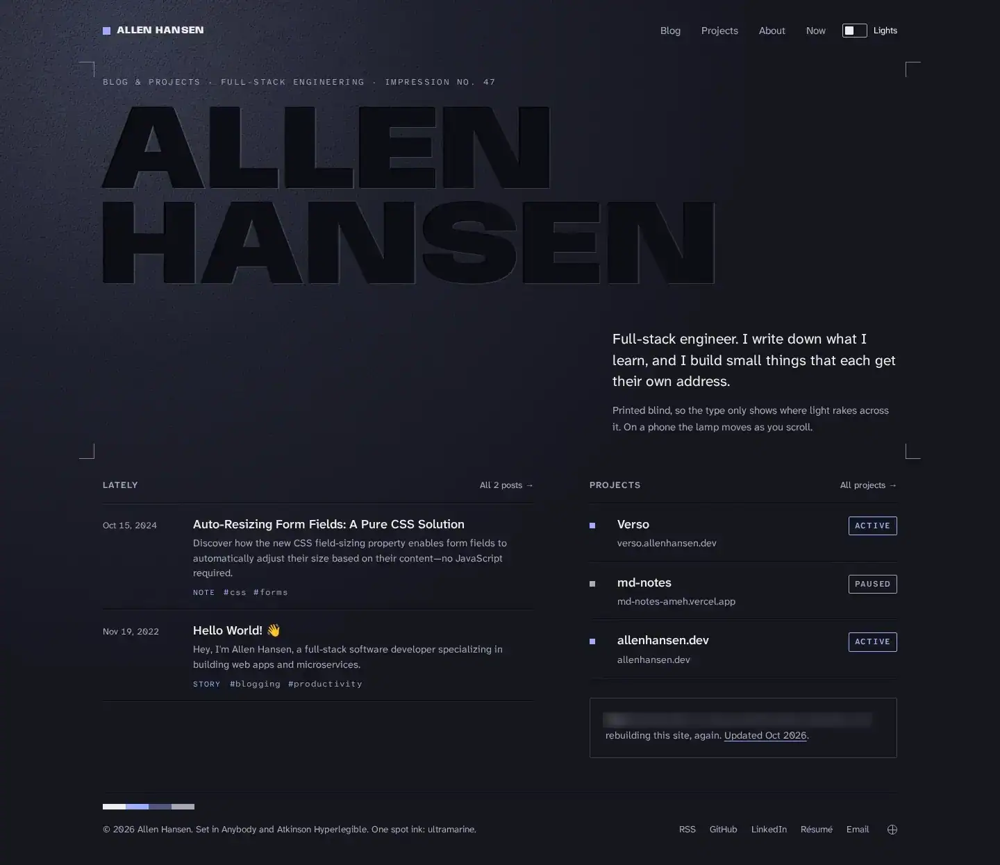

Home as first built in #136, before the copy cleanup in #144. It still has
"Impression No. 47" and the paragraph explaining the lamp. Dark mode, desktop.
Lines of draft copy with personal details that never went on the site are
blurred.

**[`note-dark-desktop.webp`](note-dark-desktop.webp)** · 1000 × 2769, full-page
capture

The field-sizing note after the Baseline 2026 update, rewritten in place with a
change-log entry. Dark mode, desktop.

**[`note-story-dark-desktop.webp`](note-story-dark-desktop.webp)** · 1374 × 1600

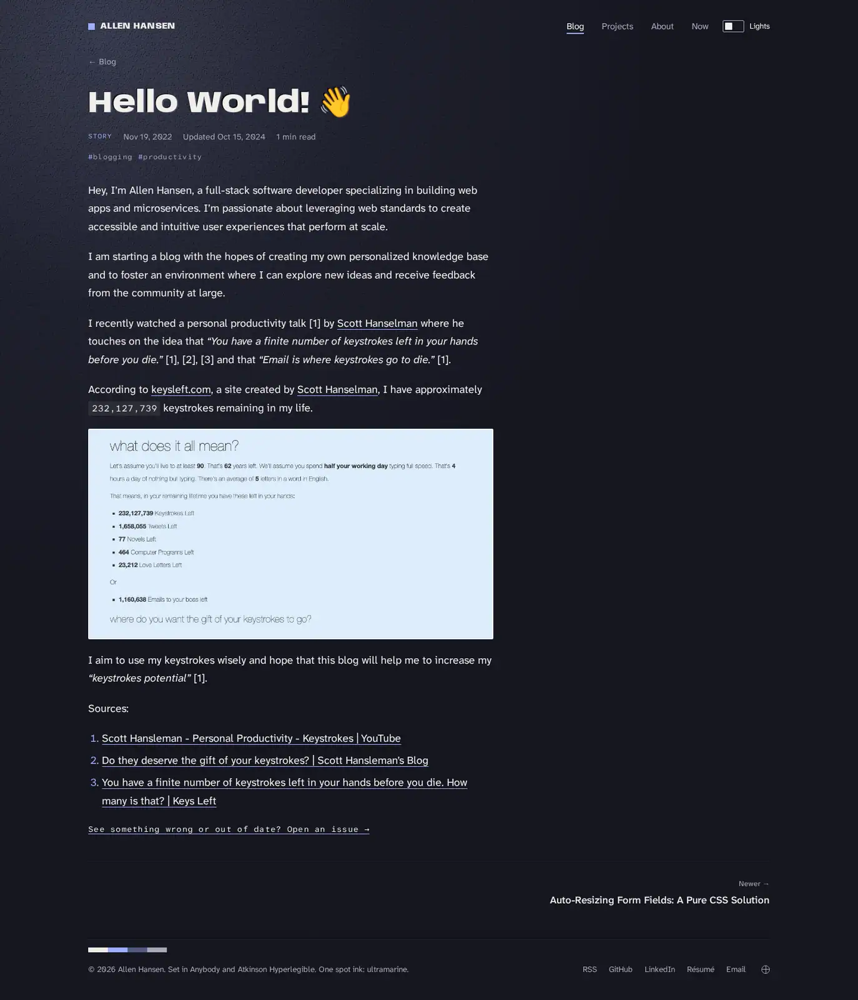

The Hello World story, which uses the same layout as a note apart from its
label. Dark mode, desktop.

**[`now-dark-desktop.webp`](now-dark-desktop.webp)** · 1440 × 900

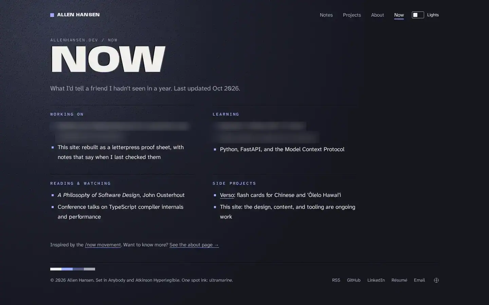

The Now page as built in #136, also behind a flag. Dark mode, desktop. Lines of
draft copy with personal details that never went on the site are blurred.

**`projects-dark-desktop.webp`** · byte-identical to
[`10-releases/v6.0.0/projects-dark-desktop.webp`](../10-releases/v6.0.0/projects-dark-desktop.webp),
so it's stored once

Projects in one grid with Active, Paused, and Archived statuses. Dark mode,
desktop.

**[`resume-dark-desktop.webp`](resume-dark-desktop.webp)** · 873 × 1600

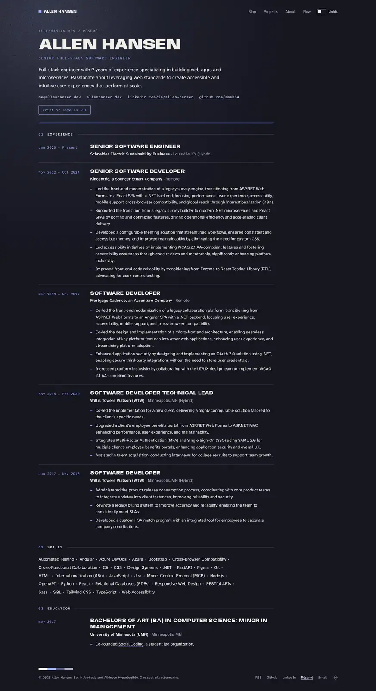

The print-friendly résumé, linked from the footer. Dark mode, desktop.

**[`404-dark-mobile.webp`](404-dark-mobile.webp)** · 600 × 1298

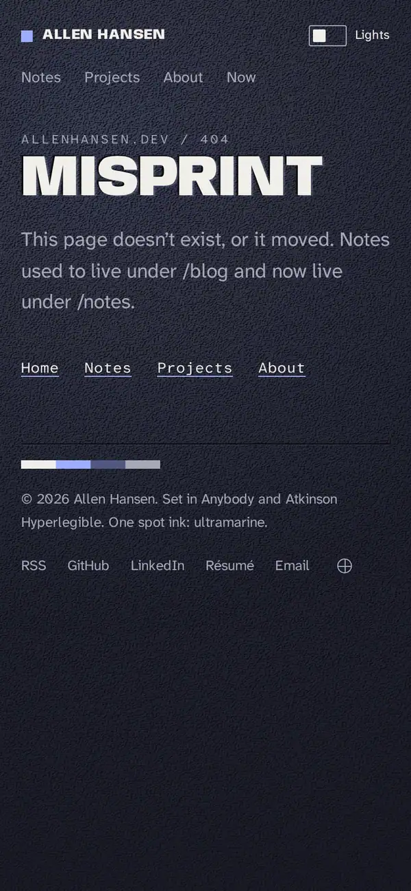

The "Misprint" 404 page. Dark mode, phone.

**[`about-dark-mobile.webp`](about-dark-mobile.webp)** · 600 × 3666, full-page
capture

About as built in #136 with photo variant D: a portrait beside the opener and
"Boba and me" full width. It shipped switched off behind a feature flag. Dark
mode, phone. Lines of draft copy with personal details that never went on the
site are blurred.

**[`home-dark-mobile.webp`](home-dark-mobile.webp)** · 600 × 2592, full-page
capture

Home as first built in #136, before the copy cleanup in #144. It still has
"Impression No. 47" and the paragraph explaining the lamp. Dark mode, phone.
Lines of draft copy with personal details that never went on the site are
blurred.

**[`note-dark-mobile.webp`](note-dark-mobile.webp)** · 600 × 8791, full-page
capture

The field-sizing note after the Baseline 2026 update, rewritten in place with a
change-log entry. Dark mode, phone.

**[`note-story-dark-mobile.webp`](note-story-dark-mobile.webp)** · 600 × 3102,
full-page capture

The Hello World story, which uses the same layout as a note apart from its
label. Dark mode, phone.

**[`now-dark-mobile.webp`](now-dark-mobile.webp)** · 600 × 2205, full-page
capture

The Now page as built in #136, also behind a flag. Dark mode, phone. Lines of
draft copy with personal details that never went on the site are blurred.

**`projects-dark-mobile.webp`** · byte-identical to
[`10-releases/v6.0.0/projects-dark-mobile.webp`](../10-releases/v6.0.0/projects-dark-mobile.webp),
so it's stored once

Projects in one grid with Active, Paused, and Archived statuses. Dark mode,
phone.

**[`resume-dark-mobile.webp`](resume-dark-mobile.webp)** · 600 × 6714, full-page
capture

The print-friendly résumé, linked from the footer. Dark mode, phone.

**[`404-light-desktop.webp`](404-light-desktop.webp)** · 1440 × 900

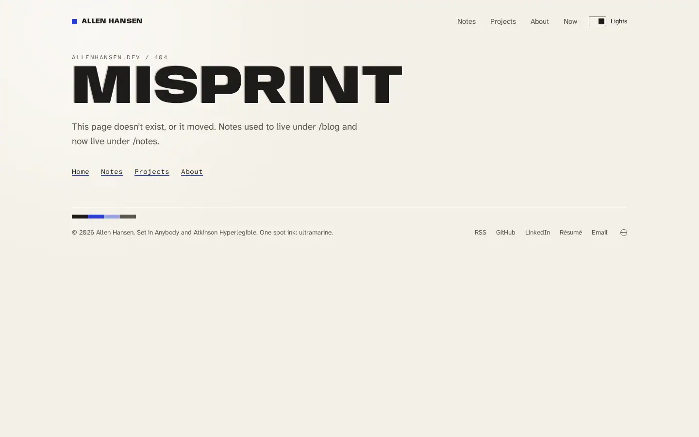

The "Misprint" 404 page. Light mode, desktop.

**[`about-light-desktop.webp`](about-light-desktop.webp)** · 1279 × 1600

About as built in #136 with photo variant D: a portrait beside the opener and
"Boba and me" full width. It shipped switched off behind a feature flag. Light
mode, desktop. Lines of draft copy with personal details that never went on the
site are blurred.

**[`home-light-desktop.webp`](home-light-desktop.webp)** · 1440 × 1246

Home as first built in #136, before the copy cleanup in #144. It still has
"Impression No. 47" and the paragraph explaining the lamp. Light mode, desktop.
Lines of draft copy with personal details that never went on the site are
blurred.

**[`note-light-desktop.webp`](note-light-desktop.webp)** · 1000 × 2769,
full-page capture

The field-sizing note after the Baseline 2026 update, rewritten in place with a
change-log entry. Light mode, desktop.

**[`note-story-light-desktop.webp`](note-story-light-desktop.webp)** · 1374 ×
1600

The Hello World story, which uses the same layout as a note apart from its
label. Light mode, desktop.

**[`now-light-desktop.webp`](now-light-desktop.webp)** · 1440 × 900

The Now page as built in #136, also behind a flag. Light mode, desktop. Lines of
draft copy with personal details that never went on the site are blurred.

**[`projects-light-desktop.webp`](projects-light-desktop.webp)** · 1440 × 1060

Projects in one grid with Active, Paused, and Archived statuses. Light mode,
desktop.

**[`resume-light-desktop.webp`](resume-light-desktop.webp)** · 873 × 1600

The print-friendly résumé, linked from the footer. Light mode, desktop.

**[`404-light-mobile.webp`](404-light-mobile.webp)** · 600 × 1298

The "Misprint" 404 page. Light mode, phone.

**[`about-light-mobile.webp`](about-light-mobile.webp)** · 600 × 3666, full-page
capture

About as built in #136 with photo variant D: a portrait beside the opener and
"Boba and me" full width. It shipped switched off behind a feature flag. Light
mode, phone. Lines of draft copy with personal details that never went on the
site are blurred.

**[`home-light-mobile.webp`](home-light-mobile.webp)** · 600 × 2592, full-page
capture

Home as first built in #136, before the copy cleanup in #144. It still has
"Impression No. 47" and the paragraph explaining the lamp. Light mode, phone.
Lines of draft copy with personal details that never went on the site are
blurred.

**[`note-light-mobile.webp`](note-light-mobile.webp)** · 600 × 8791, full-page
capture

The field-sizing note after the Baseline 2026 update, rewritten in place with a
change-log entry. Light mode, phone.

**[`note-story-light-mobile.webp`](note-story-light-mobile.webp)** · 600 × 3102,
full-page capture

The Hello World story, which uses the same layout as a note apart from its
label. Light mode, phone.

**[`now-light-mobile.webp`](now-light-mobile.webp)** · 600 × 2205, full-page
capture

The Now page as built in #136, also behind a flag. Light mode, phone. Lines of
draft copy with personal details that never went on the site are blurred.

**[`projects-light-mobile.webp`](projects-light-mobile.webp)** · 600 × 2203,
full-page capture

Projects in one grid with Active, Paused, and Archived statuses. Light mode,
phone.

**[`resume-light-mobile.webp`](resume-light-mobile.webp)** · 600 × 6714,
full-page capture

The print-friendly résumé, linked from the footer. Light mode, phone.
