# Publishing About and Now

[All images](../README.md) · [Narrative](../../07-build-and-refinements.md)

Screenshots from [PR #151](https://github.com/AMEH64/allenhansen.dev/pull/151),
which removes the feature flags and publishes About and Now with Allen's final
copy and three new photos. That PR was still open when this history was written,
so these pages may not be live yet.

**[`about-photos-desktop.webp`](about-photos-desktop.webp)** · 1274 × 1600

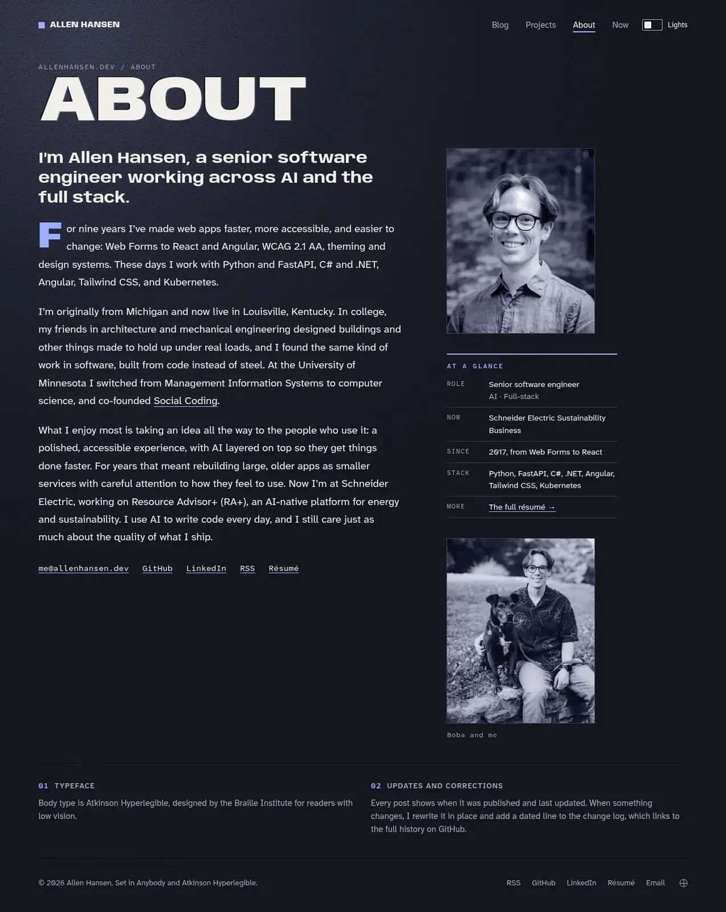

About with the final copy and two photos in the sidebar: a new headshot above
"At a glance" and Allen with Boba below it. All photos keep the low ink tint
chosen in round 5.

**[`about-photos-phone.webp`](about-photos-phone.webp)** · 600 × 4545, full-page
capture

About on a phone, where the sidebar stacks under the opener.

**[`about-photos-phone-dark.webp`](about-photos-phone-dark.webp)** · 600 × 4545,
full-page capture

About on a phone, dark mode.

**[`glance-phone-dark.webp`](glance-phone-dark.webp)** · 732 × 568

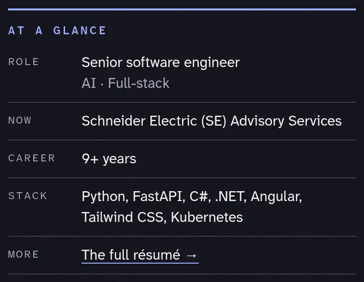

"At a glance" on a phone, dark mode.

**[`home-intro-desktop.webp`](home-intro-desktop.webp)** · 1280 × 900

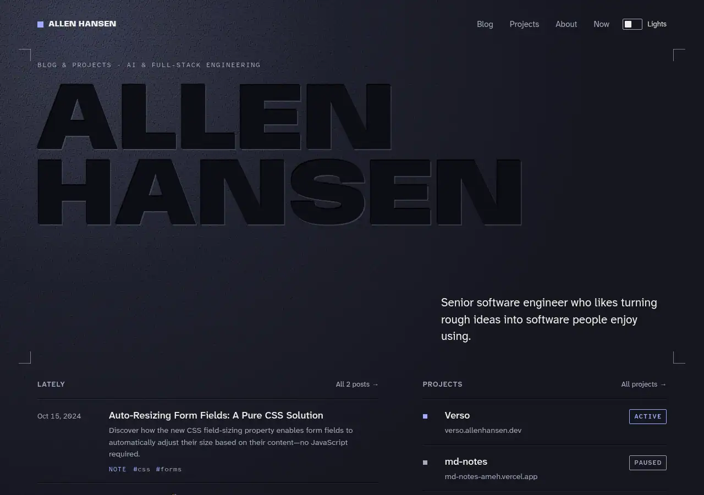

The home intro retitled "Senior software engineer…".

**[`home-intro-phone.webp`](home-intro-phone.webp)** · 600 × 1385, full-page
capture

The home intro on a phone.

**[`home-slug-desktop.webp`](home-slug-desktop.webp)** · 1600 × 250

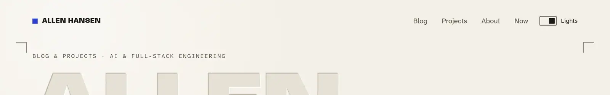

The home slug line, "Blog & projects · AI & full-stack engineering".

**[`home-slug-phone.webp`](home-slug-phone.webp)** · 780 × 520

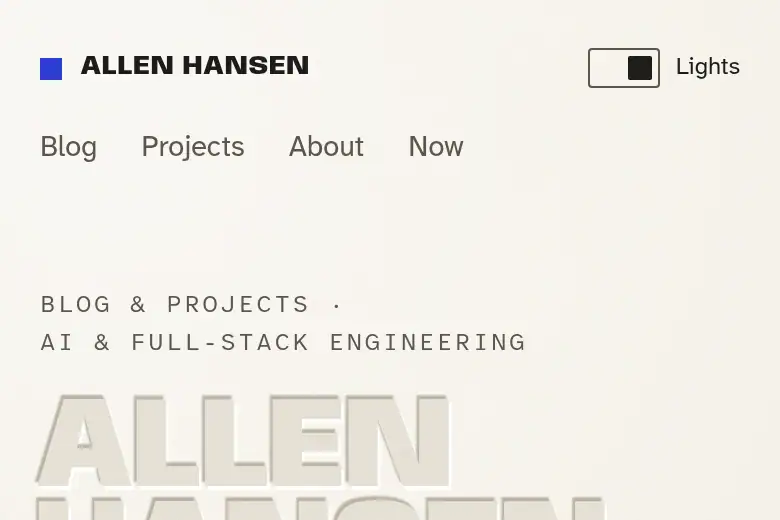

The slug line on a phone, where it breaks after the dot.

**[`now-photo-desktop.webp`](now-photo-desktop.webp)** · 1280 × 1235

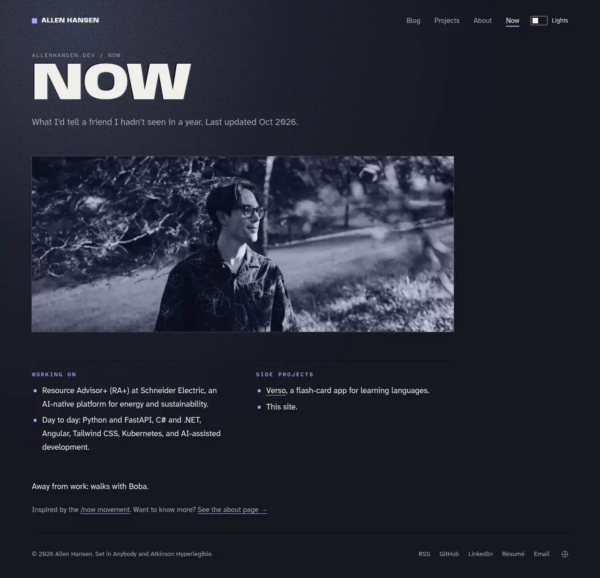

Now with the park photo in a wide frame under the title.

**[`now-photo-phone.webp`](now-photo-phone.webp)** · 600 × 2069, full-page
capture

Now on a phone, where the photo uses its full 3:2 crop.

**[`now-photo-phone-dark.webp`](now-photo-phone-dark.webp)** · 600 × 2069,
full-page capture

Now on a phone, dark mode.

**[`og-index.webp`](og-index.webp)** · 1200 × 630

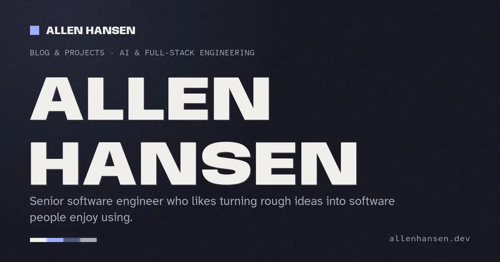

The Home share image with the new description.

**[`og-resume.webp`](og-resume.webp)** · 1200 × 630

The Résumé share image with the new description.

**[`resume-print-top.webp`](resume-print-top.webp)** · 816 × 1056

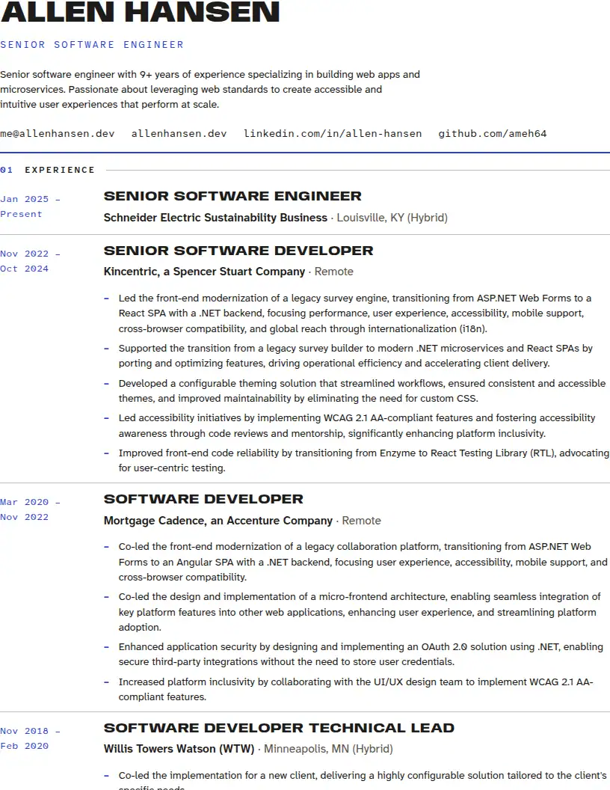

The top of the printed résumé with the new headline, "Senior Software Engineer".

**[`about-photos-desktop-light.webp`](about-photos-desktop-light.webp)** · 1274
× 1600

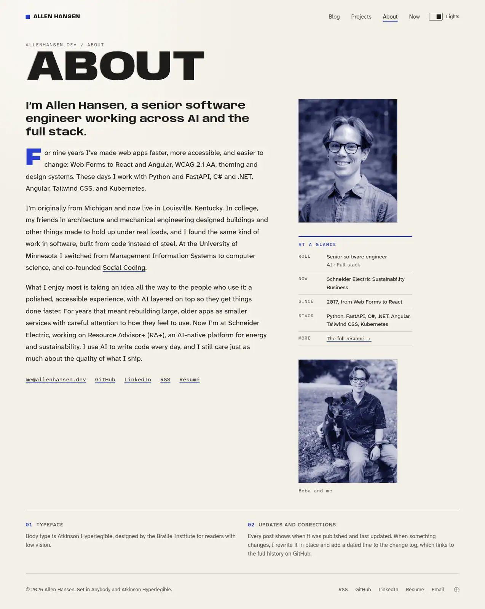

The same About page in light mode.

**[`glance-desktop-light.webp`](glance-desktop-light.webp)** · 632 × 610

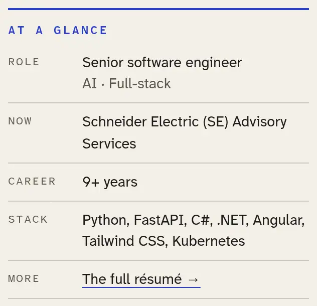

The "At a glance" panel: role, current work, career length (computed from the
same value as the résumé), and stack.

**[`now-photo-desktop-light.webp`](now-photo-desktop-light.webp)** · 1280 × 1235

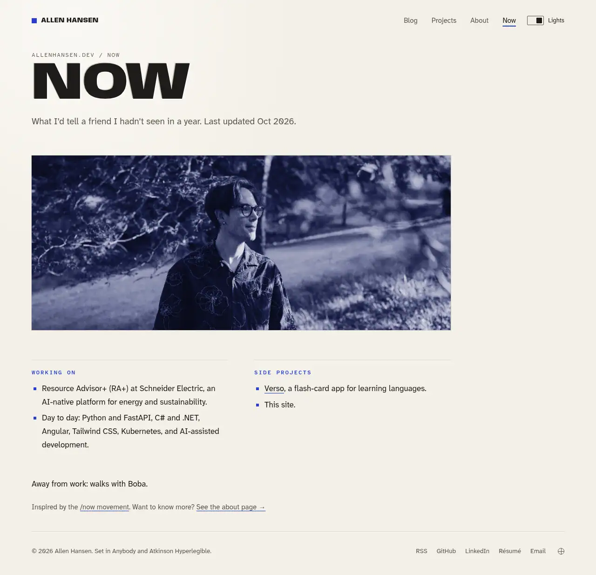

Now in light mode.
