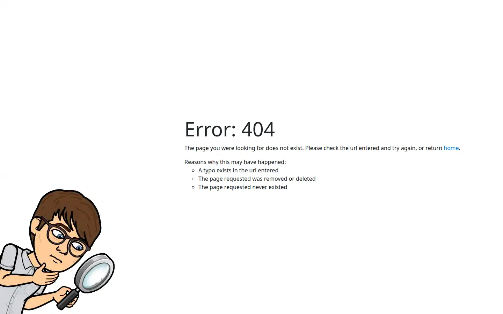
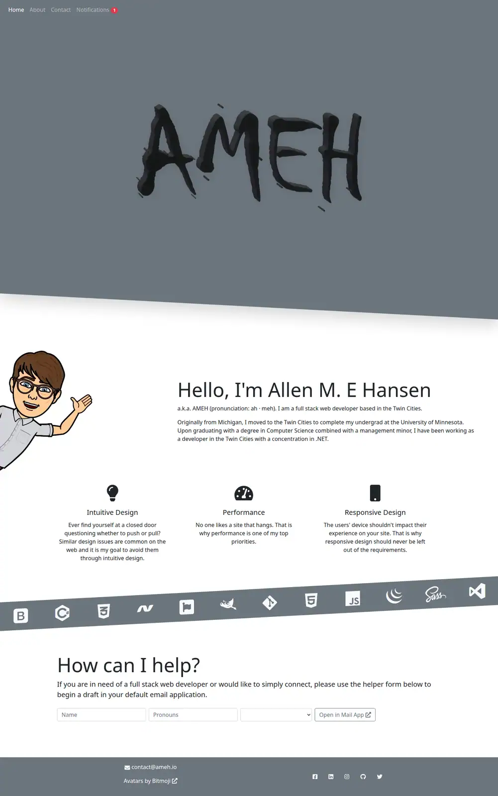
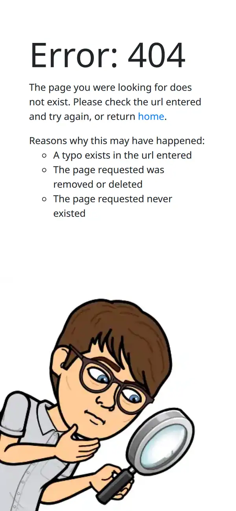

# v2.0.0 (Jun 2020)

[All images](../../README.md) · [All releases](../index.md) ·
[GitHub release](https://github.com/AMEH64/allenhansen.dev/releases/tag/v2.0.0)

Hand-written Bootstrap 4.5 refresh: brush-script AMEH logo, Bitmoji avatars,
three values, scroll animations, and a 404 page. Commit `782ea00`.

**[`404-light-desktop.webp`](404-light-desktop.webp)** · 1440 × 900

v2.0.0 404 page, light mode, desktop, rebuilt from `782ea00`.

**[`home-light-desktop.webp`](home-light-desktop.webp)** · 1001 × 1600

v2.0.0 Home, light mode, desktop, rebuilt from `782ea00`.

**[`404-light-mobile.webp`](404-light-mobile.webp)** · 600 × 1298

v2.0.0 404 page, light mode, phone, rebuilt from `782ea00`.

**[`home-light-mobile.webp`](home-light-mobile.webp)** · 600 × 5723, full-page
capture

v2.0.0 Home, light mode, phone, rebuilt from `782ea00`.
