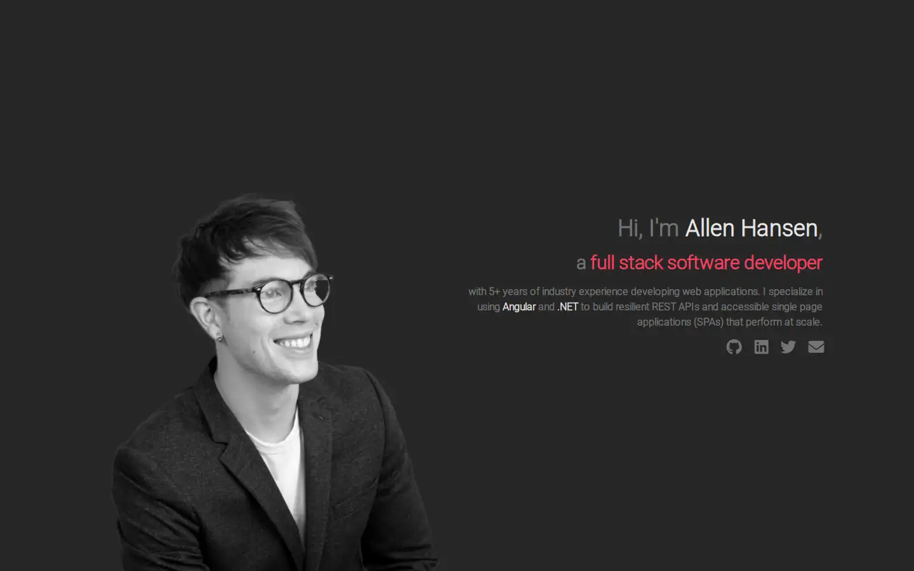
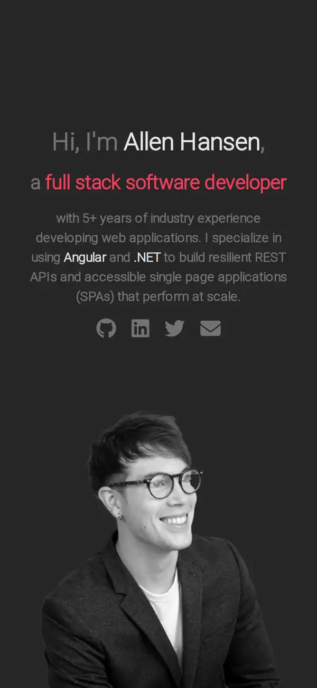
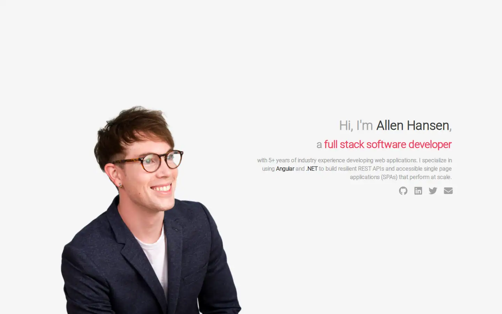
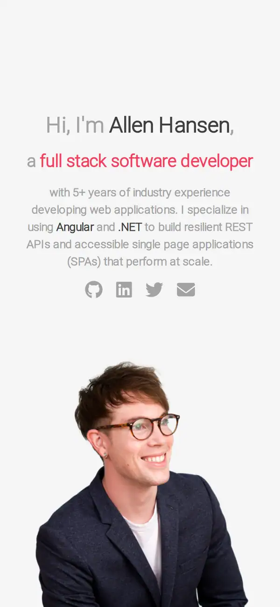

# v3.0.1 (Sep 25, 2022)

[All images](../../README.md) · [All releases](../index.md) ·
[GitHub release](https://github.com/AMEH64/allenhansen.dev/releases/tag/v3.0.1)

Dark and light themes, new copy, and a rose accent. Commit `81572d2`.

**[`home-dark-desktop.webp`](home-dark-desktop.webp)** · 1440 × 900

v3.0.1 Home, dark mode, desktop, rebuilt from `81572d2`.

**[`home-dark-mobile.webp`](home-dark-mobile.webp)** · 600 × 1298

v3.0.1 Home, dark mode, phone, rebuilt from `81572d2`.

**[`home-light-desktop.webp`](home-light-desktop.webp)** · 1440 × 900

v3.0.1 Home, light mode, desktop, rebuilt from `81572d2`.

**[`home-light-mobile.webp`](home-light-mobile.webp)** · 600 × 1298

v3.0.1 Home, light mode, phone, rebuilt from `81572d2`.
