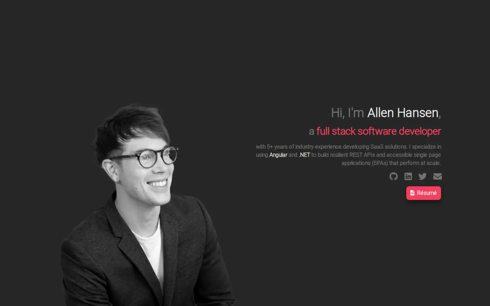
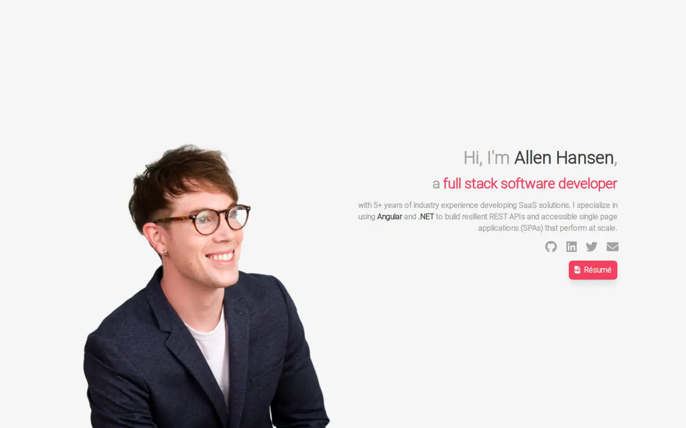

# v3.1.3 (Oct 15, 2022)

[All images](../../README.md) · [All releases](../index.md) ·
[GitHub release](https://github.com/AMEH64/allenhansen.dev/releases/tag/v3.1.3)

A résumé file rename and hosting cleanup. Commit `cf74fda`.

**[`home-dark-desktop.webp`](home-dark-desktop.webp)** · 1440 × 900

v3.1.3 Home, dark mode, desktop, rebuilt from `cf74fda`.

**[`home-dark-mobile.webp`](home-dark-mobile.webp)** · 600 × 1298

v3.1.3 Home, dark mode, phone, rebuilt from `cf74fda`.

**[`home-light-desktop.webp`](home-light-desktop.webp)** · 1440 × 900

v3.1.3 Home, light mode, desktop, rebuilt from `cf74fda`.

**[`home-light-mobile.webp`](home-light-mobile.webp)** · 600 × 1298

v3.1.3 Home, light mode, phone, rebuilt from `cf74fda`.
