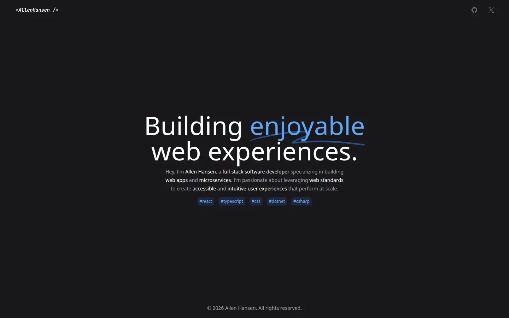
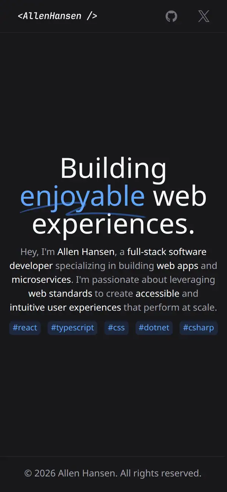
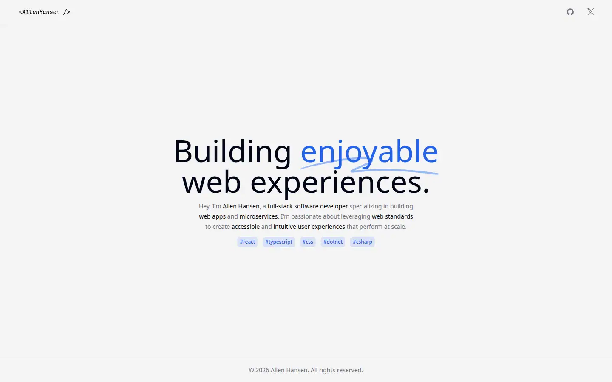
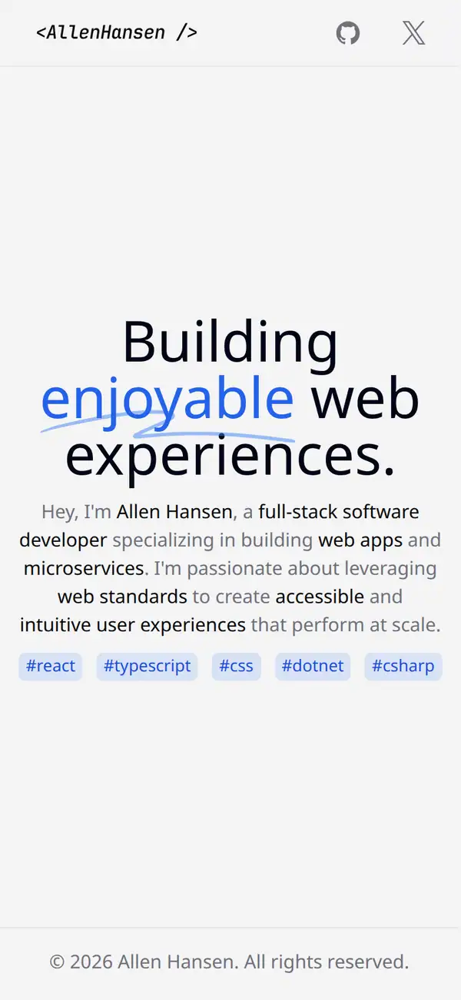

# v4.0.0 (Apr 24, 2024)

[All images](../../README.md) · [All releases](../index.md) ·
[GitHub release](https://github.com/AMEH64/allenhansen.dev/releases/tag/v4.0.0)

Remix on Vercel: the `<AllenHansen />` wordmark, a blue accent, and "Building
enjoyable web experiences." Commit `a155152`.

**[`home-dark-desktop.webp`](home-dark-desktop.webp)** · 1440 × 900

v4.0.0 Home, dark mode, desktop, rebuilt from `a155152`.

**[`home-dark-mobile.webp`](home-dark-mobile.webp)** · 600 × 1299

v4.0.0 Home, dark mode, phone, rebuilt from `a155152`.

**[`home-light-desktop.webp`](home-light-desktop.webp)** · 1440 × 900

v4.0.0 Home, light mode, desktop, rebuilt from `a155152`.

**[`home-light-mobile.webp`](home-light-mobile.webp)** · 600 × 1299

v4.0.0 Home, light mode, phone, rebuilt from `a155152`.
