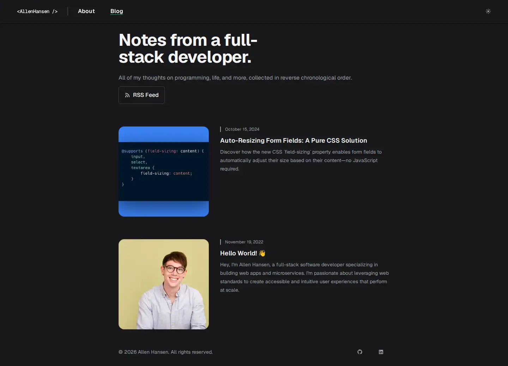
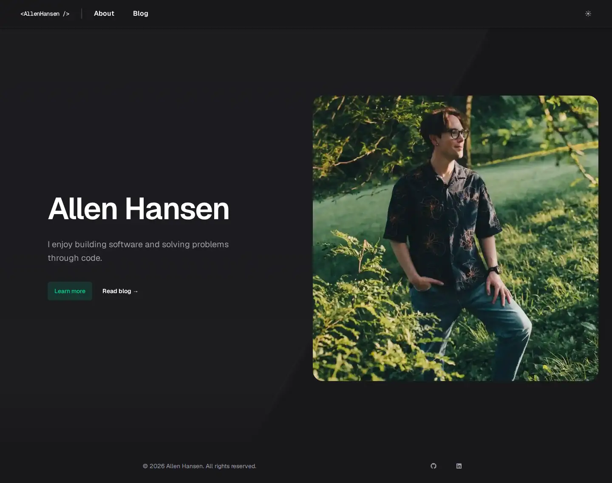
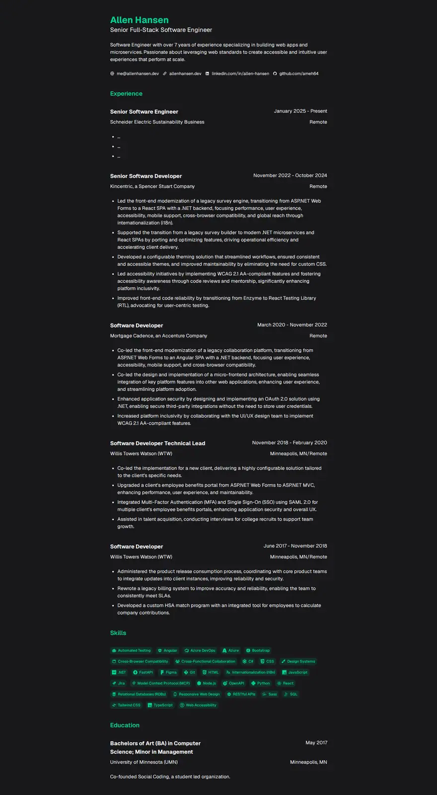
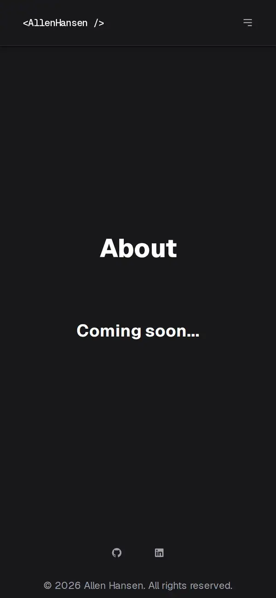
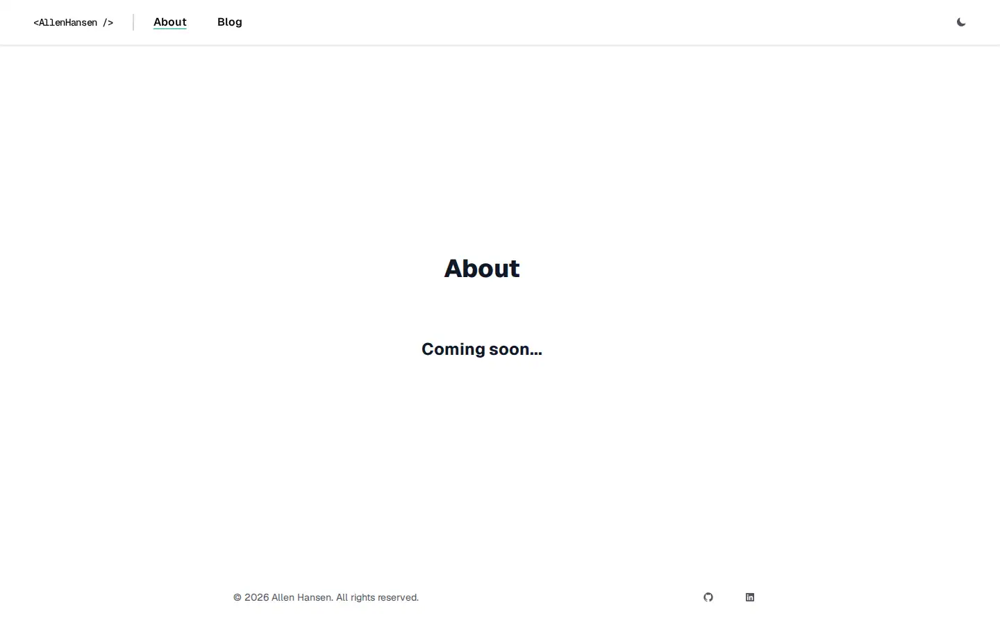
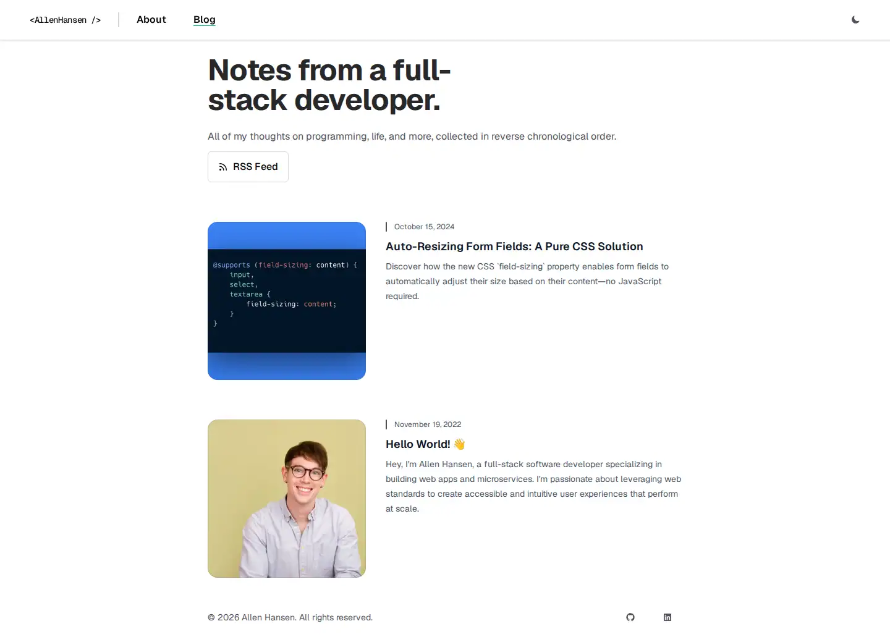
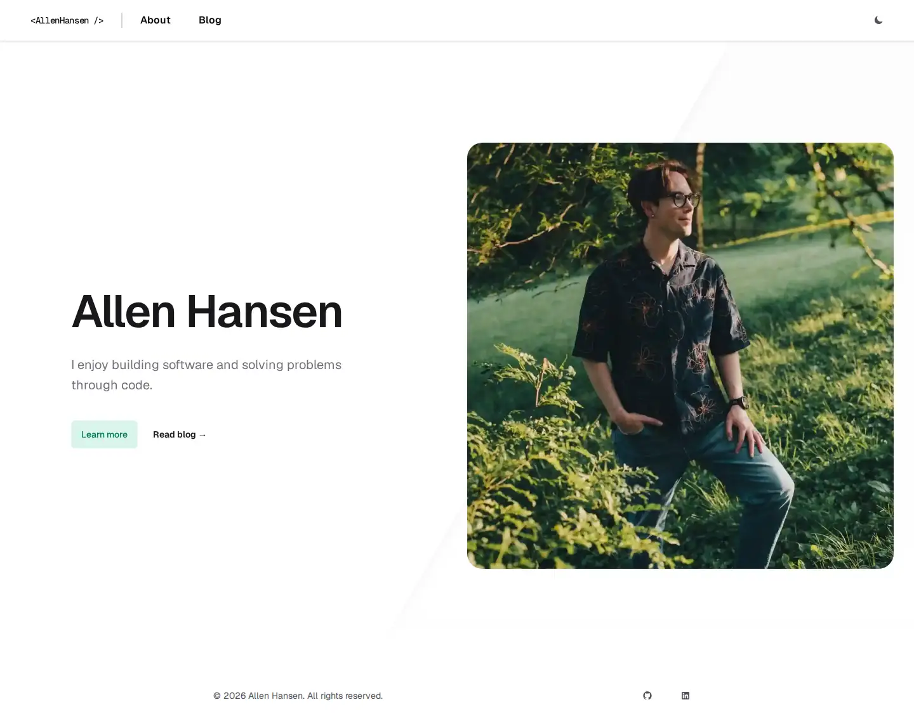
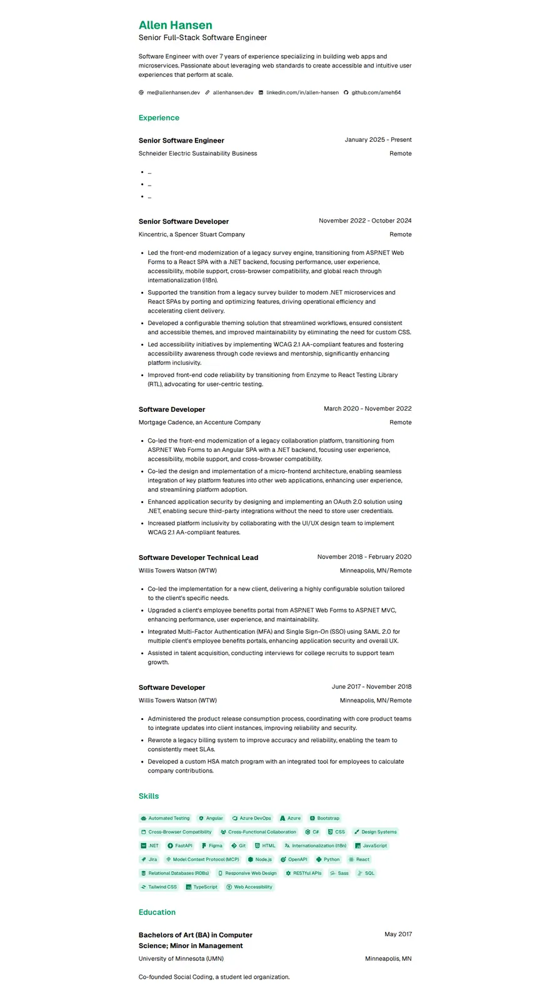
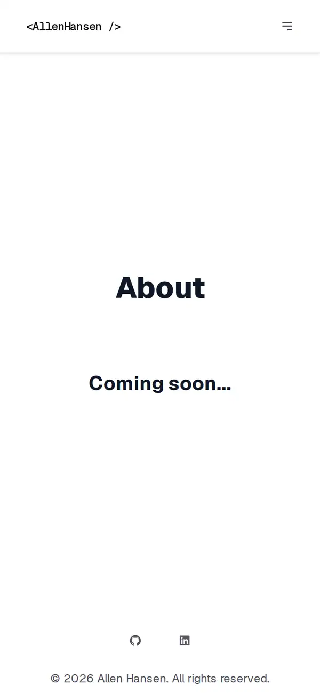

# v5.2.0 (Aug 2025)

[All images](../../README.md) · [All releases](../index.md) ·
[GitHub release](https://github.com/AMEH64/allenhansen.dev/releases/tag/v5.2.0)

The emerald home page with a golden-hour photo hero; earlier, Tailwind 4 and
pnpm. Commit `a2db52a`.

**[`about-dark-desktop.webp`](about-dark-desktop.webp)** · 1440 × 900

v5.2.0 About, dark mode, desktop, rebuilt from `a2db52a`.

**[`blog-dark-desktop.webp`](blog-dark-desktop.webp)** · 1440 × 1039

v5.2.0 Blog, dark mode, desktop, rebuilt from `a2db52a`.

**[`home-dark-desktop.webp`](home-dark-desktop.webp)** · 1440 × 1137

v5.2.0 Home, dark mode, desktop, rebuilt from `a2db52a`.

**[`post-dark-desktop.webp`](post-dark-desktop.webp)** · 1000 × 2728, full-page
capture

v5.2.0 Blog post, dark mode, desktop, rebuilt from `a2db52a`.

**[`resume-dark-desktop.webp`](resume-dark-desktop.webp)** · 880 × 1600

v5.2.0 Résumé, dark mode, desktop, rebuilt from `a2db52a`.

**[`about-dark-mobile.webp`](about-dark-mobile.webp)** · 600 × 1298

v5.2.0 About, dark mode, phone, rebuilt from `a2db52a`.

**[`blog-dark-mobile.webp`](blog-dark-mobile.webp)** · 600 × 2058, full-page
capture

v5.2.0 Blog, dark mode, phone, rebuilt from `a2db52a`.

**[`home-dark-mobile.webp`](home-dark-mobile.webp)** · 600 × 1682, full-page
capture

v5.2.0 Home, dark mode, phone, rebuilt from `a2db52a`.

**[`post-dark-mobile.webp`](post-dark-mobile.webp)** · 600 × 7674, full-page
capture

v5.2.0 Blog post, dark mode, phone, rebuilt from `a2db52a`.

**[`resume-dark-mobile.webp`](resume-dark-mobile.webp)** · 600 × 7637, full-page
capture

v5.2.0 Résumé, dark mode, phone, rebuilt from `a2db52a`.

**[`about-light-desktop.webp`](about-light-desktop.webp)** · 1440 × 900

v5.2.0 About, light mode, desktop, rebuilt from `a2db52a`.

**[`blog-light-desktop.webp`](blog-light-desktop.webp)** · 1440 × 1039

v5.2.0 Blog, light mode, desktop, rebuilt from `a2db52a`.

**[`home-light-desktop.webp`](home-light-desktop.webp)** · 1440 × 1137

v5.2.0 Home, light mode, desktop, rebuilt from `a2db52a`.

**[`post-light-desktop.webp`](post-light-desktop.webp)** · 1000 × 2728,
full-page capture

v5.2.0 Blog post, light mode, desktop, rebuilt from `a2db52a`.

**[`resume-light-desktop.webp`](resume-light-desktop.webp)** · 880 × 1600

v5.2.0 Résumé, light mode, desktop, rebuilt from `a2db52a`.

**[`about-light-mobile.webp`](about-light-mobile.webp)** · 600 × 1298

v5.2.0 About, light mode, phone, rebuilt from `a2db52a`.

**[`blog-light-mobile.webp`](blog-light-mobile.webp)** · 600 × 2058, full-page
capture

v5.2.0 Blog, light mode, phone, rebuilt from `a2db52a`.

**[`home-light-mobile.webp`](home-light-mobile.webp)** · 600 × 1682, full-page
capture

v5.2.0 Home, light mode, phone, rebuilt from `a2db52a`.

**[`post-light-mobile.webp`](post-light-mobile.webp)** · 600 × 7674, full-page
capture

v5.2.0 Blog post, light mode, phone, rebuilt from `a2db52a`.

**[`resume-light-mobile.webp`](resume-light-mobile.webp)** · 600 × 7637,
full-page capture

v5.2.0 Résumé, light mode, phone, rebuilt from `a2db52a`.
