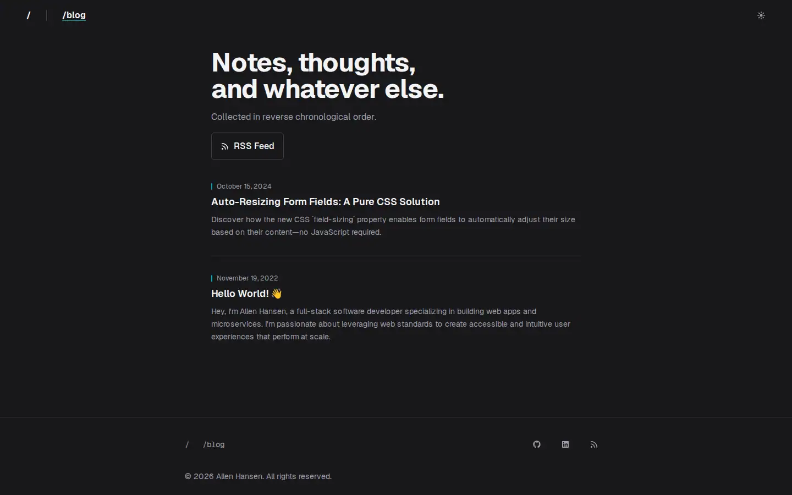
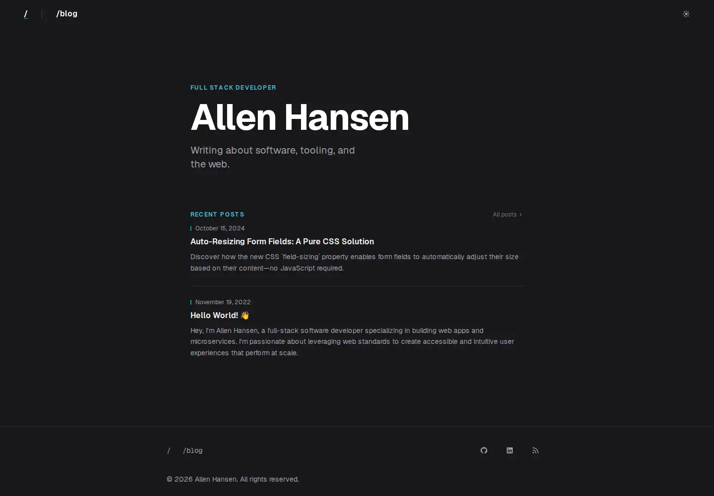
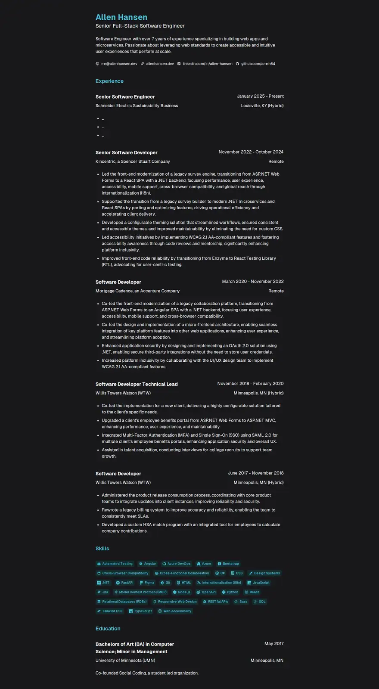
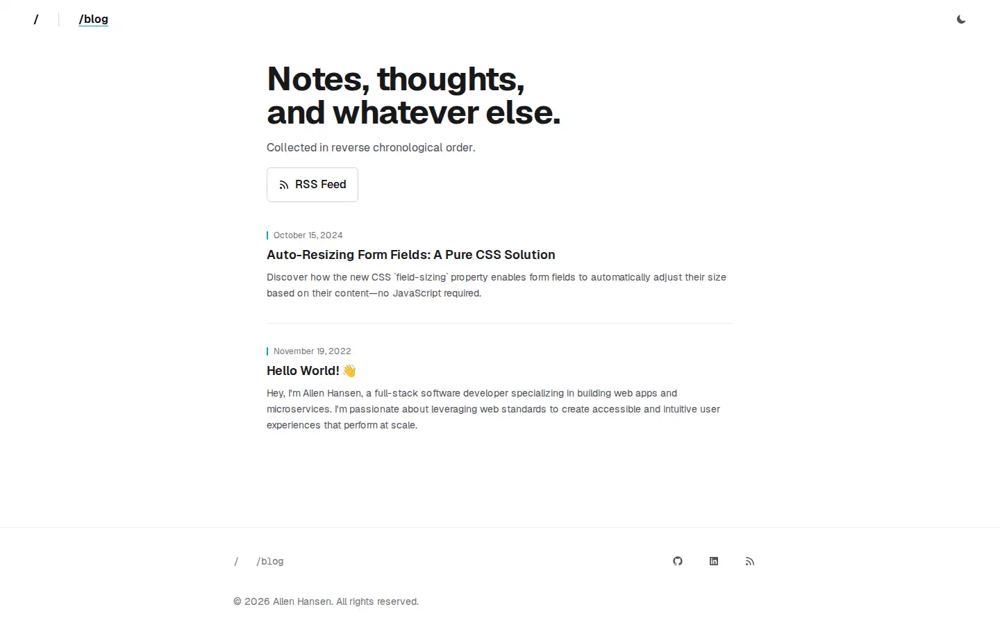
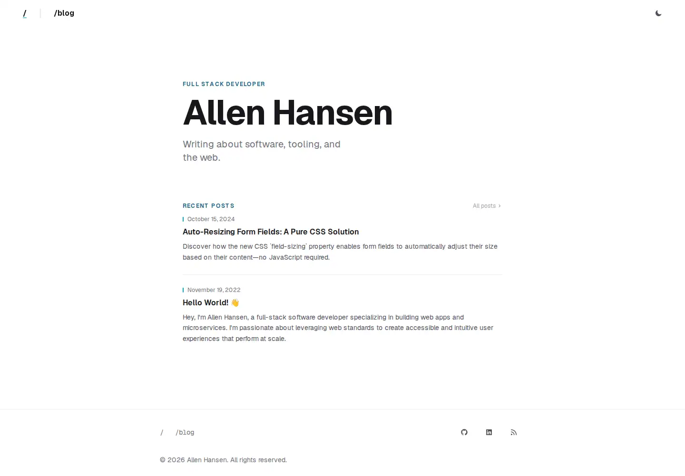
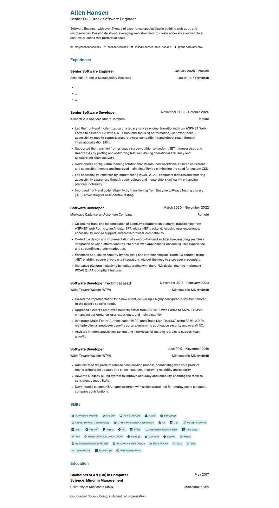

# v5.3.0 (May 2, 2026)

[All images](../../README.md) · [All releases](../index.md) ·
[GitHub release](https://github.com/AMEH64/allenhansen.dev/releases/tag/v5.3.0)

Text-first refresh: photo removed, teal-slate accent, Geist, `/path` nav, recent
posts, Astro 6. This is the site the redesign started from. Commit `0e7782e`.

**[`blog-dark-desktop.webp`](blog-dark-desktop.webp)** · 1440 × 900

v5.3.0 Blog, dark mode, desktop, rebuilt from `0e7782e`.

**[`home-dark-desktop.webp`](home-dark-desktop.webp)** · 1440 × 1001

v5.3.0 Home, dark mode, desktop, rebuilt from `0e7782e`.

**[`post-dark-desktop.webp`](post-dark-desktop.webp)** · 1000 × 2669, full-page
capture

v5.3.0 Blog post, dark mode, desktop, rebuilt from `0e7782e`.

**[`resume-dark-desktop.webp`](resume-dark-desktop.webp)** · 880 × 1600

v5.3.0 Résumé, dark mode, desktop, rebuilt from `0e7782e`.

**[`blog-dark-mobile.webp`](blog-dark-mobile.webp)** · 600 × 1398, full-page
capture

v5.3.0 Blog, dark mode, phone, rebuilt from `0e7782e`.

**[`home-dark-mobile.webp`](home-dark-mobile.webp)** · 600 × 1512, full-page
capture

v5.3.0 Home, dark mode, phone, rebuilt from `0e7782e`.

**[`post-dark-mobile.webp`](post-dark-mobile.webp)** · 600 × 7675, full-page
capture

v5.3.0 Blog post, dark mode, phone, rebuilt from `0e7782e`.

**[`resume-dark-mobile.webp`](resume-dark-mobile.webp)** · 600 × 7637, full-page
capture

v5.3.0 Résumé, dark mode, phone, rebuilt from `0e7782e`.

**[`blog-light-desktop.webp`](blog-light-desktop.webp)** · 1440 × 900

v5.3.0 Blog, light mode, desktop, rebuilt from `0e7782e`.

**[`home-light-desktop.webp`](home-light-desktop.webp)** · 1440 × 1001

v5.3.0 Home, light mode, desktop, rebuilt from `0e7782e`.

**[`post-light-desktop.webp`](post-light-desktop.webp)** · 1000 × 2669,
full-page capture

v5.3.0 Blog post, light mode, desktop, rebuilt from `0e7782e`.

**[`resume-light-desktop.webp`](resume-light-desktop.webp)** · 880 × 1600

v5.3.0 Résumé, light mode, desktop, rebuilt from `0e7782e`.

**[`blog-light-mobile.webp`](blog-light-mobile.webp)** · 600 × 1398, full-page
capture

v5.3.0 Blog, light mode, phone, rebuilt from `0e7782e`.

**[`home-light-mobile.webp`](home-light-mobile.webp)** · 600 × 1512, full-page
capture

v5.3.0 Home, light mode, phone, rebuilt from `0e7782e`.

**[`post-light-mobile.webp`](post-light-mobile.webp)** · 600 × 7675, full-page
capture

v5.3.0 Blog post, light mode, phone, rebuilt from `0e7782e`.

**[`resume-light-mobile.webp`](resume-light-mobile.webp)** · 600 × 7637,
full-page capture

v5.3.0 Résumé, light mode, phone, rebuilt from `0e7782e`.
