# v6.0.0 (Oct 14, 2026)

[All images](../../README.md) · [All releases](../index.md) ·
[GitHub release](https://github.com/AMEH64/allenhansen.dev/releases/tag/v6.0.0)

The Letterpress redesign: a Blog with Note and Story labels, tags and filters,
Projects, a print-friendly résumé, and About and Now behind flags. Captured from
production. Commit `128d61b`.

**[`blog-dark-desktop.webp`](blog-dark-desktop.webp)** · 1440 × 900

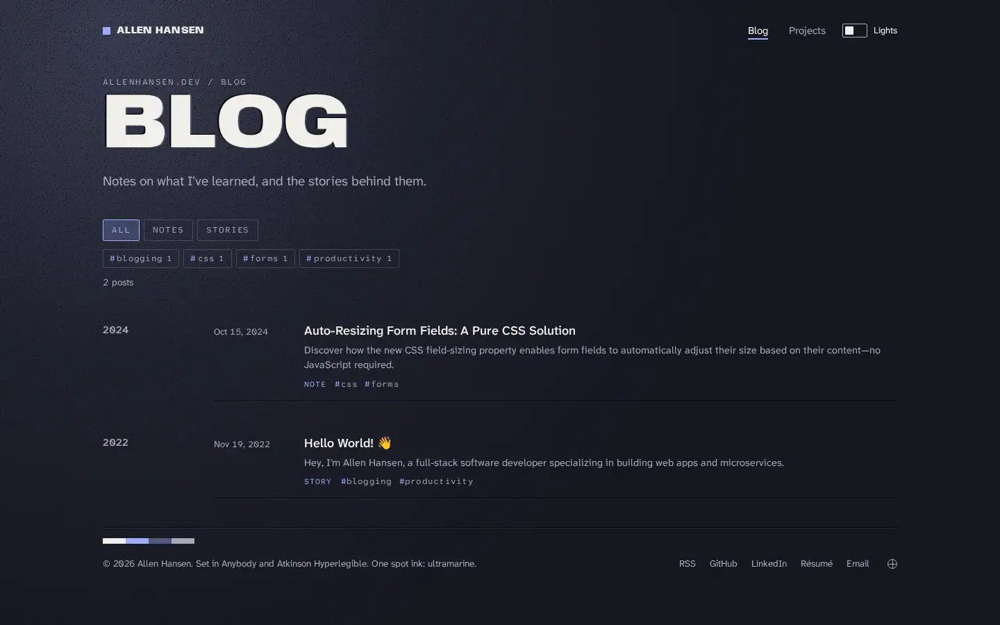

v6.0.0 Blog, dark mode, desktop, from production.

**[`blog-filtered-dark-desktop.webp`](blog-filtered-dark-desktop.webp)** · 1440
× 900

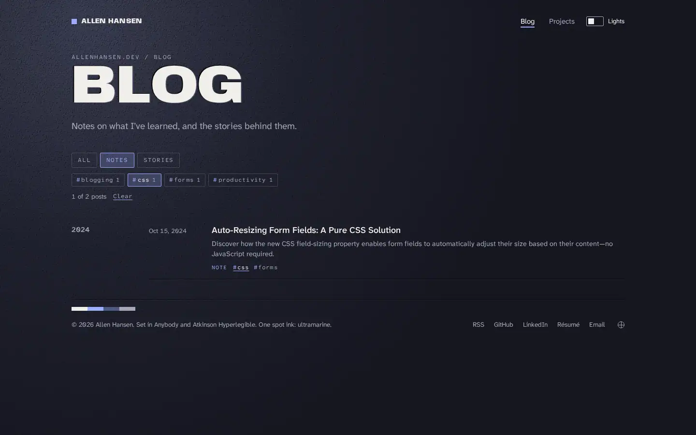

v6.0.0 Blog filtered by tag, dark mode, desktop, from production.

**[`home-dark-desktop.webp`](home-dark-desktop.webp)** · 1440 × 1165

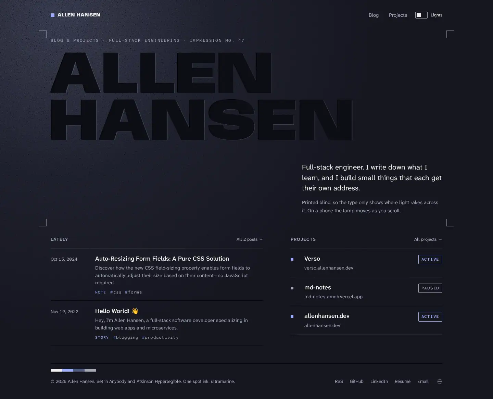

v6.0.0 Home, dark mode, desktop, from production.

**[`note-dark-desktop.webp`](note-dark-desktop.webp)** · 1000 × 2769, full-page
capture

v6.0.0 Note, dark mode, desktop, from production.

**[`projects-dark-desktop.webp`](projects-dark-desktop.webp)** · 1440 × 1060

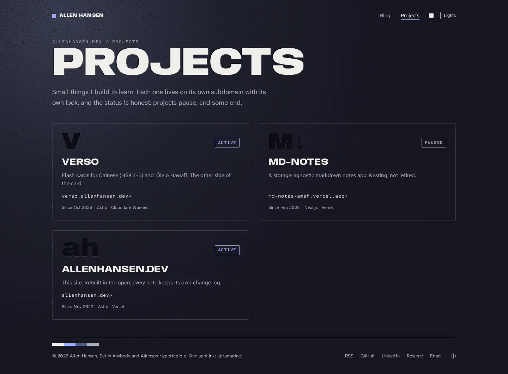

v6.0.0 Projects, dark mode, desktop, from production.

**[`resume-dark-desktop.webp`](resume-dark-desktop.webp)** · 873 × 1600

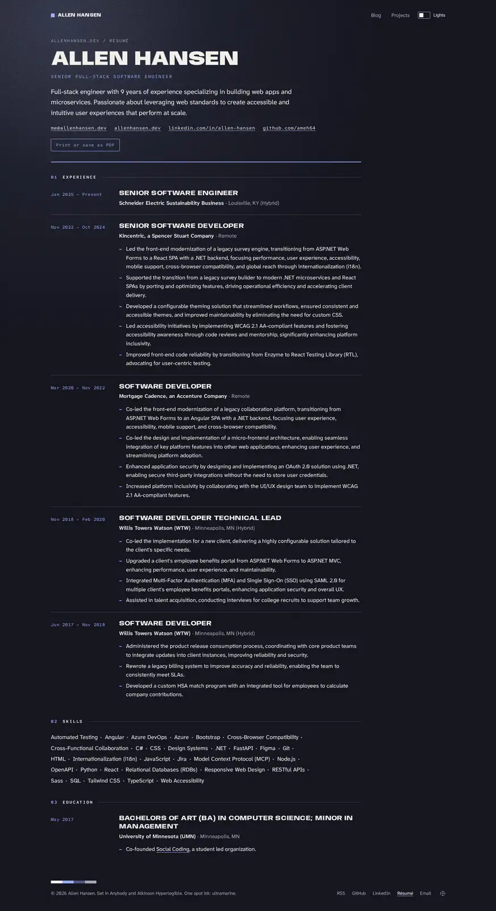

v6.0.0 Résumé, dark mode, desktop, from production.

**[`story-dark-desktop.webp`](story-dark-desktop.webp)** · 1374 × 1600

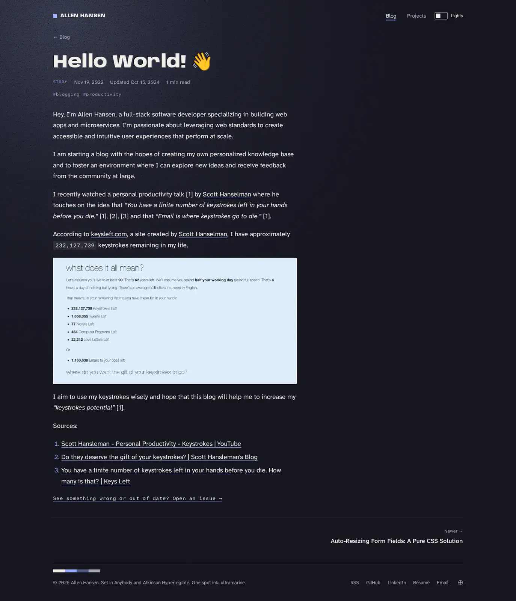

v6.0.0 Story (Hello World), dark mode, desktop, from production.

**[`blog-dark-mobile.webp`](blog-dark-mobile.webp)** · 600 × 1771, full-page
capture

v6.0.0 Blog, dark mode, phone, from production.

**[`home-dark-mobile.webp`](home-dark-mobile.webp)** · 600 × 2380, full-page
capture

v6.0.0 Home, dark mode, phone, from production.

**[`note-dark-mobile.webp`](note-dark-mobile.webp)** · 600 × 8791, full-page
capture

v6.0.0 Note, dark mode, phone, from production.

**[`projects-dark-mobile.webp`](projects-dark-mobile.webp)** · 600 × 2203,
full-page capture

v6.0.0 Projects, dark mode, phone, from production.

**[`resume-dark-mobile.webp`](resume-dark-mobile.webp)** · 600 × 6714, full-page
capture

v6.0.0 Résumé, dark mode, phone, from production.

**[`story-dark-mobile.webp`](story-dark-mobile.webp)** · 600 × 3102, full-page
capture

v6.0.0 Story (Hello World), dark mode, phone, from production.

**[`blog-light-desktop.webp`](blog-light-desktop.webp)** · 1440 × 900

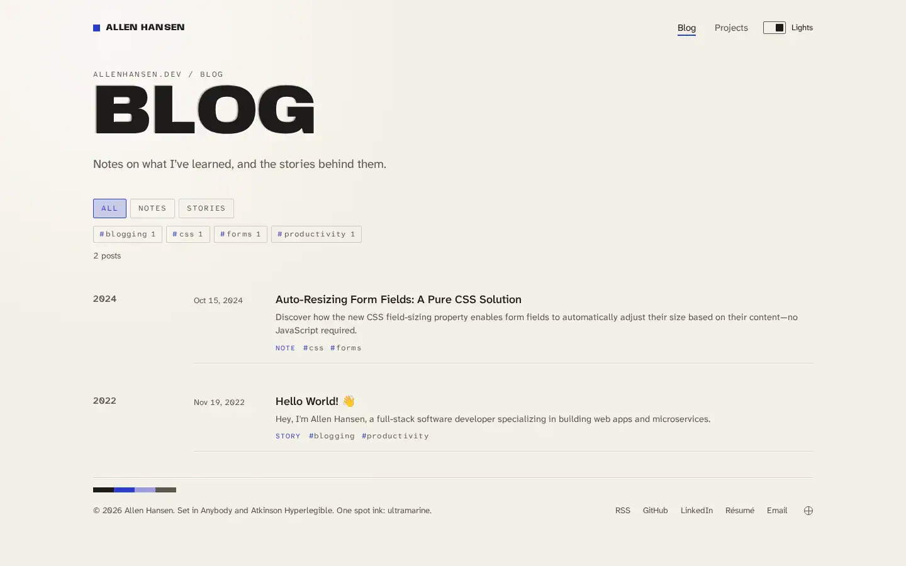

v6.0.0 Blog, light mode, desktop, from production.

**[`home-light-desktop.webp`](home-light-desktop.webp)** · 1440 × 1165

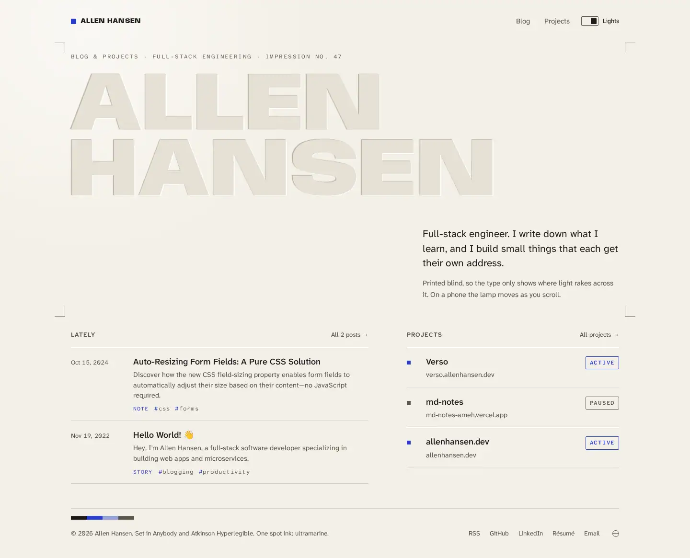

v6.0.0 Home, light mode, desktop, from production.

**[`note-light-desktop.webp`](note-light-desktop.webp)** · 1000 × 2769,
full-page capture

v6.0.0 Note, light mode, desktop, from production.

**[`projects-light-desktop.webp`](projects-light-desktop.webp)** · 1440 × 1060

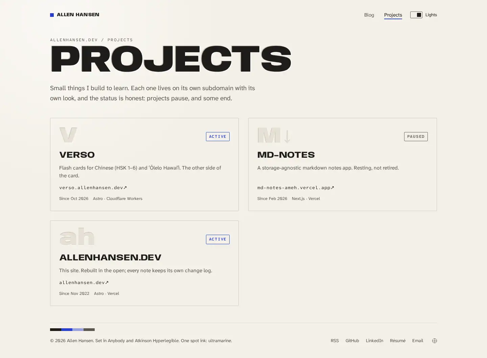

v6.0.0 Projects, light mode, desktop, from production.

**[`resume-light-desktop.webp`](resume-light-desktop.webp)** · 873 × 1600

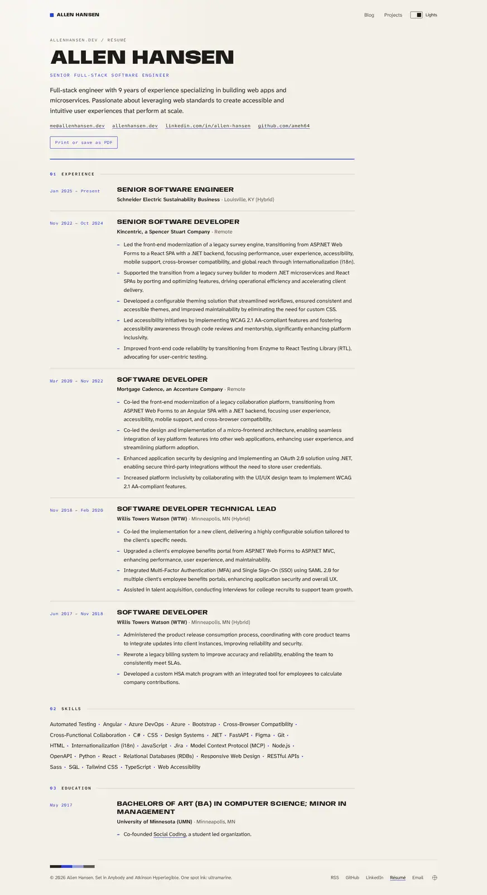

v6.0.0 Résumé, light mode, desktop, from production.

**[`story-light-desktop.webp`](story-light-desktop.webp)** · 1374 × 1600

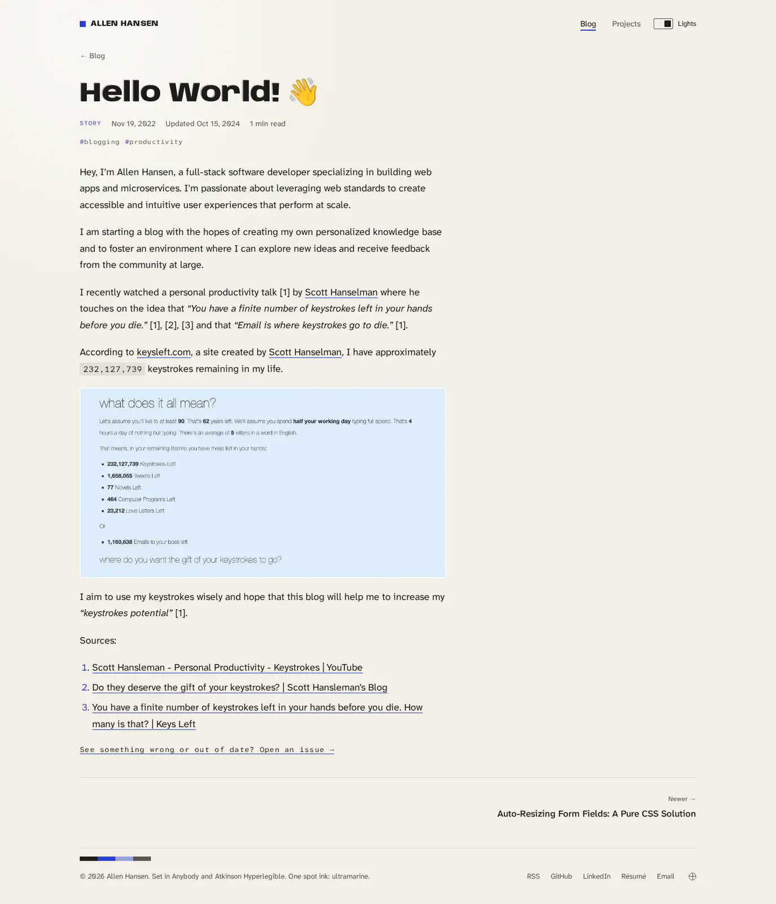

v6.0.0 Story (Hello World), light mode, desktop, from production.

**[`blog-light-mobile.webp`](blog-light-mobile.webp)** · 600 × 1771, full-page
capture

v6.0.0 Blog, light mode, phone, from production.

**[`home-light-mobile.webp`](home-light-mobile.webp)** · 600 × 2380, full-page
capture

v6.0.0 Home, light mode, phone, from production.

**[`note-light-mobile.webp`](note-light-mobile.webp)** · 600 × 8791, full-page
capture

v6.0.0 Note, light mode, phone, from production.

**[`projects-light-mobile.webp`](projects-light-mobile.webp)** · 600 × 2203,
full-page capture

v6.0.0 Projects, light mode, phone, from production.

**[`resume-light-mobile.webp`](resume-light-mobile.webp)** · 600 × 6714,
full-page capture

v6.0.0 Résumé, light mode, phone, from production.

**[`story-light-mobile.webp`](story-light-mobile.webp)** · 600 × 3102, full-page
capture

v6.0.0 Story (Hello World), light mode, phone, from production.
